# Detailed test report: streaming a language model's layers from NVMe

24 September to 5 October 2026 · test machine **halo** (AMD Ryzen AI Max+ 395, 16 cores, 125 GB unified RAM, one NVMe at 7.1 GB/s) · models Qwen2.5 1.5B / 3B / 7B / 14B, gpt-oss-20b, Qwen3-30B-A3B · **1,431 measured runs** in 17 data files.

This report lists every test run in the project, in the order it was run. For each test it gives the reason for running it, how it was run, a table, a chart, and what the result means. Where a later test corrected an earlier one, both are shown and the correction is marked.

## How to read the numbers

- **Baseline**: the whole model in memory in one pod. Every comparison uses the baseline measured in the same round.
- **Per token**: time to generate one token for one user (decode). For speculative runs: total decode time ÷ tokens produced.
- **First token**: time from receiving the prompt to the first generated token (prompt processing, "prefill").
- **RAM**: peak resident memory (high-water mark) of all pods together, coordinator included, unless the table says "stage pod". Decimal GB (10⁹ bytes).
- **vs baseline**: per token ÷ baseline per token. 1.0× = same speed, 8× = eight times slower.
- **Same output**: the generated tokens are compared one by one with the baseline's. Greedy decoding, bf16, no quantization anywhere.
- **Prompts**: 128 / 512 / 2048 tokens of a technical text (first experiments), a 512-token non-repeating prose text, and chat-style instructions (explain, summary, code) in the model's chat template.
- Setup: a one-node k3d Kubernetes cluster pinned to 16 cores; stage pods hold layers, a coordinator pod runs the tokenizer, embeddings, output layer and sampling. Weight files are evicted from the page cache around every read, so a reload is a real disk read.

## Overview: all tests

| test | name | question | runs | result |
|---|---|---|---|---|
| A1 | Correctness of our model code | Does our layer code compute exactly what Hugging Face computes? | checks | Yes, to fp32 precision, for all four architectures |
| A2 | Load vs compute per layer | How long does a layer take to load from disk, and to compute? | microbench | Loading is 12× (3B) to 94× (gpt-oss) slower than computing one token |
| A3 | Disk bandwidth vs readers | How fast is the NVMe, and how many parallel reads does it need? | microbench | 7.1 GB/s, reached with 4 readers; direct I/O no faster |
| B1 | 3B cyclic: memory | How much memory does cyclic streaming save? | 219 | 94% of weights with 2 pods; RAM breaks even at ~14 pods |
| B2 | 3B cyclic: first token | Does prompt processing stay as fast? | 219 | Yes for long prompts (1.00× at 2048), 1.2–2× for short ones |
| B3 | 3B cyclic: time per token | Does generation stay as fast? | 219 | No: 6–8× slower with any number of pods |
| B4 | 3B: why more pods don't help | Why does adding pods not fix it? | 219 | Every pod adds a reader on one drive; floor 0.78 s per token |
| B5 | 3B: cost of splitting alone | What does the pipeline cost without reloading? | 219 | About +30% per token |
| B6 | 3B: partial residency | Pin most layers, stream a few? | 195 | 1.33× before saving anything; 3.6× for 30% saved |
| B7 | 3B: kernel paging | Let Linux page the weights under a memory limit? | 195 | Worst option: 7.7–10.9× |
| B8 | 3B: speculative decoding | Get several tokens per disk read with a small draft model? | 195 | 3.3× at 51% less RAM (was 7.6×) |
| B9 | 3B: batching | Serve many users per disk read? | 195 | 84% of baseline throughput at 512 users |
| B10 | 3B: single-pod streaming | Does the cycle need pods at all? | 63 | No: one pod with 4 slots, same speed, less RAM |
| B11 | 3B: all approaches compared | Which approach is best? | — | Speculative decoding (then); see D6 for the optimised result |
| C1 | gpt-oss: memory | Same idea on a 20B mixture-of-experts model | 192 | 92% of weights saved with 2 pods |
| C2 | gpt-oss: first token |  | 192 | 1.44× even at 2048 tokens: loading slows compute 30–55% |
| C3 | gpt-oss: time per token |  | 192 | 33–44× slower; floor 5.55 s |
| C4 | gpt-oss: cost of splitting |  | 192 | +20–25% per token |
| C5 | gpt-oss: single-pod streaming |  | 183 | Same floor, less RAM |
| C6 | gpt-oss: partial residency |  | 183 | 3.9× before saving anything |
| C7 | gpt-oss: kernel paging |  | 183 + 57 | Best option for experts; first figure (1.87×) was an artifact, real 7.4–8.0× at −54% |
| C8 | gpt-oss: batching |  | 183 | 1.78× per user at 512 users |
| C9 | 3B vs gpt-oss | What changes with size and experts? | — | Everything scales with bytes read per token |
| D1 | Optimisation round 1 | Move speculation to one pod | 33 | 441 → 350 ms; direct-I/O rows invalid (artifact) |
| D2 | Direct I/O and contention | Can direct reads raise bandwidth or stop the compute slowdown? | microbench | No bandwidth gain; less slowdown for single tokens only |
| D3 | Optimisation round 2 | Tree speculation instead of a chain | 72 | 3.9–5.4 tokens per read; best tree 23–65 candidates |
| D4 | Optimisation round 3 | Lean drafter in our own code | 72 | 198–248 ms on chat prompts (1.7–2.2×) |
| D5 | Optimisation round 4 | Direct I/O end to end, bigger and deeper trees | 75 | No gain; 65-node tree stays best |
| D6 | Optimisation: net result |  | — | 441 → 198–248 ms at 3.2–3.4 GB |
| E1 | Six models: all approaches | Is the best approach the same for every model? | 270 | Dense: tree speculation; experts: kernel paging |
| E2 | Six models: the disk floor | Does streaming sit exactly on bytes ÷ bandwidth? | 270 | Within 5% for all six |
| E3 | Six models: first token | What does each approach cost on the prompt? | 270 | Streaming 1.2–4.5×; paging up to 11× on experts |
| E4 | Kernel-paging replication | Was host page-cache pressure distorting paging? | 45 | No: same numbers within 10% |
| E5 | Degenerate-prompt recheck | Why was gpt-oss paging 1.87× before? | 12 | Repeated '…' output kept the same experts hot |
| F1 | Output identity, all runs | Is every output the same as the baseline? | all | All non-speculative runs; speculative except near-ties |
| F2 | Near-ties in fp32 | Are the divergences bugs? | 8 positions | No: top-2 gaps of 0.2–1.2% |
| F3 | bf16 shape noise | How big is bf16 rounding noise? | 40 positions | Up to 0.28–0.42 logit points, more than every gap |

Not a test, but part of the work: a literature check on 2 October (layer streaming, tree speculation and expert offloading are all known methods; the measurements on this hardware are new). It is summarised in `docs/FULL_RECORD.md`.

# Part A. Groundwork: is the code right, and how fast is the hardware?

## A1. Correctness of our model code

**Why.** Every later test streams our own implementation of the model's layers, not the reference library. If our code computed anything different, a speed or memory result would mean nothing. So each architecture was checked against Hugging Face `transformers` in full precision (fp32) before it was used.

**How.** Same weights, same input, both in fp32. We compare outputs layer by layer (or the final logits), plus the decode path (one token with a cache) against the full-prompt path.

| check | result | verdict |
|---|---|---|
| Qwen2.5-3B (Qwen2), whole model, logits at 128 positions | max \|Δ\| 0.0 on scale 27.7; top-1 identical at every position | exact |
| Qwen2.5-3B, our bf16 baseline vs HF bf16 `generate`, 128-token prompt | same first 5 tokens, then a different token at 6 | bf16 rounding order (the fp32 check above is exact) |
| gpt-oss-20b, layer 0 (sliding window), fp32, 256 tokens | max \|Δ\| 1.5e-5 on scale 103 | exact to fp32 |
| gpt-oss-20b, layer 1 (full attention) | 1.7e-5 on scale 67 | exact to fp32 |
| gpt-oss-20b, layer 22 | 2.0e-3 on scale 76,293 | exact to fp32 |
| gpt-oss-20b, layer 23 | 1.7e-2 on scale 189,899 | exact to fp32 |
| gpt-oss-20b, our bf16 baseline vs HF bf16 `generate`, 16 tokens | identical tokens | exact |
| Qwen3 dense (Qwen3-0.6B), layers vs transformers | max \|Δ\| 3.8e-6 to 7.8e-3 on scales 6.8 to 11,297 | exact to fp32 |
| Qwen3-MoE router and experts, tiny random model | max \|Δ\| 1.2e-7 | exact |
| Qwen3-30B-A3B, layer 0 | 4.8e-7 on scale 2.5 | exact to fp32 |
| Qwen3-30B-A3B, layer 24 | 4.9e-6 on scale 5.1 | exact to fp32 |
| Qwen3-30B-A3B, layer 47 | 5.0e-5 on scale 104 | exact to fp32 |
| Lean drafter (Qwen3-0.6B in our code) vs transformers, fp32 | last-position logits Δ = 0.0; greedy path inside the drafted tree | exact |
| Tree speculation (tree attention + cache compaction), fp32, local 0.5B | same tokens as plain greedy decoding | exact |
| Low-memory weight splitter vs original splitter | byte-identical layer files | exact |
| Eviction (3B): reload from disk vs page cache | 41 ms vs 19 ms; load counters = tokens × layer groups | reloads are real disk reads |

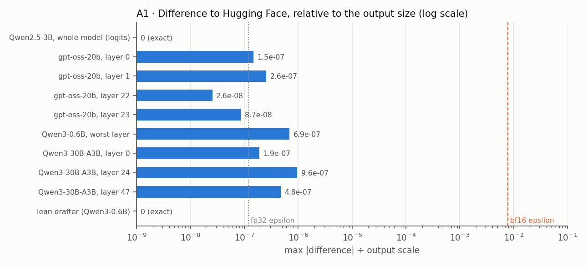

*Figure: every numeric check sits at fp32 precision, 4–5 orders of magnitude below what bf16 can even represent*

**What it means.** Our layer code is the reference computation, to fp32 precision, for Qwen2, gpt-oss, Qwen3 and Qwen3-MoE. The only "difference" ever seen is in bf16, where two correct implementations can round in a different order: the 3B's bf16 output differs from Hugging Face's own bf16 output at token 6, while the fp32 comparison is exact. That rounding effect comes back in F1–F3.

## A2. How long a layer takes to load from disk, and to compute

**Why.** Cyclic streaming hides the loading of the next layer behind the computation of the other pods. That works only if loading is not much slower than computing. This microbenchmark measures both, one process alone, before any Kubernetes test.

**How.** `microbench.py`: load one layer file cold (evicted from the page cache) and warm (from the cache), and time one layer's forward pass for 1, 128, 512 and 2048 tokens. 16 threads, nothing else running.

| measurement | Qwen2.5-3B | gpt-oss-20b |
|---|---|---|
| layer size | 154 MB | 1,646 MB |
| load from disk, one reader | 41 ms (3.74 GB/s) | 598 ms (2.75 GB/s) |
| load from page cache | 19 ms | 245 ms |
| compute, 1 token (generation) | 3.5 ms | 6.4 ms |
| compute, 128 tokens | 9.9 ms | 47.0 ms |
| compute, 512 tokens | 27.3 ms | 103.5 ms |
| compute, 2048 tokens | 166 ms | 388 ms |
| load ÷ compute for one token | 12× | 94× |
| pods needed to hide one load (1 + load ÷ compute) | 13 | 95 |

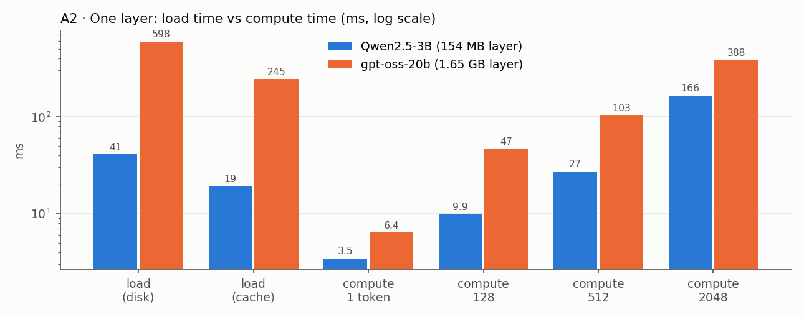

*Figure: loading one layer costs as much as computing it for hundreds of tokens*

**What it means.** During generation a layer computes one token in 3.5 ms (3B) but takes 41 ms to load, so about 13 pods would be needed to hide each load behind the others' work, and 95 for gpt-oss. During a long prompt the picture flips for the 3B (166 ms of compute per layer against 41 ms of load), so loads can hide there. This table predicted the two main results before the Kubernetes tests: long prompts can keep their speed, generation cannot.

## A3. Disk bandwidth and the number of parallel reads

**Why.** Each pod reads its next layer while the others compute, so the drive serves several reads at once. The total bandwidth the drive can deliver sets the floor for streaming. A second test checked whether direct reads (O_DIRECT, bypassing the page cache) are faster.

**How.** `diskbw.py`: 1 to 18 threads each reading different layer files, evicted from the cache. `iotest.py`: buffered vs O_DIRECT reads, checking that the page cache does not grow (so the numbers are real disk reads).

| parallel readers | total GB/s | per reader |
|---|---|---|
| 1 | 4.14 | 4.14 |
| 2 | 6.09 | 3.04 |
| 4 | 7.01 | 1.75 |
| 8 | 7.11 | 0.89 |
| 12 | 7.12 | 0.59 |
| 18 | 7.11 | 0.40 |

| read mode (iotest) | 1 reader | 4 readers | page cache change |
|---|---|---|---|
| buffered + evict | 3.71 GB/s | 6.54 GB/s | ≤ 0.02 GB |
| O_DIRECT | 4.17 GB/s | 6.49 GB/s | 0.00 GB |

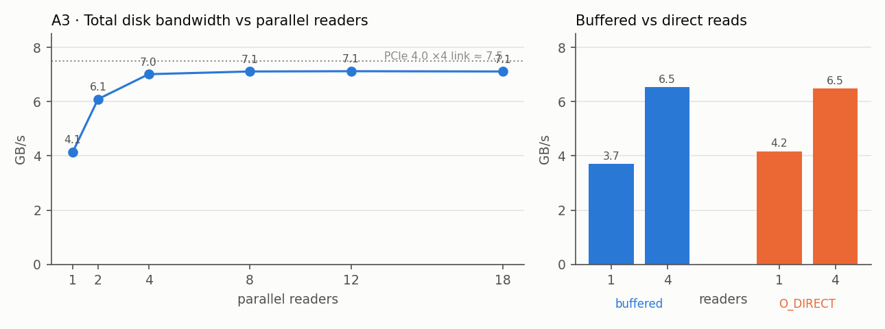

*Figure: the drive is capped by its PCIe 4.0 ×4 link at 7.1 GB/s; four readers reach it, direct reads do not go faster*

**What it means.** One reader gets 4.1 GB/s, four get 7.0, eight or more 7.1: 95% of what the PCIe 4.0 ×4 link can carry. The drive itself is a PCIe 5.0 part, but the processor only offers PCIe 4.0, and there is no second slot. So the floor for any scheme that re-reads all layers per token is model bytes ÷ 7.1 GB/s: 0.78 s for the 3B, 5.55 s for gpt-oss. Nothing in software changes that number.

# Part B. Qwen2.5-3B: cyclic streaming (the original idea) and four alternatives

Experiment 1 (24 Sep, 219 runs): baseline, 18 cyclic configurations (G groups of layers ∈ {36, 18, 12, 9, 6, 4}, K pods from 2 to 18), 3 resident controls, baseline again. Prompts of 128 / 512 / 2048 tokens, 16 generated tokens, 3 repetitions (baseline 5 at the start + 5 at the end). Pod *i* owns groups *i, i+K, i+2K…*; after computing a group it frees it and starts loading its next group from disk.

## B1. Cyclic streaming: memory

**Why.** The point of the idea is less memory. This measures how much, counting not only weights but everything each pod needs to run.

**How.** One layer per group (G = 36), 128-token prompt, peak resident memory of the stage pods. Baseline stage pod: 5.55 GB of weights, 5.96 GB of RAM. Numbers from the verified table in `FULL_RECORD.md` §6.1.

| pods | layers in memory | weights | weights saved | stage-pod RAM | RAM saved |
|---|---|---|---|---|---|
| 2 | 2 | 0.31 GB | 94% | 0.99 GB | 83% |
| 3 | 3 | 0.46 GB | 92% | 1.40 GB | 76% |
| 4 | 4 | 0.62 GB | 89% | 1.81 GB | 70% |
| 6 | 6 | 0.92 GB | 83% | 2.64 GB | 56% |
| 9 | 9 | 1.39 GB | 75% | 3.86 GB | 35% |
| 12 | 12 | 1.85 GB | 67% | 5.10 GB | 14% |
| 18 | 18 | 2.77 GB | 50% | 7.57 GB | -27% |

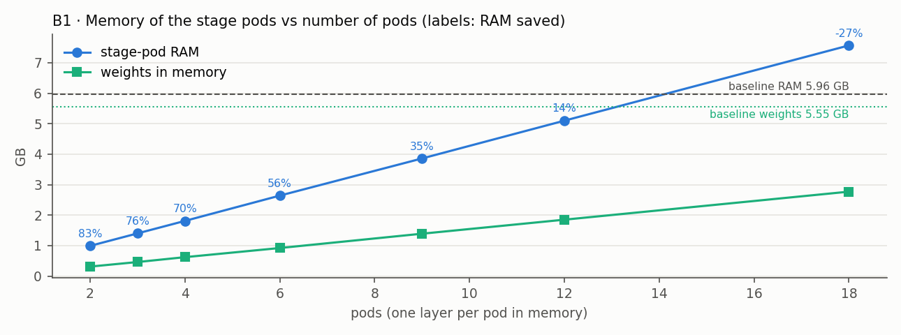

*Figure: weights fall to K/36 of the model; each pod adds ~250 MB of runtime, so RAM breaks even at about 14 pods*

**What it means.** The idea delivers its memory promise: with 2 pods only 2 of 36 layers exist in memory (94% less weight memory, 83% less stage-pod RAM; 71% less total RAM including the coordinator). Each pod carries ~250 MB of Python/PyTorch runtime plus its share of the 151 MB attention cache, so adding pods eats the saving, and 18 pods use more RAM than the baseline. Long prompts add 0.8–0.9 GB of temporary activations per pod.

## B2. Cyclic streaming: time to the first token

**Why.** The first goal was the same latency, both for reading the prompt and for generating. Prompt processing computes many tokens per layer, so the loads have more cover.

**How.** Median time to first token, best cyclic configuration per prompt length, against the baseline median. Computed here from the raw file `results/qwen2.5-3b/results.jsonl`.

| prompt | baseline (median; range) | best cyclic | ratio | pods (groups) |
|---|---|---|---|---|
| 128 tokens | 0.46 s (0.42–0.58) | 0.91 s | 1.99× | 4 (36) |
| 512 tokens | 1.35 s (1.17–1.57) | 1.64 s | 1.22× | 3 (36) |
| 2048 tokens | 6.67 s (6.37–7.10) | 6.66 s | 1.00× | 2 (36) |

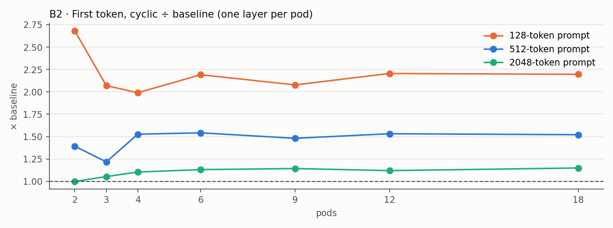

*Figure: with a 2048-token prompt the loads hide completely; short prompts don't give them enough cover*

**What it means.** With a 2048-token prompt each layer computes for ~166 ms while a load takes ~41 ms, so the loads finish in the background: 2 pods reach the baseline (1.00×, within its own run-to-run range). With 512 tokens the best is 1.22×, with 128 tokens 1.99×. Prompt processing keeps its speed only when the prompt is long.

## B3. Cyclic streaming: time per generated token

**Why.** This is the number a user feels while text appears. Each generated token passes through all 36 layers in order, so the cycle runs once per token.

**How.** Median time per token, 512-token prompt, one layer per pod, and where the time goes (from the stage-pod traces: waiting for weights, compute, pod-to-pod hops; the coordinator's 13–19 ms per token is not in the three columns). Verified table, `docs/FULL_RECORD.md` §6.3. Baseline 130 ms.

| pods | per token | vs baseline | waiting for weights | compute | hops |
|---|---|---|---|---|---|
| 2 | 1013 ms | 7.8× | 782 ms | 188 ms | 26 ms |
| 3 | 822 ms | 6.3× | 555 ms | 216 ms | 30 ms |
| 4 | 781 ms | 6.0× | 464 ms | 269 ms | 35 ms |
| 6 | 772 ms | 5.9× | 437 ms | 276 ms | 38 ms |
| 9 | 770 ms | 5.9× | 416 ms | 283 ms | 38 ms |
| 12 | 774 ms | 6.0× | 409 ms | 304 ms | 39 ms |
| 18 | 769 ms | 5.9× | 400 ms | 308 ms | 38 ms |

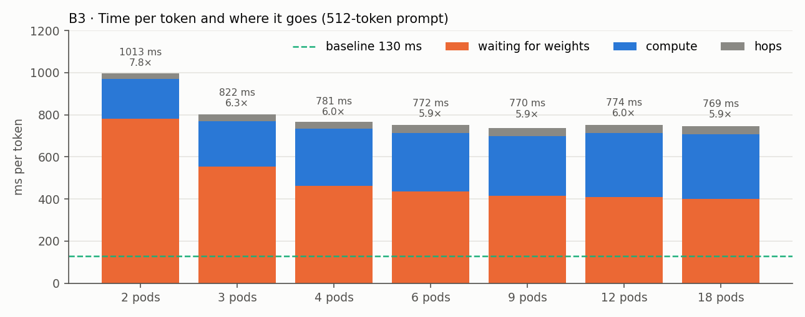

*Figure: most of every token is spent waiting for weights; the total stays at 0.77–1.01 s whatever the pod count*

**What it means.** Generation is 6–8× slower than the baseline with any number of pods, and most of each token is spent waiting for a layer to arrive. With 128-token prompts it is 6.3–8.2×; with 2048 tokens 3.6–5.0× only because the baseline itself slows to 214 ms there. The idea does not keep generation latency on this machine. B4 explains why.

## B4. Why more pods don't help

**Why.** The intuition was: with enough pods, the next layer is always loaded by the time the token comes back. A2 says ~13 pods should do it. The sweep went to 18 and the time stayed flat, so this test looks at why.

**How.** From the same runs: the time one layer takes to load as the pod count grows (traces), and the time per token for every grouping of layers (G groups, K pods), computed here from `results/qwen2.5-3b/results.jsonl`.

| pods | one layer load | ≈ readers in flight | cover from the other pods' compute (1 token) |
|---|---|---|---|
| 2 | 49 ms | 2 | ≈ 7 ms |
| 3 | 62 ms | 3 | ≈ 14 ms |
| 4 | 78 ms | 4 | ≈ 21 ms |
| 6 | 119 ms | 6 | ≈ 35 ms |
| 9 | 179 ms | 9 | ≈ 56 ms |
| 12 | 231 ms | 12 | ≈ 77 ms |
| 18 | 318 ms | 18 | ≈ 119 ms |

| groups G (layers per group) | K=2 | K=3 | K=4 | K=6 | K=9 | K=12 | K=18 |
|---|---|---|---|---|---|---|---|
| 36 (1) | 1013 | 822 | 781 | 772 | 770 | 774 | 769 |
| 18 (2) | 1026 |  |  | 771 | 770 |  |  |
| 12 (3) | 986 | 844 | 787 | 770 |  |  |  |
| 9 (4) |  | 863 |  |  |  |  |  |
| 6 (6) | 1013 | 847 |  |  |  |  |  |
| 4 (9) | 1011 |  |  |  |  |  |  |

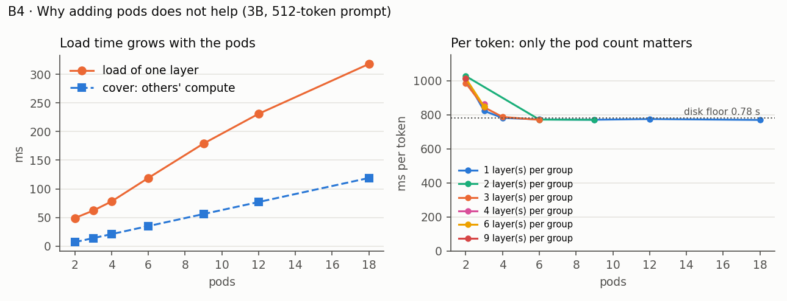

*Figure: each pod adds a concurrent reader, so loads slow down as fast as the cover grows; grouping layers changes nothing*

**What it means.** Three effects break the intuition:

1. **All pods share one drive.** Each pod starts loading as soon as it finishes computing, so about K reads are in flight and each one is slower: 49 ms with 2 pods, 318 ms with 18. A pod adds as much load time as it adds cover.
2. **The drive saturates.** Every token re-reads all 36 layers (5.55 GB). At 7.1 GB/s that is 0.78 s per token, reached from 4 pods on: the flat line.
3. **Loading slows computing.** Compute per layer rises from ~4 ms to 5–9 ms while other pods load (shared memory bandwidth). D2 measures this directly.

Grouping layers does not matter: every 2-pod configuration is ~1.0 s whatever the group size, every 3-pod one 0.82–0.86 s, everything from 4 pods on 0.77–0.79 s. Baseline speed by this route would need ~43 GB/s, six times this drive.

## B5. The cost of splitting alone (resident controls)

**Why.** Part of the slowdown could come from the pipeline itself (sending activations between pods), not from reloading. These controls split the model over K pods but keep every layer in memory, so there is no reloading at all.

**How.** K pods, each permanently holding its 36/K layers, 512-token prompt. Computed from `results/qwen2.5-3b/results.jsonl`.

| configuration | per token | vs baseline |
|---|---|---|
| baseline (1 pod) | 130 ms | 1.00× |
| 4 pods, all resident | 167 ms | 1.28× |
| 12 pods, all resident | 171 ms | 1.31× |
| 36 pods, all resident | 172 ms | 1.32× |
| 4 pods, cyclic (for comparison) | 781 ms | 6.00× |

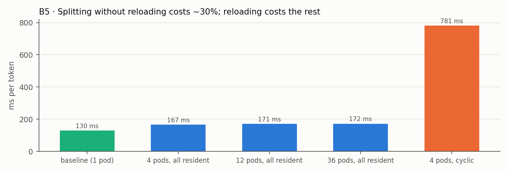

*Figure: the pipeline itself adds ~40 ms per token; reloading adds ~600 ms*

**What it means.** Splitting the model over pods with no reloading costs about 30% per token (hops of ~13 ms plus slightly slower compute per pod); first-token times stay within noise. So of the 781 ms per token with 4 cyclic pods, about 40 ms is the pipeline and about 610 ms is reloading.

## B6. Partial residency: keep most layers, stream only a few

**Why.** If streaming all layers is too slow, stream just a few and pin the rest. The pinned layers' compute could hide the few loads.

**How.** Experiment 2 (27 Sep, 195 runs for B6–B9). One pod pins the first layers and streams the last ones through a few slots. 512-token prompt. Verified table, `docs/FULL_RECORD.md` §7.1. Baseline 133 ms.

| pinned / streamed / slots | layers saved | total RAM | RAM saved | per token | vs baseline |
|---|---|---|---|---|---|
| 33 / 3 / 3 | 0 | 7.08 GB | 0% | 176 ms | 1.33× |
| 30 / 6 / 3 | 3 | 6.60 GB | 7% | 235 ms | 1.76× |
| 27 / 9 / 3 | 6 | 6.14 GB | 13% | 298 ms | 2.24× |
| 24 / 12 / 4 | 8 | 5.84 GB | 17% | 339 ms | 2.55× |
| 18 / 18 / 4 | 14 | 4.92 GB | 30% | 478 ms | 3.59× |

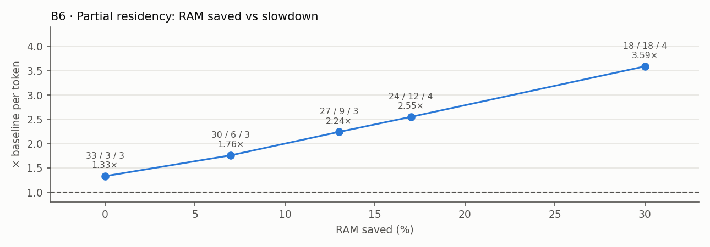

*Figure: even saving nothing costs 1.33×; each layer saved costs about one extra disk read per token*

**What it means.** Streaming 3 layers and saving none already costs 1.33×: the background reads slow the pinned layers' compute. Each layer saved beyond the slot count adds ~20–30 ms per token. Saving 30% of RAM costs 3.6×. This approach is only useful for small savings.

## B7. Kernel paging: memory-mapped weights under a memory limit

**Why.** No loading code at all: map the weight files into memory and give the pod a Kubernetes memory limit. Linux then keeps what fits and re-reads the rest on demand. If this worked, it would be the simplest possible solution.

**How.** One pod, weights memory-mapped, limit from 6 GiB (everything fits) down to 1.5 GiB. The page cache is dropped after deploying, so pages are really charged to the pod (two earlier attempts measured the cache by mistake and were discarded, see Part G). Verified table, `docs/FULL_RECORD.md` §7.2.

| memory limit | total RAM | RAM saved | per token | vs baseline | first token vs baseline |
|---|---|---|---|---|---|
| 6 GiB (fits) | 7.07 GB | 0% | 131 ms | 0.99× | 0.91× |
| 4 GiB | 5.38 GB | 24% | 1029 ms | 7.7× | 1.6× |
| 3 GiB | 4.31 GB | 39% | 1399 ms | 10.5× | 1.9× |
| 2 GiB | 3.23 GB | 54% | 1413 ms | 10.6× | 1.88× |
| 1.5 GiB | 2.70 GB | 62% | 1455 ms | 10.9× | 1.95× |

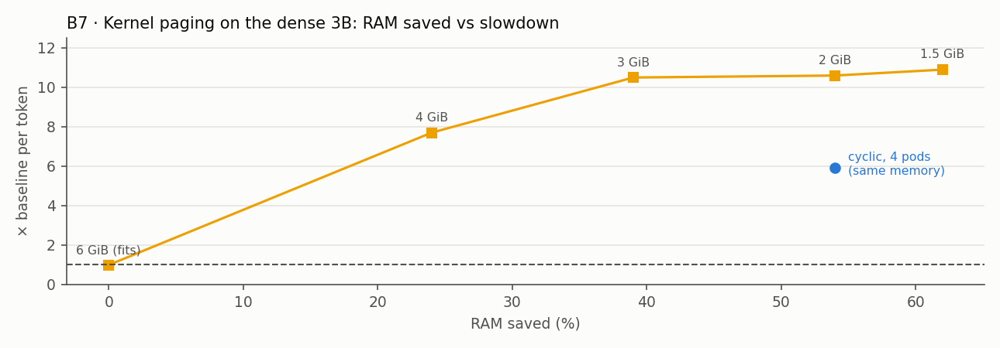

*Figure: as soon as the model does not fit, every token re-faults the whole model page by page*

**What it means.** As soon as the limit is below the model size, each token touches every page, and the kernel re-reads the model in small pieces with one reader (~4 GB/s effective). That is 7.7–10.9× slower, and at equal memory the explicit 4-pod pipeline is 1.8× faster. For a dense model this is the worst option. Part C and E show it becomes the best option for mixture-of-experts models, for a structural reason.

## B8. Speculative decoding on top of cyclic streaming

**Why.** The disk read is fixed per pass, so the only way to go faster is to get more than one token out of each pass. A small draft model (Qwen2.5-0.5B, 1 GB, kept in memory) guesses several tokens; the streamed 3B model checks all of them in one pass and keeps those it agrees with, plus one of its own. The output stays exactly the 3B model's.

**How.** Draft proposes γ tokens per cycle. Non-repeating 750-token text, 512-token prompt, 32 generated tokens. (A first run with the original, repetitive text gave 6.0 tokens per cycle because the model just continued the repetition; it was discarded, see Part G.) Verified table, `docs/FULL_RECORD.md` §7.3. Baseline 133 ms.

| configuration | drafts accepted per cycle | tokens per cycle | draft | verify | cycle | per token | vs baseline | total RAM |
|---|---|---|---|---|---|---|---|---|
| all resident + draft, γ=5 | 1.82 | 2.8 | 167 ms | 137 ms | 309 ms | 120 ms | 0.91× | 8.35 GB (+18%) |
| cyclic 2 pods + draft, γ=5 | 1.82 | 2.8 | 194 ms | 1008 ms | 1209 ms | 441 ms | 3.3× | 3.48 GB (−51%) |
| cyclic 4 pods + draft, γ=5 | 1.82 | 2.8 | 212 ms | 778 ms | 994 ms | 365 ms | 2.75× | 4.47 GB (−37%) |
| cyclic 4 pods + draft, γ=8 | 2.10 | 3.1 | 321 ms | 786 ms | 1114 ms | 371 ms | 2.8× | 4.53 GB (−36%) |

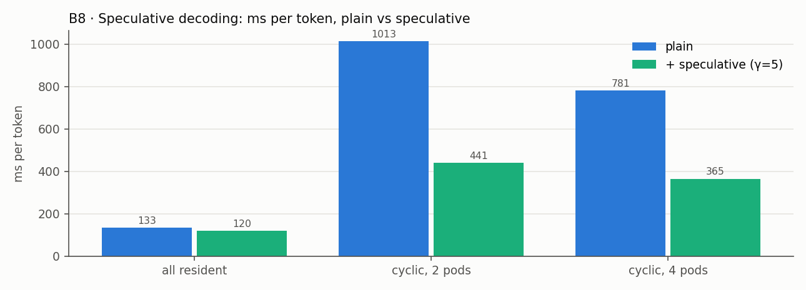

*Figure: one disk-bound verify pass now yields 2.8 tokens, cutting the cyclic penalty from 7.6× to 3.3×*

**What it means.** The verify pass costs about the same as a plain token (it is disk-bound), but now produces 2.8 tokens. The 2-pod cyclic penalty drops from 7.6× to 3.3× for 1 GB of extra memory, with identical output. More guesses (γ=8) do not help because acceptance drops. On the all-resident model it barely helps (0.91×) because the draft model is slow on CPU (35–40 ms per guess). This was the best single-user result of the first phase, and the starting point of the optimisation in Part D.

## B9. Batching: many users per disk read

**Why.** One disk pass can advance many conversations by one token each. With enough users, the fixed disk cost per pass is shared.

**How.** B independent 128-token prompts generated in lockstep. Per-user latency = time per step; throughput = B tokens per step. Verified table, `docs/FULL_RECORD.md` §7.4; 2 repetitions (1 at 512).

| users | baseline per user | cyclic 4 pods per user | ratio | baseline tokens/s | cyclic tokens/s | cyclic share of throughput |
|---|---|---|---|---|---|---|
| 1 | 122 ms | 783 ms | 6.42× | 8 | 1.3 | 16% |
| 16 | 188 ms | 795 ms | 4.23× | 85 | 20 | 24% |
| 64 | 541 ms | 1015 ms | 1.88× | 118 | 63 | 53% |
| 256 | 1897 ms | 2475 ms | 1.30× | 135 | 103 | 76% |
| 512 | 3418 ms | 4058 ms | 1.19× | 150 | 126 | 84% |

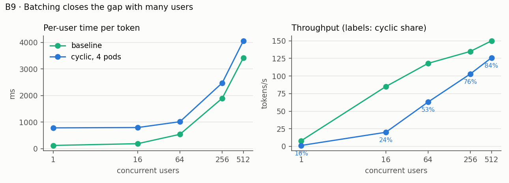

*Figure: the disk cost per step is fixed while compute grows with the batch, so the pipeline catches up at hundreds of users*

**What it means.** At 512 concurrent users the 4-pod pipeline delivers 84% of the baseline's throughput with 4 of 36 layers in memory, but each user still waits at least one full cycle (0.78 s) per token. Batching is a server-throughput solution, not a single-user latency one. The attention cache (37 KB per token per request) is the same on both sides and becomes the memory limit.

## B10. Single-pod sequential streaming: the same cycle without pods

**Why.** B4 suggested that pods only matter as a way to have several reads in flight. This test removes the pods: one pod computes the 36 layers in order, frees layer *i* and starts loading layer *i+S*, so up to S layers are in memory.

**How.** One pod, S = 1 to 9 slots (up to 4 reads in flight), 512-token prompt. Verified table, `docs/archive/FINAL_REPORT.md` §5.5 (raw: `results/qwen2.5-3b/results3.jsonl`, 63 runs).

| slots | total RAM | RAM saved | per token | vs baseline | first token vs baseline |
|---|---|---|---|---|---|
| 1 | 1.69 GB | 76% | 1664 ms | 12.5× | 2.03× |
| 2 | 1.85 GB | 74% | 1044 ms | 7.85× | 1.35× |
| 3 | 1.99 GB | 72% | 868 ms | 6.5× | 1.36× |
| 4 | 2.14 GB | 70% | 798 ms | 6.0× | 1.43× |
| 6 | 2.44 GB | 66% | 778 ms | 5.85× | 1.39× |
| 9 | 2.93 GB | 59% | 784 ms | 5.9× | 1.44× |

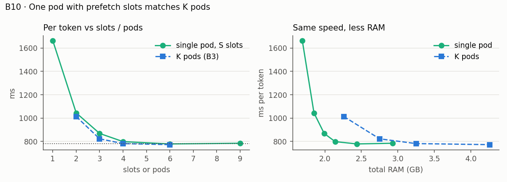

*Figure: the curve is the same as for pods: it was always the number of reads in flight that mattered*

**What it means.** One slot means no overlap: 36 × (41 ms load + 4 ms compute) ≈ 1.65 s. Each extra slot adds a reader until the drive saturates at 4, then the curve is flat at 0.78 s, exactly like the pod sweep. At equal speed the single pod uses less RAM (2.14 GB vs 3.25 GB at ~0.79 s) because it has one runtime and no traffic between pods. From here on, all streaming is done in one pod.

## B11. All approaches compared (first phase)

**Why.** To pick the best approach per goal, all results are put on one scale: total RAM and time per token for one user.

**How.** 512-token prompt, total RAM including the coordinator, baseline 7.07 GB / 133 ms (experiment 2's baseline, so the cyclic ratios here are slightly lower than in B3, which used experiment 1's 130 ms). Verified table, `docs/FULL_RECORD.md` §8 (single-pod row from B10).

| approach | configuration | total RAM | RAM saved | per token | vs baseline |
|---|---|---|---|---|---|
| baseline | 36 layers in one pod | 7.07 GB | 0% | 133 ms | 1.0× |
| cyclic streaming | 2 pods | 2.26 GB | 68% | 1013 ms | 7.6× |
| cyclic streaming | 4 pods | 3.25 GB | 54% | 781 ms | 5.9× |
| cyclic streaming | 18 pods | 10.24 GB | -45% | 769 ms | 5.8× |
| single-pod streaming | 4 slots | 2.14 GB | 70% | 798 ms | 6.0× |
| partial residency | −3 layers | 6.60 GB | 7% | 235 ms | 1.8× |
| partial residency | −14 layers | 4.92 GB | 30% | 478 ms | 3.6× |
| kernel paging | 2 GiB limit | 3.23 GB | 54% | 1413 ms | 10.6× |
| cyclic + speculative | 2 pods, γ=5 | 3.48 GB | 51% | 441 ms | 3.3× |
| cyclic + speculative | 4 pods, γ=5 | 4.47 GB | 37% | 365 ms | 2.7× |
| speculative alone | all resident + draft | 8.35 GB | -18% | 120 ms | 0.9× |

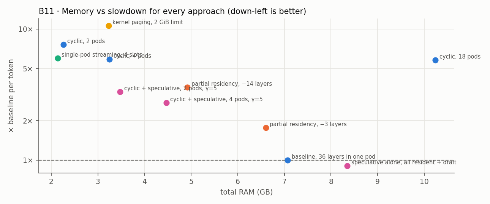

*Figure: speculative decoding on top of streaming was the best trade-off of the first phase*

**What it means.** Memory: the idea works (68% less RAM with 2 pods). Latency: nothing that streams weights from this drive gets close to the baseline for a single user. The best trade-off was cyclic streaming + speculative decoding (51% less RAM at 3.3×). Kernel paging is the worst. Part D later improves the speculative approach to 1.7–2.2× at the same memory.

# Part C. gpt-oss-20b: the same tests on a 20B mixture-of-experts model

gpt-oss-20b: 24 layers of 1.65 GB (39.5 GB of layer weights, bf16, no quantization), 32 experts per layer of which 4 are used per token. Experiment 1 (192 runs): G ∈ {24, 12, 8, 6, 4}, K from 2 to 12, resident controls, prompts of 128 / 512 / 2048 tokens, 16 tokens, 3 repetitions. Experiment 2 (183 runs): the alternatives. Coordinator ~2.9 GB in every configuration.

## C1. Memory

**Why / how.** Same question as B1 for a model whose layers are ten times larger. One layer per pod, 128-token prompt, stage pods. Baseline stage pod 39.51 GB of weights, 40.08 GB of RAM. Verified table, `docs/archive/FINAL_REPORT_GPTOSS.md` §3.1.

| pods | layers in memory | weights | weights saved | stage-pod RAM | RAM saved |
|---|---|---|---|---|---|
| 2 | 2 | 3.29 GB | 92% | 4.18 GB | 90% |
| 3 | 3 | 4.94 GB | 88% | 6.13 GB | 85% |
| 4 | 4 | 6.59 GB | 83% | 8.07 GB | 80% |
| 6 | 6 | 9.88 GB | 75% | 11.93 GB | 70% |
| 8 | 8 | 13.17 GB | 67% | 15.76 GB | 61% |
| 12 | 12 | 19.76 GB | 50% | 23.45 GB | 41% |

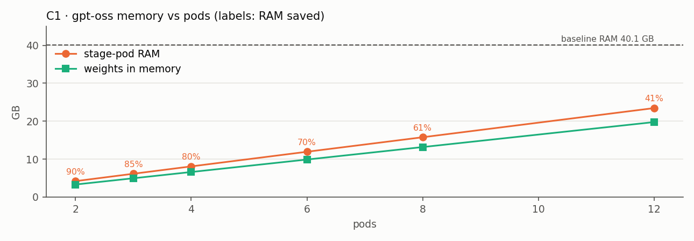

*Figure: with 1.65 GB layers the per-pod runtime is negligible: RAM saving tracks the weight saving*

**What it means.** Memory works the same way and even better: the ~0.3 GB runtime per pod is small next to 1.65 GB layers, so 2 pods save 90% of stage-pod RAM and 12 pods still save 41%. At 2048-token prompts each pod adds ~2.6 GB of temporary expert activations.

## C2. First token

**Why.** For the 3B, long prompts hid the loads completely. Does that still hold with layers ten times larger?

**How.** Best cyclic configuration per prompt length (computed from `results/gpt-oss-20b/results.jsonl`), and where the 2048-token prefill time goes (traces; verified table §3.2).

| prompt | baseline | best cyclic | ratio | pods |
|---|---|---|---|---|
| 128 tokens | 1.19 s | 5.27 s | 4.43× | 12 |
| 512 tokens | 2.76 s | 6.23 s | 2.26× | 8 |
| 2048 tokens | 9.92 s | 14.32 s | 1.44× | 2 |

| 2048-token prompt | first token | waiting for weights | compute | hops | compute per layer |
|---|---|---|---|---|---|
| baseline | 9.3 s | 0 s | 9.29 s | 0 s | 387 ms |
| resident control, 4 pods | 10.6 s | 0 s | 10.51 s | 0.09 s | 438 ms |
| cyclic, 2 pods | 14.3 s | 1.89 s | 12.21 s | 0.17 s | 509 ms |
| cyclic, 4 pods | 14.4 s | 0.12 s | 14.04 s | 0.18 s | 585 ms |
| cyclic, 12 pods | 14.8 s | 0 s | 14.57 s | 0.19 s | 607 ms |

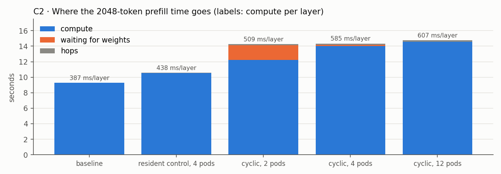

*Figure: the loads are hidden from 3 pods on, but the compute itself slows by 30–55% while 1.65 GB layers stream in*

**What it means.** Even at 2048 tokens the first token takes 1.44× the baseline. From 3 pods on the loads are hidden (waiting ≤ 0.24 s), but every layer's compute slows from 387 ms to 509–607 ms (+30–55%) because the disk transfers and the matrix multiplications share the same memory bandwidth on this chip. For the 3B the same effect was +8%. Short prompts are 2.3× (512) and 4.4× (128).

## C3. Time per generated token

**Why / how.** Same as B3 and B4. 512-token prompt, one layer per pod; breakdown from the traces (verified table §3.3), per grouping computed from the raw file. Baseline 167 ms.

| pods | per token | vs baseline | waiting for weights | compute | hops | one layer load |
|---|---|---|---|---|---|---|
| 2 | 7087 ms | 42× | 6762 ms | 210 ms | 81 ms | 573 ms |
| 3 | 5772 ms | 35× | 5240 ms | 288 ms | 113 ms | 697 ms |
| 4 | 5636 ms | 34× | 5231 ms | 300 ms | 126 ms | 929 ms |
| 6 | 5499 ms | 33× | 5005 ms | 327 ms | 123 ms | 1356 ms |
| 8 | 5463 ms | 33× | 5034 ms | 357 ms | 131 ms | 1797 ms |
| 12 | 5533 ms | 33× | 4917 ms | 372 ms | 128 ms | 2647 ms |

| groups G (layers per group) | K=2 | K=3 | K=4 | K=6 | K=8 | K=12 |
|---|---|---|---|---|---|---|
| 24 (1) | 7087 | 5772 | 5636 | 5499 | 5463 | 5533 |
| 12 (2) | 7086 | 5962 | 5514 | 5476 |  |  |
| 8 (3) | 7097 |  | 5603 |  |  |  |
| 6 (4) | 7088 | 5875 |  |  |  |  |
| 4 (6) | 7061 |  |  |  |  |  |

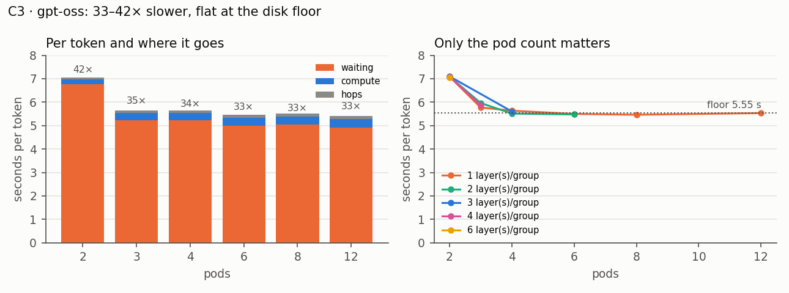

*Figure: same shape as the 3B, at 39.5 GB ÷ 7.1 GB/s = 5.55 s per token*

**What it means.** The same shape as the 3B, with much bigger numbers: 7.1 s with 2 pods, then flat at the 5.55 s floor (39.5 GB ÷ 7.1 GB/s), 33× the baseline. One layer's load grows from 573 ms to 2.6 s with the pod count. A fourth effect makes it worse than the 3B: **the scheme loads 8× more bytes than a token uses**, because which 4 of the 32 experts a token needs is only known when it reaches the layer, so whole layers must be prefetched. Baseline speed this way would need 236 GB/s.

## C4. Cost of splitting alone

**Why / how.** Same as B5. K pods each holding 24/K layers permanently, 512-token prompt, from the raw file.

| configuration | per token | vs baseline |
|---|---|---|
| baseline (1 pod) | 167 ms | 1.00× |
| 4 pods, all resident | 198 ms | 1.18× |
| 12 pods, all resident | 207 ms | 1.24× |
| 24 pods, all resident | 206 ms | 1.23× |

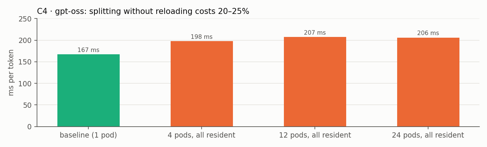

*Figure: the pipeline costs less than for the 3B because each layer computes longer relative to a hop*

**What it means.** The pipeline itself costs 20–25% per token here, less than the 3B's 30%, because each gpt-oss layer computes for longer compared with the ~5 ms hop. Again, nearly all of the 33× comes from reloading.

## C5. Single-pod sequential streaming

**Why / how.** Same as B10. One pod, S slots, 512-token prompt. Verified table, `docs/archive/FINAL_REPORT_GPTOSS.md` §6.1. Baseline 168 ms, 43.3 GB.

| slots | total RAM | RAM saved | per token | vs baseline |
|---|---|---|---|---|
| 1 | 5.4 GB | 87% | 12.4 s | 73× |
| 2 | 7.3 GB | 83% | 7.18 s | 43× |
| 3 | 8.7 GB | 80% | 5.95 s | 35× |
| 4 | 10.5 GB | 76% | 5.56 s | 33× |
| 6 | 12.6 GB | 71% | 5.53 s | 33× |

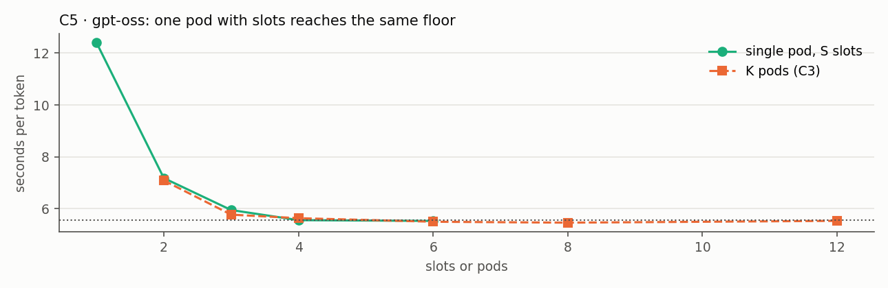

*Figure: 4 slots reach the 5.55 s floor with less RAM than 4 pods*

**What it means.** Same conclusion as the 3B: 3–4 slots in one pod reach the 5.5 s floor with less RAM than K pods (10.5 GB with 4 slots vs 12.1 GB with 4 pods). With one slot, load and compute alternate with no overlap: 24 × (510 + 6) ms = 12.4 s.

## C6. Partial residency

**Why / how.** Same as B6. Verified table, `docs/archive/FINAL_REPORT_GPTOSS.md` §6.2.

| pinned / streamed / slots | layers saved | total RAM | RAM saved | per token | vs baseline |
|---|---|---|---|---|---|
| 22 / 2 / 2 | 0 | 43.3 GB | 0% | 648 ms | 3.9× |
| 20 / 4 / 2 | 2 | 40.1 GB | 8% | 1229 ms | 7.3× |
| 18 / 6 / 3 | 3 | 38.4 GB | 11% | 1472 ms | 8.8× |
| 16 / 8 / 4 | 4 | 36.8 GB | 15% | 1851 ms | 11.0× |
| 12 / 12 / 4 | 8 | 30.2 GB | 30% | 2755 ms | 16.4× |

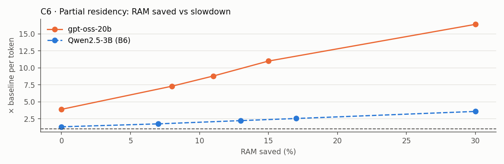

*Figure: with 1.65 GB layers there is nothing to hide the loads behind*

**What it means.** Streaming 2 layers and saving none costs 3.9× (3B: 1.33×): re-reading 3.3 GB takes ~0.47 s while the 22 pinned layers compute for only 0.14 s. Saving 30% of RAM costs 16×. Not usable on this model.

## C7. Kernel paging on a mixture of experts (with the correction)

**Why.** On the dense 3B, paging was the worst option because every token touches every page. A gpt-oss token touches only 4 of 32 experts per layer, so the kernel might keep the hot experts and read only what is used.

**How.** Same method as B7. First measured on 1–2 October with the original prompt (5 limits). Re-measured on 4–5 October in the six-model test with the real prompts (prose + 2 chat prompts, 32 tokens, 3 repetitions), then replicated with the host page cache cleared (E4). The cause of the difference is in E5.

| limit | RAM saved | per token vs baseline (1–2 Oct, repetitive prompt) | status |
|---|---|---|---|
| 48 GiB (fits) | 10% | 0.99× | **invalid**: degenerate output, see E5 |
| 32 GiB | 15% | 1.22× | **invalid**: degenerate output, see E5 |
| 24 GiB | 35% | 1.58× | **invalid**: degenerate output, see E5 |
| 16 GiB | 54% | 1.87× | **invalid**: degenerate output, see E5 |
| 8 GiB | 74% | 4.67× | **invalid**: degenerate output, see E5 |

| limit | total RAM | RAM saved | per token: prose / chat summary / chat code | vs baseline (4–5 Oct, real prompts) |
|---|---|---|---|---|
| 26 GiB | 30.3 GB | 30% | 447 ms / 519 ms / 590 ms | 3.0–4.0× |
| 16 GiB | 19.9 GB | 54% | 1120 ms / 1190 ms / 1194 ms | 7.4–8.0× |

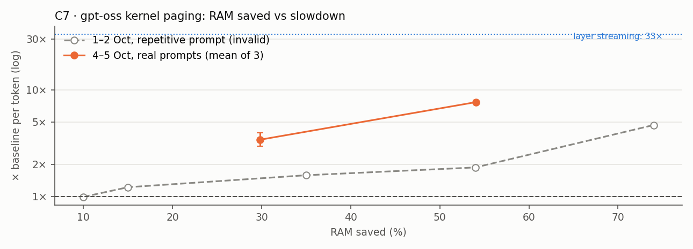

*Figure: with real text, paging costs 3–4× at −30% and 7.4–8× at −54%; still 4–12× better than layer streaming*

**What it means.** With real prompts, kernel paging costs 3.0–4.0× at 30% less RAM and 7.4–8.0× at 54% less. The first measurement (1.87× at 54% less) was an artifact: the old repetitive prompt made gpt-oss output "…" sixteen times in a row, which routes to the same experts at every step, so the cache always hit (E5 reproduces it). Even corrected, paging is 4–12× cheaper than any layer-streaming scheme on this model, because it reads only the experts a token touches. The first prompt pass pays 4–11×, because it touches almost every expert.

## C8. Batching

**Why / how.** Same as B9. 128-token prompts in lockstep. Verified table, `docs/archive/FINAL_REPORT_GPTOSS.md` §6.4.

| users | baseline per user | cyclic 4 pods per user | ratio | baseline tokens/s | cyclic tokens/s | cyclic share |
|---|---|---|---|---|---|---|
| 1 | 162 ms | 5.50 s | 34× | 6 | 0.2 | 3% |
| 16 | 568 ms | 5.52 s | 9.72× | 28 | 3 | 11% |
| 64 | 976 ms | 5.58 s | 5.72× | 66 | 11 | 17% |
| 256 | 2370 ms | 6.00 s | 2.53× | 108 | 43 | 40% |
| 512 | 3780 ms | 6.74 s | 1.78× | 135 | 76 | 56% |

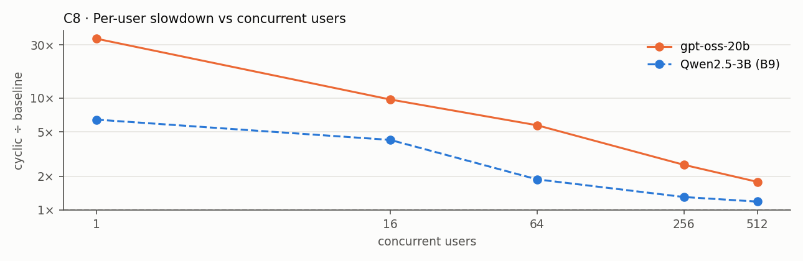

*Figure: the gap closes with users, from a much higher start: 1.78× at 512 users*

**What it means.** The gap closes with more users but from 34×: at 512 users the pipeline is still 1.78× slower per user and delivers 56% of the baseline's throughput (3B: 1.19×, 84%).

## C9. Small dense vs big mixture of experts, side by side

**Why.** To see what changes with model size and with experts, and why.

**How.** Key numbers from C1–C8 and B1–B10 (corrected paging figure). Verified table, `docs/archive/FINAL_REPORT_GPTOSS.md` §7.

|  | Qwen2.5-3B (dense) | gpt-oss-20b (experts) |
|---|---|---|
| one layer: load ÷ compute (1 token) | 12× | 94× |
| bytes loaded per token ÷ bytes used | 1 | 8 |
| disk floor per token | 0.78 s | 5.55 s |
| cyclic, 4+ pods | 6× | 33× |
| first token, 2048-token prompt, best cyclic | 1.00× | 1.44× |
| compute slowdown while loading (prefill) | +8% | +30–55% |
| single pod, 4 slots: RAM saved · slowdown | 70% · 6.0× | 76% · 33× |
| partial residency, nothing saved | 1.33× | 3.9× |
| kernel paging at ~54% less RAM | 10.6× | 7.4–8.0× |
| batching, 512 users, per user | 1.19× | 1.78× |

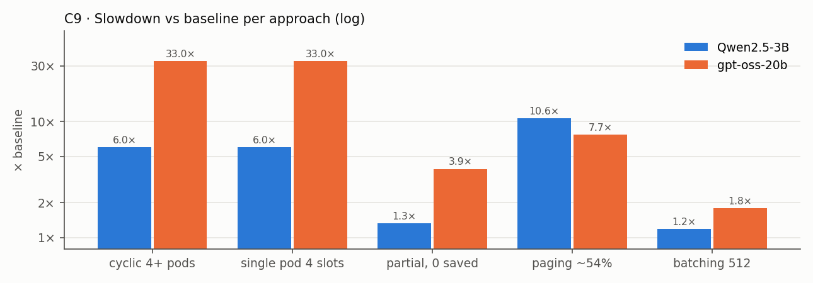

*Figure: every streaming approach gets worse with layer size; only paging improves, because experts are touched sparsely*

**What it means.** Memory savings scale in favour of the big model (the runtime per pod becomes negligible). Everything about latency gets worse in proportion to bytes read per token. The mixture of experts makes layer streaming worse still (8× more bytes than used) but makes kernel paging relatively better, because only touched experts are read. The six-model test (Part E) checks whether this is a rule.

# Part D. Latency optimisation of the 3B at the same memory (≤ 3.5 GB)

Goal (2 October, decisions taken at the start of the round): keep the ~3.5 GB of the best speculative configuration (B8) and cut the time per token, with no quantization, a bf16 0.5B draft model, and exact output as far as bf16 allows. Prompts: the 512-token prose text and three chat instructions (explain, summary, code). Four rounds; rounds 1–3 and 4 ran at different machine loads, so only comparisons within a round are used. Tables in this part are computed here from the raw files.

## D1. Round 1: speculation in one pod (and a direct-I/O artifact)

**Why.** B10 showed one pod with 4 slots streams as fast as many pods with less memory. Moving the speculative chain (B8) into one pod should remove the hops. Direct I/O (reads that bypass the page cache) was also tried as a way to load faster.

**How.** 512-token prose prompt, 32 generated tokens, 3 repetitions (`results/qwen2.5-3b/results4.jsonl`).

| configuration | total RAM | per token | vs baseline | tokens per read | draft ms | verify ms | same output |
|---|---|---|---|---|---|---|---|
| baseline · all resident | 7.09 GB | 129 ms | 1.00× |  |  |  | yes |
| partial · pinned 0-32, 3 slots · direct I/O **(invalid)** | 7.08 GB | 143 ms | 1.10× |  |  |  | yes |
| partial · pinned 0-32, 3 slots | 7.08 GB | 163 ms | 1.26× |  |  |  | yes |
| chain γ=5 · 4 pods · direct I/O **(invalid)** | 4.49 GB | 240 ms | 1.85× | 2.82 | 172 | 479 | yes |
| chain γ=5 · 1 pod, 4 slots · direct I/O **(invalid)** | 3.41 GB | 274 ms | 2.11× | 2.82 | 238 | 494 | yes |
| chain γ=5 · 1 pod, 6 slots | 3.68 GB | 342 ms | 2.64× | 2.82 | 200 | 733 | yes |
| chain γ=5 · 1 pod, 4 slots | 3.41 GB | 350 ms | 2.70× | 2.82 | 179 | 776 | yes |
| chain γ=5 · 2 pods | 3.49 GB | 428 ms | 3.31× | 2.82 | 173 | 1004 | yes |
| cyclic · 4 pods · direct I/O **(invalid)** | 3.26 GB | 483 ms | 3.73× |  |  |  | yes |
| plain streaming · 1 pod, 4 slots · direct I/O **(invalid)** | 2.14 GB | 505 ms | 3.90× |  |  |  | yes |
| plain streaming · 1 pod, 4 slots | 2.14 GB | 786 ms | 6.08× |  |  |  | yes |

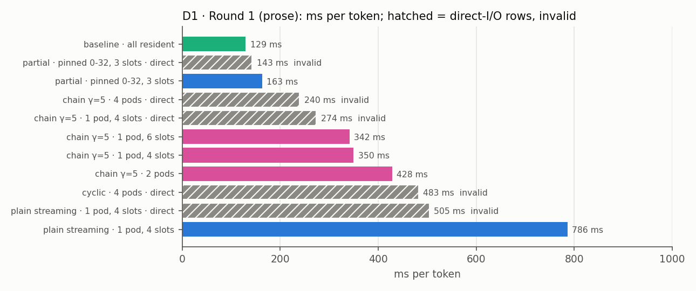

*Figure: the single-pod chain cuts 428 → 350 ms; the impressive direct-I/O rows were served partly from the page cache*

**What it means.** Valid result: the speculative chain in one pod with 4 slots is 350 ms per token (2.7×) against 428 ms with 2 pods, because the verify pass drops from 1004 to 776 ms (four reads in flight, no hops). The direct-I/O rows looked spectacular (plain streaming at 483–505 ms, below the 0.78 s disk floor) but were impossible: on halo's btrfs filesystem, part of each direct read silently falls back to buffered reads, and 48% of the weight files were found in the page cache right after those runs. They are invalid and were re-measured properly in D2 and D5.

## D2. Direct I/O and memory-bandwidth contention

**Why.** Two questions: can direct reads raise the bandwidth, and does loading slow the computation (as B4 and C2 suggested) and can direct reads avoid that?

**How.** `contention.py`: compute one layer for 1 and 512 tokens while 4 threads load other layers, buffered vs direct, and measure bandwidth with 1/2/4 readers. Run once with the buggy loader (artifact) and again with an end-of-file-safe loader that evicts any fallback pages, verified to leave the page cache unchanged.

| measurement | buffered | direct (fixed loader) | direct (first run, invalid) |
|---|---|---|---|
| bandwidth, 1 reader | 3.95 GB/s | 4.2 GB/s | 5.78 GB/s |
| bandwidth, 2 readers | 6.08 GB/s | 5.7 GB/s | 8.32 GB/s |
| bandwidth, 4 readers | 7.11 GB/s | 6.83 GB/s | 11.19 GB/s |
| compute slowdown during loads, 1 token | 1.44× | 1.18× | 0.76× |
| compute slowdown during loads, 512 tokens | 1.72× | 1.65× | 1.04× |

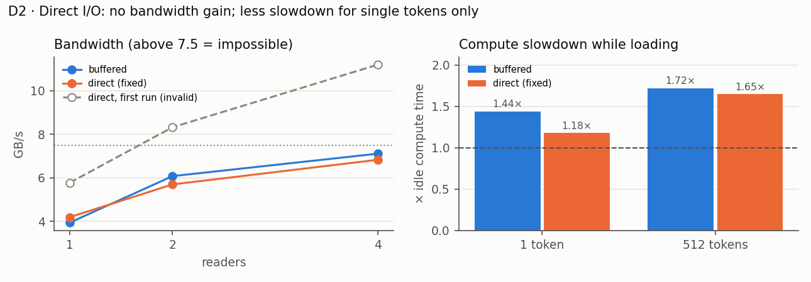

*Figure: 11 GB/s from a 7.5 GB/s link was the tell-tale sign of the artifact*

**What it means.** Loading really does slow computation: one-token compute takes 1.44× longer and 512-token compute 1.72× longer while layers stream in, confirming B4 and C2. Direct reads do not raise bandwidth (6.8 vs 7.1 GB/s; the link is the limit). They reduce the slowdown for one-token work (1.18× vs 1.44×) but not for prompt-sized work (1.65× vs 1.72×). The first run reported 11 GB/s through a 7.5 GB/s link, which is how the artifact was caught.

## D3. Round 2: tree speculation instead of a chain

**Why.** A chain of 5 guesses is wasted after the first wrong one. Because the verify pass costs the same whether it checks 5 or 65 candidates (it is disk-bound), the draft can propose a tree of alternatives, and the big model picks the longest correct branch in one pass (the SpecExec / Sequoia idea). Implemented with tree attention masks and cache compaction, proven exact in fp32 (A1).

**How.** Single pod, 4 slots, Hugging Face drafter. Trees of 23, 65, 129 and 201 nodes and the chain, on all four prompts, 48 tokens, 3 repetitions (`results/qwen2.5-3b/results5.jsonl`).

**prose 512**

| configuration | total RAM | per token | vs baseline | tokens per read | draft ms | verify ms | same output |
|---|---|---|---|---|---|---|---|
| baseline · all resident | 7.07 GB | 126 ms | 1.00× |  |  |  | yes |
| tree 23 nodes (4,6,6,4,2) · 1 pod, 4 slots | 3.50 GB | 324 ms | 2.57× | 3.85 | 382 | 838 | yes |
| tree 65 nodes (8,16,16,12,8,4) · 1 pod, 4 slots | 3.97 GB | 342 ms | 2.71× | 4.55 | 616 | 879 | yes |
| tree 129 nodes (16,32,32,24,16,8) · 1 pod, 4 slots | 4.53 GB | 431 ms | 3.42× | 4.90 | 1014 | 1026 | yes |
| chain γ=5 · 1 pod, 4 slots | 3.38 GB | 440 ms | 3.49× | 2.43 | 232 | 789 | yes |
| tree 201 nodes (16,32,48,48,32,16,8) · 1 pod, 4 slots | 4.21 GB | 562 ms | 4.46× | 5.00 | 1547 | 1218 | yes |

**chat: explain**

| configuration | total RAM | per token | vs baseline | tokens per read | draft ms | verify ms | same output |
|---|---|---|---|---|---|---|---|
| baseline · all resident | 6.96 GB | 110 ms | 1.00× |  |  |  | yes |
| tree 65 nodes (8,16,16,12,8,4) · 1 pod, 4 slots | 3.23 GB | 237 ms | 2.15× | 4.90 | 291 | 866 | yes |
| tree 23 nodes (4,6,6,4,2) · 1 pod, 4 slots | 3.18 GB | 237 ms | 2.15× | 4.45 | 207 | 842 | yes |
| tree 129 nodes (16,32,32,24,16,8) · 1 pod, 4 slots | 3.42 GB | 259 ms | 2.35× | 5.44 | 376 | 1019 | yes |
| tree 201 nodes (16,32,48,48,32,16,8) · 1 pod, 4 slots | 3.47 GB | 315 ms | 2.86× | 5.67 | 584 | 1184 | yes |
| chain γ=5 · 1 pod, 4 slots | 3.08 GB | 315 ms | 2.86× | 3.06 | 181 | 776 | yes |

**chat: summary**

| configuration | total RAM | per token | vs baseline | tokens per read | draft ms | verify ms | same output |
|---|---|---|---|---|---|---|---|
| baseline · all resident | 6.99 GB | 123 ms | 1.00× |  |  |  | yes |
| tree 65 nodes (8,16,16,12,8,4) · 1 pod, 4 slots | 3.43 GB | 245 ms | 1.98× | 5.20 | 394 | 874 | yes |
| tree 23 nodes (4,6,6,4,2) · 1 pod, 4 slots | 3.23 GB | 248 ms | 2.01× | 4.33 | 220 | 839 | yes |
| tree 129 nodes (16,32,32,24,16,8) · 1 pod, 4 slots | 3.47 GB | 290 ms | 2.35× | 5.67 | 576 | 1046 | 0/3 |
| chain γ=5 · 1 pod, 4 slots | 3.13 GB | 301 ms | 2.44× | 3.27 | 192 | 784 | 0/3 |
| tree 201 nodes (16,32,48,48,32,16,8) · 1 pod, 4 slots | 3.57 GB | 356 ms | 2.88× | 5.88 | 788 | 1266 | yes |

**chat: code**

| configuration | total RAM | per token | vs baseline | tokens per read | draft ms | verify ms | same output |
|---|---|---|---|---|---|---|---|
| baseline · all resident | 6.97 GB | 111 ms | 1.00× |  |  |  | yes |
| tree 65 nodes (8,16,16,12,8,4) · 1 pod, 4 slots | 3.33 GB | 217 ms | 1.95× | 5.44 | 298 | 886 | yes |
| tree 23 nodes (4,6,6,4,2) · 1 pod, 4 slots | 3.20 GB | 219 ms | 1.97× | 4.90 | 213 | 847 | yes |
| chain γ=5 · 1 pod, 4 slots | 3.07 GB | 260 ms | 2.34× | 3.77 | 186 | 783 | yes |
| tree 129 nodes (16,32,32,24,16,8) · 1 pod, 4 slots | 3.49 GB | 260 ms | 2.35× | 5.88 | 489 | 1062 | yes |
| tree 201 nodes (16,32,48,48,32,16,8) · 1 pod, 4 slots | 3.57 GB | 272 ms | 2.45× | 6.86 | 607 | 1212 | yes |

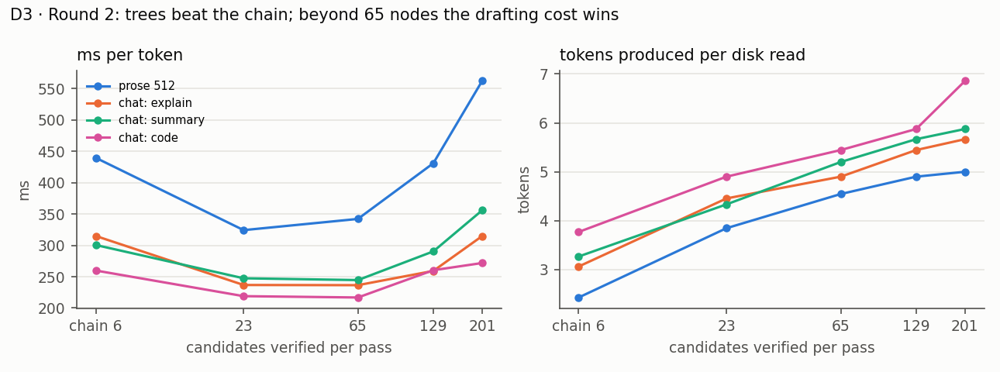

*Figure: tokens per read keep rising with tree size, but drafting a big tree with the HF model costs more than it saves*

**What it means.** Trees of 23–65 candidates beat the 5-token chain on every prompt: tokens per disk read rise from 2.4–3.8 to 3.9–5.4, giving 324 ms on prose and 217–248 ms on chat prompts. Bigger trees produce even more tokens per read (up to 6.9), but drafting them with the Hugging Face model took 0.4–1.5 s per cycle and the verify pass rose to 1.0–1.3 s, so they lost. The drafter became the bottleneck, which round 3 attacks. Two configurations differ from the baseline on the summary prompt, at one near-tie token (F2).

## D4. Round 3: a lean drafter in our own layer code

**Why.** Drafting a 65-node tree with Hugging Face cost 290–620 ms per cycle. Running the 0.5B draft through our own layer code, with tree attention and the same cache compaction as the big model, means one forward pass per tree level and no cache copies.

**How.** Trees of 20–65 nodes (including a deep, narrow 20-node shape) at 4 slots, and the 65-node tree at 5 slots, on all four prompts (`results/qwen2.5-3b/results6.jsonl`). The prose baseline of this round ran while other users loaded the machine (173 ms instead of 126–129); chat baselines were normal.

**prose 512**

| configuration | total RAM | per token | vs baseline | tokens per read | draft ms | verify ms | same output |
|---|---|---|---|---|---|---|---|
| baseline · all resident | 7.08 GB | 173 ms | 1.00× |  |  |  | yes |
| tree 65 nodes (8,16,16,12,8,4) · 1 pod, 4 slots | 3.44 GB | 242 ms | 1.40× | 4.55 | 241 | 855 | yes |
| tree 65 nodes (8,16,16,12,8,4) · 1 pod, 5 slots | 3.60 GB | 268 ms | 1.55× | 4.55 | 351 | 862 | yes |
| tree 23 nodes (4,6,6,4,2) · 1 pod, 4 slots | 3.41 GB | 282 ms | 1.63× | 3.73 | 203 | 838 | yes |
| tree 20 nodes (3,4,4,3,2,2,1) · 1 pod, 4 slots | 3.43 GB | 297 ms | 1.72× | 3.64 | 244 | 828 | yes |
| tree 29 nodes (8,8,8,4) · 1 pod, 4 slots | 3.43 GB | 312 ms | 1.81× | 3.36 | 191 | 843 | yes |

**chat: explain**

| configuration | total RAM | per token | vs baseline | tokens per read | draft ms | verify ms | same output |
|---|---|---|---|---|---|---|---|
| baseline · all resident | 6.97 GB | 115 ms | 1.00× |  |  |  | yes |
| tree 65 nodes (8,16,16,12,8,4) · 1 pod, 5 slots | 3.37 GB | 238 ms | 2.07× | 4.36 | 219 | 817 | 2/3 |
| tree 20 nodes (3,4,4,3,2,2,1) · 1 pod, 4 slots | 3.11 GB | 239 ms | 2.07× | 4.45 | 211 | 835 | yes |
| tree 65 nodes (8,16,16,12,8,4) · 1 pod, 4 slots | 3.18 GB | 248 ms | 2.16× | 4.36 | 219 | 864 | 2/3 |
| tree 29 nodes (8,8,8,4) · 1 pod, 4 slots | 3.18 GB | 273 ms | 2.37× | 3.62 | 147 | 838 | 2/3 |
| tree 23 nodes (4,6,6,4,2) · 1 pod, 4 slots | 3.12 GB | 295 ms | 2.56× | 3.37 | 167 | 812 | yes |

**chat: summary**

| configuration | total RAM | per token | vs baseline | tokens per read | draft ms | verify ms | same output |
|---|---|---|---|---|---|---|---|
| baseline · all resident | 6.99 GB | 118 ms | 1.00× |  |  |  | yes |
| tree 65 nodes (8,16,16,12,8,4) · 1 pod, 5 slots | 3.36 GB | 197 ms | 1.66× | 5.50 | 232 | 838 | yes |
| tree 65 nodes (8,16,16,12,8,4) · 1 pod, 4 slots | 3.24 GB | 200 ms | 1.69× | 5.50 | 226 | 873 | yes |
| tree 20 nodes (3,4,4,3,2,2,1) · 1 pod, 4 slots | 3.18 GB | 221 ms | 1.87× | 4.84 | 223 | 841 | 0/3 |
| tree 23 nodes (4,6,6,4,2) · 1 pod, 4 slots | 3.20 GB | 251 ms | 2.12× | 4.03 | 170 | 837 | 0/3 |
| tree 29 nodes (8,8,8,4) · 1 pod, 4 slots | 3.22 GB | 254 ms | 2.15× | 3.89 | 154 | 831 | 0/3 |

**chat: code**

| configuration | total RAM | per token | vs baseline | tokens per read | draft ms | verify ms | same output |
|---|---|---|---|---|---|---|---|
| baseline · all resident | 6.97 GB | 115 ms | 1.00× |  |  |  | yes |
| tree 65 nodes (8,16,16,12,8,4) · 1 pod, 5 slots | 3.38 GB | 194 ms | 1.69× | 5.44 | 221 | 835 | yes |
| tree 20 nodes (3,4,4,3,2,2,1) · 1 pod, 4 slots | 3.14 GB | 198 ms | 1.72× | 5.44 | 207 | 856 | yes |
| tree 65 nodes (8,16,16,12,8,4) · 1 pod, 4 slots | 3.22 GB | 198 ms | 1.72× | 5.44 | 209 | 865 | yes |
| tree 23 nodes (4,6,6,4,2) · 1 pod, 4 slots | 3.14 GB | 215 ms | 1.87× | 4.59 | 147 | 832 | yes |
| tree 29 nodes (8,8,8,4) · 1 pod, 4 slots | 3.13 GB | 246 ms | 2.14× | 4.03 | 144 | 838 | yes |

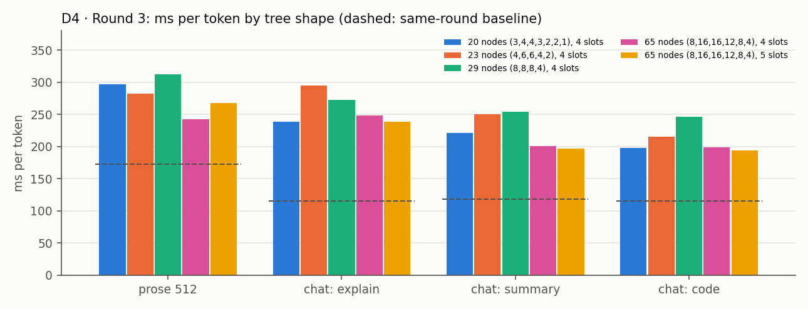

*Figure: with the lean drafter the 65-node tree is best or tied on every prompt*

**What it means.** Drafting a 65-node tree dropped from 290–620 ms to 210–240 ms per cycle, making the 65-node tree the best or tied shape on every prompt: 242 ms on prose, 198–248 ms on the chat prompts (1.7–2.2× the normal baselines) at 3.2–3.4 GB. A cycle is now ~80% verify pass (~860 ms: the 0.78 s disk floor plus compute). Five slots help a little on chat prompts and hurt on prose. Twelve of 60 runs differ from the baseline, all at the same two near-tie tokens (F2).

## D5. Round 4: direct I/O end to end, a bigger tree, a deeper tree

**Why.** Check, end to end, the three remaining ideas: direct I/O with the fixed loader (D2 showed less compute slowdown), a 129-node tree with the lean drafter, and the deep 20-node tree.

**How.** Same configurations with and without direct I/O, back to back (`results/qwen2.5-3b/results7.jsonl`). This round ran while other users loaded halo (baselines 143–172 ms), so only comparisons inside the round are valid.

**prose 512**

| configuration | total RAM | per token | vs baseline | tokens per read | draft ms | verify ms | same output |
|---|---|---|---|---|---|---|---|
| baseline · all resident | 7.08 GB | 167 ms | 1.00× |  |  |  | yes |
| partial · pinned 0-32, 3 slots · direct I/O | 7.09 GB | 195 ms | 1.17× |  |  |  | yes |
| partial · pinned 0-32, 3 slots | 7.08 GB | 209 ms | 1.25× |  |  |  | yes |
| tree 65 nodes (8,16,16,12,8,4) · 1 pod, 4 slots | 3.44 GB | 279 ms | 1.67× | 4.55 | 343 | 909 | yes |
| tree 65 nodes (8,16,16,12,8,4) · 1 pod, 4 slots · direct I/O | 3.46 GB | 288 ms | 1.72× | 4.55 | 370 | 945 | yes |
| tree 129 nodes (16,32,32,24,16,8) · 1 pod, 4 slots | 3.50 GB | 331 ms | 1.98× | 4.22 | 324 | 1038 | yes |
| tree 20 nodes (3,4,4,3,2,2,1) · 1 pod, 4 slots · direct I/O | 3.41 GB | 335 ms | 2.00× | 3.64 | 344 | 889 | yes |
| plain streaming · 1 pod, 4 slots | 2.15 GB | 808 ms | 4.83× |  |  |  | yes |
| plain streaming · 1 pod, 4 slots · direct I/O | 2.15 GB | 834 ms | 4.99× |  |  |  | yes |

**chat: explain**

| configuration | total RAM | per token | vs baseline | tokens per read | draft ms | verify ms | same output |
|---|---|---|---|---|---|---|---|
| baseline · all resident | 6.96 GB | 160 ms | 1.00× |  |  |  | yes |
| tree 20 nodes (3,4,4,3,2,2,1) · 1 pod, 4 slots · direct I/O | 3.14 GB | 239 ms | 1.50× | 4.45 | 203 | 844 | yes |
| tree 65 nodes (8,16,16,12,8,4) · 1 pod, 4 slots | 3.21 GB | 284 ms | 1.78× | 4.36 | 330 | 913 | 2/3 |
| tree 65 nodes (8,16,16,12,8,4) · 1 pod, 4 slots · direct I/O | 3.21 GB | 288 ms | 1.81× | 4.36 | 334 | 932 | 2/3 |
| tree 129 nodes (16,32,32,24,16,8) · 1 pod, 4 slots | 3.32 GB | 315 ms | 1.97× | 4.42 | 345 | 1049 | yes |

**chat: summary**

| configuration | total RAM | per token | vs baseline | tokens per read | draft ms | verify ms | same output |
|---|---|---|---|---|---|---|---|
| baseline · all resident | 6.98 GB | 167 ms | 1.00× |  |  |  | yes |
| tree 65 nodes (8,16,16,12,8,4) · 1 pod, 4 slots | 3.20 GB | 209 ms | 1.25× | 5.50 | 237 | 897 | yes |
| tree 65 nodes (8,16,16,12,8,4) · 1 pod, 4 slots · direct I/O | 3.20 GB | 214 ms | 1.28× | 5.50 | 268 | 896 | yes |
| tree 20 nodes (3,4,4,3,2,2,1) · 1 pod, 4 slots · direct I/O | 3.17 GB | 242 ms | 1.45× | 4.84 | 290 | 882 | 0/3 |
| tree 129 nodes (16,32,32,24,16,8) · 1 pod, 4 slots | 3.31 GB | 261 ms | 1.56× | 5.89 | 410 | 1132 | yes |

**chat: code**

| configuration | total RAM | per token | vs baseline | tokens per read | draft ms | verify ms | same output |
|---|---|---|---|---|---|---|---|
| baseline · all resident | 6.97 GB | 143 ms | 1.00× |  |  |  | yes |
| tree 20 nodes (3,4,4,3,2,2,1) · 1 pod, 4 slots · direct I/O | 3.17 GB | 197 ms | 1.38× | 5.44 | 205 | 864 | yes |
| tree 65 nodes (8,16,16,12,8,4) · 1 pod, 4 slots | 3.21 GB | 200 ms | 1.40× | 5.44 | 220 | 865 | yes |
| tree 65 nodes (8,16,16,12,8,4) · 1 pod, 4 slots · direct I/O | 3.21 GB | 205 ms | 1.44× | 5.44 | 214 | 892 | yes |
| tree 129 nodes (16,32,32,24,16,8) · 1 pod, 4 slots | 3.33 GB | 238 ms | 1.66× | 5.44 | 267 | 1017 | yes |

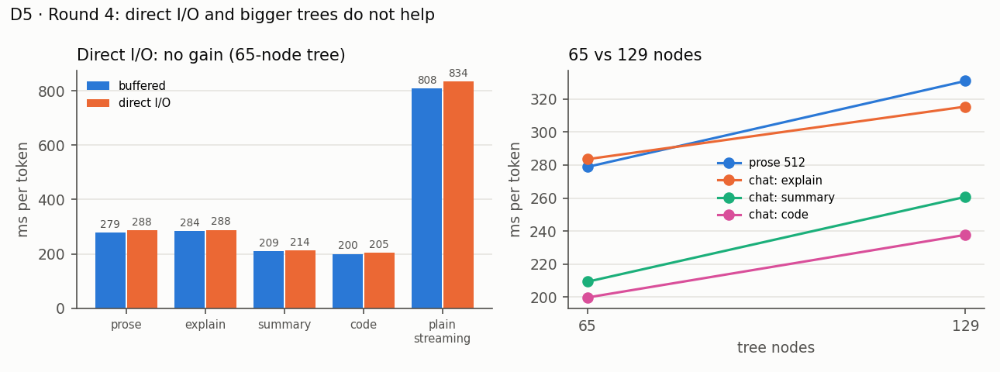

*Figure: direct I/O is 1–3% slower end to end; the 129-node tree is slower than the 65-node tree on every prompt*

**What it means.** Direct I/O gives no end-to-end gain for streaming (65-node tree 279 → 288 ms on prose, +2–3% on chat prompts; plain streaming 808 → 834 ms). It only helps partial residency (209 → 195 ms) and plain streaming's first token. The 129-node tree is slower than the 65-node tree on every prompt: verify rises to 1.0–1.1 s while tokens per read barely move. The deep 20-node tree matches or beats the 65-node tree on explain and code, but not on summary or prose. Conclusion: 65 nodes, buffered reads, 4 slots.

## D6. Optimisation: the net result

**Why / how.** The best configuration of each step, per prompt, in ms per token (rounds 1–3; verified table `docs/archive/FINAL_REPORT.md` §6b). All at 3.1–3.5 GB, 51–54% less than the baseline's 7.07 GB.

| step | prose 512 | chat: explain | chat: summary | chat: code |
|---|---|---|---|---|
| start: chain γ=5, 2 pods (B8) | 441 ms (3.3×) | – | – | – |
| 1: chain γ=5, single pod, 4 slots | 350 ms (2.7×) | 315 ms (2.9×) | 301 ms (2.4×) | 260 ms (2.3×) |
| 2: tree, 23–65 nodes, HF drafter | 324 ms (2.6×) | 237 ms (2.15×) | 245 ms (2.0×) | 217 ms (1.95×) |
| 3: tree, 65 nodes, lean drafter | 242 ms (1.9×) | 248 ms (2.2×) | 200 ms (1.7×) | 198 ms (1.7×) |
| baselines | 126–133 ms | 110–115 ms | 118–123 ms | 111–115 ms |

Ratios use the baseline of the round each step was measured in; the round-3 prose baseline ran under load (173 ms), so step 3's prose ratio uses the normal 126–129 ms.

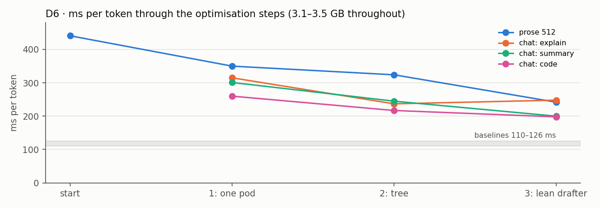

*Figure: from 441 ms to 198–248 ms per token at the same memory*

**What it means.** From 441 ms to 198–248 ms per token (1.7–2.2× the baselines) at 3.2–3.4 GB, 51–54% less memory than the baseline. Best general configuration: one pod, 4 slots, 65-node tree, lean drafter. What is left, in the order the data suggests: choosing the tree shape per prompt from the draft's confidence, drafting during the verify pass, and pinning the layers that fit in the leftover memory.

# Part E. Six models: is the best approach the same for every model?

Question (4 October): is "streaming + tree speculation" the best approach for every model? Same protocol on six models (the Qwen2.5 1.5B / 7B / 14B trio plus Qwen3-30B-A3B, with the 3B and gpt-oss re-run under the same protocol): baseline, single-pod streaming (4 slots), streaming + 64-node tree speculation with a lean drafter (Qwen2.5-0.5B, or Qwen3-0.6B for the Qwen3 model; gpt-oss has no drafter), kernel paging at 2–3 memory limits. Prompts: prose 512, chat summary, chat code; 32 tokens; 3 repetitions. 270 runs. All tables in this part are computed here from `results/six-models/*.jsonl`.

## E1. Six models: every approach, every prompt

**Why.** The 3B and gpt-oss pointed to two different winners. Six models of different sizes and both architectures show whether that is a rule.

**How.** One table per model; "best" = lowest slowdown on the prose prompt among configurations that save at least a fifth of the memory.

### Qwen2.5-1.5B — 2.6 GB of layer weights

| prompt | approach | RAM | saved | per token | vs baseline | tokens per read | same output |
|---|---|---|---|---|---|---|---|
| prose 512 | baseline | 3.9 GB | 0% | 69 ms | 1.0× |  | — |
| prose 512 | streaming, 4 slots | 1.7 GB | 57% | 378 ms | 5.4× |  | 3/3 |
| prose 512 | streaming + tree speculation | 3.0 GB | 24% | 149 ms | 2.1× | 4.5 | 0/3 |
| prose 512 | kernel paging, 1700 MiB | 2.7 GB | 31% | 712 ms | 10.2× |  | 3/3 |
| prose 512 | kernel paging, 1200 MiB | 2.2 GB | 44% | 687 ms | 9.9× |  | 3/3 |
| chat: summary | baseline | 3.9 GB | 0% | 64 ms | 1.0× |  | — |
| chat: summary | streaming, 4 slots | 1.6 GB | 58% | 376 ms | 5.9× |  | 3/3 |
| chat: summary | streaming + tree speculation | 2.8 GB | 28% | 108 ms | 1.7× | 6.4 | 3/3 |
| chat: summary | kernel paging, 1700 MiB | 2.7 GB | 30% | 716 ms | 11.1× |  | 3/3 |
| chat: summary | kernel paging, 1200 MiB | 2.2 GB | 43% | 694 ms | 10.8× |  | 3/3 |
| chat: code | baseline | 3.8 GB | 0% | 64 ms | 1.0× |  | — |
| chat: code | streaming, 4 slots | 1.6 GB | 59% | 370 ms | 5.7× |  | 3/3 |
| chat: code | streaming + tree speculation | 2.8 GB | 28% | 121 ms | 1.9× | 5.4 | 3/3 |
| chat: code | kernel paging, 1700 MiB | 2.7 GB | 29% | 695 ms | 10.8× |  | 3/3 |
| chat: code | kernel paging, 1200 MiB | 2.2 GB | 43% | 702 ms | 10.9× |  | 3/3 |

### Qwen2.5-3B — 5.5 GB of layer weights

| prompt | approach | RAM | saved | per token | vs baseline | tokens per read | same output |
|---|---|---|---|---|---|---|---|
| prose 512 | baseline | 7.1 GB | 0% | 124 ms | 1.0× |  | — |
| prose 512 | streaming, 4 slots | 2.1 GB | 70% | 790 ms | 6.4× |  | 3/3 |
| prose 512 | streaming + tree speculation | 3.4 GB | 51% | 213 ms | 1.7× | 5.2 | 3/3 |
| prose 512 | kernel paging, 2800 MiB | 4.0 GB | 43% | 1459 ms | 11.8× |  | 3/3 |
| prose 512 | kernel paging, 4 GiB | 5.4 GB | 24% | 1209 ms | 9.8× |  | 3/3 |
| chat: summary | baseline | 7.0 GB | 0% | 120 ms | 1.0× |  | — |
| chat: summary | streaming, 4 slots | 2.0 GB | 71% | 792 ms | 6.6× |  | 3/3 |
| chat: summary | streaming + tree speculation | 3.2 GB | 54% | 228 ms | 1.9× | 4.7 | 3/3 |
| chat: summary | kernel paging, 2800 MiB | 4.0 GB | 43% | 1423 ms | 11.9× |  | 3/3 |
| chat: summary | kernel paging, 4 GiB | 5.4 GB | 23% | 1024 ms | 8.5× |  | 3/3 |
| chat: code | baseline | 7.0 GB | 0% | 113 ms | 1.0× |  | — |
| chat: code | streaming, 4 slots | 2.0 GB | 71% | 790 ms | 7.0× |  | 3/3 |
| chat: code | streaming + tree speculation | 3.2 GB | 54% | 168 ms | 1.5× | 6.2 | 3/3 |
| chat: code | kernel paging, 2800 MiB | 4.0 GB | 42% | 1428 ms | 12.6× |  | 3/3 |
| chat: code | kernel paging, 4 GiB | 5.4 GB | 23% | 1394 ms | 12.3× |  | 3/3 |

### Qwen2.5-7B — 13.1 GB of layer weights

| prompt | approach | RAM | saved | per token | vs baseline | tokens per read | same output |
|---|---|---|---|---|---|---|---|
| prose 512 | baseline | 16.3 GB | 0% | 232 ms | 1.0× |  | — |
| prose 512 | streaming, 4 slots | 5.1 GB | 69% | 1867 ms | 8.1× |  | 3/3 |
| prose 512 | streaming + tree speculation | 6.4 GB | 61% | 683 ms | 2.9× | 3.3 | 2/3 |
| prose 512 | kernel paging, 6500 MiB | 9.4 GB | 42% | 2608 ms | 11.3× |  | 3/3 |
| prose 512 | kernel paging, 9 GiB | 12.3 GB | 25% | 2659 ms | 11.5× |  | 3/3 |
| chat: summary | baseline | 16.1 GB | 0% | 229 ms | 1.0× |  | — |
| chat: summary | streaming, 4 slots | 4.9 GB | 69% | 1866 ms | 8.1× |  | 3/3 |
| chat: summary | streaming + tree speculation | 6.1 GB | 62% | 446 ms | 1.9× | 5.1 | 0/3 |
| chat: summary | kernel paging, 6500 MiB | 9.4 GB | 42% | 2580 ms | 11.2× |  | 3/3 |
| chat: summary | kernel paging, 9 GiB | 12.3 GB | 24% | 2164 ms | 9.4× |  | 3/3 |
| chat: code | baseline | 16.1 GB | 0% | 218 ms | 1.0× |  | — |
| chat: code | streaming, 4 slots | 4.9 GB | 69% | 1882 ms | 8.6× |  | 3/3 |
| chat: code | streaming + tree speculation | 6.1 GB | 62% | 379 ms | 1.7× | 5.9 | 3/3 |
| chat: code | kernel paging, 6500 MiB | 9.4 GB | 42% | 2585 ms | 11.9× |  | 3/3 |
| chat: code | kernel paging, 9 GiB | 12.3 GB | 24% | 2594 ms | 11.9× |  | 3/3 |

### Qwen2.5-14B — 26.4 GB of layer weights

| prompt | approach | RAM | saved | per token | vs baseline | tokens per read | same output |
|---|---|---|---|---|---|---|---|
| prose 512 | baseline | 31.2 GB | 0% | 454 ms | 1.0× |  | — |
| prose 512 | streaming, 4 slots | 6.9 GB | 78% | 3815 ms | 8.4× |  | 3/3 |
| prose 512 | streaming + tree speculation | 8.3 GB | 74% | 1207 ms | 2.7× | 3.6 | 0/3 |
| prose 512 | kernel paging, 12500 MiB | 16.6 GB | 47% | 5707 ms | 12.6× |  | 3/3 |
| prose 512 | kernel paging, 18 GiB | 22.8 GB | 27% | 5789 ms | 12.8× |  | 3/3 |
| chat: summary | baseline | 31.0 GB | 0% | 408 ms | 1.0× |  | — |
| chat: summary | streaming, 4 slots | 6.8 GB | 78% | 3907 ms | 9.6× |  | 3/3 |
| chat: summary | streaming + tree speculation | 7.9 GB | 74% | 890 ms | 2.2× | 5.0 | 3/3 |
| chat: summary | kernel paging, 12500 MiB | 16.6 GB | 47% | 5632 ms | 13.8× |  | 3/3 |
| chat: summary | kernel paging, 18 GiB | 22.8 GB | 26% | 6055 ms | 14.9× |  | 3/3 |
| chat: code | baseline | 31.0 GB | 0% | 403 ms | 1.0× |  | — |
| chat: code | streaming, 4 slots | 6.8 GB | 78% | 3868 ms | 9.6× |  | 3/3 |
| chat: code | streaming + tree speculation | 8.0 GB | 74% | 827 ms | 2.1× | 5.3 | 3/3 |
| chat: code | kernel paging, 12500 MiB | 16.6 GB | 46% | 5668 ms | 14.1× |  | 3/3 |
| chat: code | kernel paging, 18 GiB | 22.8 GB | 26% | 4912 ms | 12.2× |  | 3/3 |

### gpt-oss-20b — 39.5 GB of layer weights

| prompt | approach | RAM | saved | per token | vs baseline | tokens per read | same output |
|---|---|---|---|---|---|---|---|
| prose 512 | baseline | 43.2 GB | 0% | 151 ms | 1.0× |  | — |
| prose 512 | streaming, 4 slots | 10.4 GB | 76% | 5568 ms | 36.9× |  | 3/3 |
| prose 512 | kernel paging, 26 GiB | 30.3 GB | 30% | 447 ms | 3.0× |  | 3/3 |
| prose 512 | kernel paging, 16 GiB | 19.9 GB | 54% | 1120 ms | 7.4× |  | 3/3 |
| chat: summary | baseline | 43.1 GB | 0% | 157 ms | 1.0× |  | — |
| chat: summary | streaming, 4 slots | 10.1 GB | 77% | 5571 ms | 35.4× |  | 3/3 |
| chat: summary | kernel paging, 26 GiB | 30.4 GB | 29% | 519 ms | 3.3× |  | 3/3 |
| chat: summary | kernel paging, 16 GiB | 19.8 GB | 54% | 1190 ms | 7.6× |  | 3/3 |
| chat: code | baseline | 43.0 GB | 0% | 149 ms | 1.0× |  | — |
| chat: code | streaming, 4 slots | 10.0 GB | 77% | 5550 ms | 37.2× |  | 3/3 |
| chat: code | kernel paging, 26 GiB | 30.4 GB | 29% | 590 ms | 4.0× |  | 3/3 |
| chat: code | kernel paging, 16 GiB | 19.8 GB | 54% | 1194 ms | 8.0× |  | 3/3 |

### Qwen3-30B-A3B — 59.8 GB of layer weights

| prompt | approach | RAM | saved | per token | vs baseline | tokens per read | same output |
|---|---|---|---|---|---|---|---|
| prose 512 | baseline | 62.6 GB | 0% | 267 ms | 1.0× |  | — |
| prose 512 | streaming, 4 slots | 7.7 GB | 88% | 8480 ms | 31.8× |  | 3/3 |
| prose 512 | streaming + tree speculation | 9.8 GB | 84% | 2820 ms | 10.6× | 3.2 | 2/3 |
| prose 512 | kernel paging, 38 GiB | 38.7 GB | 38% | 465 ms | 1.7× |  | 3/3 |
| prose 512 | kernel paging, 26 GiB | 27.2 GB | 57% | 692 ms | 2.6× |  | 3/3 |
| prose 512 | kernel paging, 16 GiB | 17.4 GB | 72% | 1266 ms | 4.7× |  | 3/3 |
| chat: summary | baseline | 62.3 GB | 0% | 248 ms | 1.0× |  | — |
| chat: summary | streaming, 4 slots | 7.4 GB | 88% | 8368 ms | 33.8× |  | 3/3 |
| chat: summary | streaming + tree speculation | 9.5 GB | 85% | 1654 ms | 6.7× | 5.3 | 3/3 |
| chat: summary | kernel paging, 38 GiB | 38.7 GB | 38% | 422 ms | 1.7× |  | 3/3 |
| chat: summary | kernel paging, 26 GiB | 26.5 GB | 57% | 822 ms | 3.3× |  | 3/3 |
| chat: summary | kernel paging, 16 GiB | 17.1 GB | 72% | 1297 ms | 5.2× |  | 3/3 |
| chat: code | baseline | 62.2 GB | 0% | 240 ms | 1.0× |  | — |
| chat: code | streaming, 4 slots | 7.4 GB | 88% | 8379 ms | 34.9× |  | 3/3 |
| chat: code | streaming + tree speculation | 9.4 GB | 85% | 1737 ms | 7.2× | 5.0 | 3/3 |
| chat: code | kernel paging, 38 GiB | 37.8 GB | 39% | 413 ms | 1.7× |  | 3/3 |
| chat: code | kernel paging, 26 GiB | 26.2 GB | 58% | 683 ms | 2.8× |  | 3/3 |
| chat: code | kernel paging, 16 GiB | 17.0 GB | 73% | 1030 ms | 4.3× |  | 3/3 |

*Figure: memory saved vs slowdown for every configuration of every model (prose prompt); lower-right is better*

**Best approach per model** (ranges over the three prompts):

| model | best approach | RAM saved | per token vs baseline |
|---|---|---|---|
| Qwen2.5-1.5B | streaming + tree speculation | 24–28% | 1.7–2.1× |
| Qwen2.5-3B | streaming + tree speculation | 51–54% | 1.5–1.9× |
| Qwen2.5-7B | streaming + tree speculation | 61–62% | 1.7–2.9× |
| Qwen2.5-14B | streaming + tree speculation | 74% | 2.1–2.7× |
| gpt-oss-20b | kernel paging, 26 GiB | 29–30% | 3.0–4.0× |
| Qwen3-30B-A3B | kernel paging, 38 GiB | 38–39% | 1.7× |

**What it means.** The rule holds on all six. Dense models (Qwen2.5 1.5B to 14B): streaming + tree speculation wins every time and kernel paging is the worst every time (9–15×). Mixtures of experts (gpt-oss, Qwen3-30B-A3B): kernel paging is the only approach with a moderate cost, while layer streaming is 32–37× and tree speculation cannot rescue it (each read is 40–60 GB). The drafter must be small next to the target: at 1.5B the 1 GB drafter eats most of the saving (24–28% left); from 7B up it costs 2–7% of the model.

## E2. Does plain streaming sit exactly on the disk floor?

**Why.** The core claim of the project is a predictive rule: time per token ≥ bytes not in memory ÷ disk bandwidth. If plain streaming matches bytes ÷ 7.1 GB/s on all six models, the rule predicts any model on this machine without running it.

**How.** Exact layer bytes per model (sum of the layer files) ÷ 7.1 GB/s, against the measured single-pod streaming time per token on the three prompts.

| model | layer bytes | predicted floor (÷ 7.1 GB/s) | measured streaming | measured ÷ predicted |
|---|---|---|---|---|
| Qwen2.5-1.5B | 2.62 GB | 369 ms | 370–378 ms | 1.00–1.03 |
| Qwen2.5-3B | 5.55 GB | 782 ms | 790–792 ms | 1.01 |
| Qwen2.5-7B | 13.05 GB | 1838 ms | 1866–1882 ms | 1.01–1.02 |
| Qwen2.5-14B | 26.43 GB | 3722 ms | 3815–3907 ms | 1.03–1.05 |
| gpt-oss-20b | 39.51 GB | 5565 ms | 5550–5571 ms | 1.00 |
| Qwen3-30B-A3B | 59.82 GB | 8426 ms | 8368–8480 ms | 0.99–1.01 |

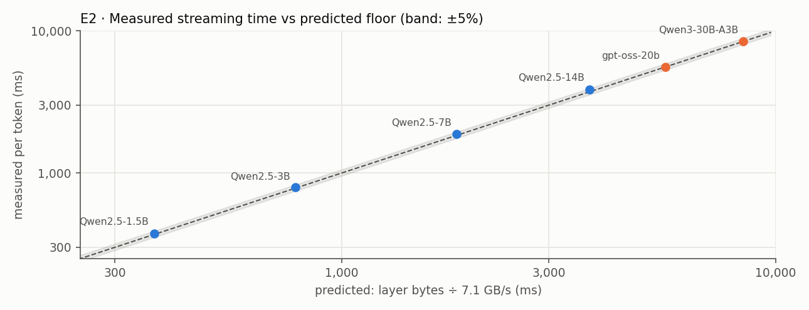

*Figure: all six models sit on the line: time per token = bytes read ÷ 7.1 GB/s*

**What it means.** Measured streaming time is within 0–5% of layer bytes ÷ 7.1 GB/s for all six models, from 2.6 GB to 60 GB of layers, dense or experts. The rule is predictive: for any model on this machine, divide the bytes you must read per token by 7.1 GB/s.

## E3. First-token cost of each approach

**Why.** Generation speed is not the whole story: a user also waits for the prompt to be processed. Streaming reads the whole model once for the prompt; kernel paging faults in almost every expert on its first pass.

**How.** Median first-token time, ÷ the same model's baseline, prose 512 prompt and the range over the two chat prompts.

| model | baseline first token (prose) | streaming (prose / chat) | streaming + tree (prose / chat) | kernel paging (prose / worst) |
|---|---|---|---|---|
| Qwen2.5-1.5B | 0.7 s | 1.2× / 1.6–2.1× | 1.5× / 1.6–2.1× | 1.9–2.0× / up to 4.0× |
| Qwen2.5-3B | 1.1 s | 1.4× / 1.4–3.1× | 1.7× / 1.6–3.1× | 1.8–2.1× / up to 5.8× |
| Qwen2.5-7B | 2.4 s | 1.3× / 2.1–3.4× | 1.4× / 2.0–3.2× | 2.0× / up to 4.9× |
| Qwen2.5-14B | 5.3 s | 1.3× / 2.6–3.3× | 1.3× / 2.6–3.3× | 2.0× / up to 5.1× |
| gpt-oss-20b | 3.1 s | 2.0× / 3.9–4.5× | — | 3.8–5.1× / up to 11.3× |
| Qwen3-30B-A3B | 4.1 s | 2.4× / 3.3–4.5× | 2.4× / 3.3–4.4× | 3.5–6.2× / up to 10.5× |

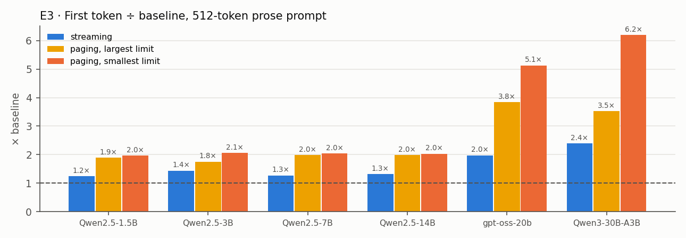

*Figure: streaming costs 1.2–2.4× on the long prompt; paging up to 6× on the mixtures of experts*

**What it means.** Streaming costs 1.2–1.4× on the 512-token prompt for dense models and 2.0–2.4× for the mixtures of experts, more on short chat prompts (the prompt pass is one full read of the weights). Kernel paging costs about 2× on dense models and 3.5–6× on the mixtures of experts on the long prompt, up to 11× on short prompts (11–26 s for Qwen3-30B-A3B), because the first pass touches nearly every expert. If time to first token matters, paging on a mixture of experts needs a warm-up.

## E4. Replication of the mixture-of-experts paging rows with the host cache cleared

**Why.** The gpt-oss paging numbers in E1 were 3–4× worse than the first measurement (C7). One hypothesis: during the sweep the host held 79 GB of cached files (downloads and splits), and global memory pressure might evict the pod's hot experts. This test removes that pressure.

**How.** Evict all large files from the page cache (79 → 51 GB cached, 26 → 54 GB free), then re-measure every kernel-paging configuration of both mixtures of experts, all three prompts, 3 repetitions (45 runs).

| model | limit | prompt | sweep | replication (cache cleared) | difference |
|---|---|---|---|---|---|
| gpt-oss-20b | 26 GiB | prose 512 | 447 ms | 478 ms | +7% |
| gpt-oss-20b | 26 GiB | chat: summary | 519 ms | 504 ms | -3% |
| gpt-oss-20b | 26 GiB | chat: code | 590 ms | 584 ms | -1% |
| gpt-oss-20b | 16 GiB | prose 512 | 1120 ms | 1110 ms | -1% |
| gpt-oss-20b | 16 GiB | chat: summary | 1190 ms | 1177 ms | -1% |
| gpt-oss-20b | 16 GiB | chat: code | 1194 ms | 1248 ms | +5% |
| Qwen3-30B-A3B | 38 GiB | prose 512 | 465 ms | 445 ms | -4% |
| Qwen3-30B-A3B | 38 GiB | chat: summary | 422 ms | 467 ms | +11% |
| Qwen3-30B-A3B | 38 GiB | chat: code | 413 ms | 423 ms | +2% |
| Qwen3-30B-A3B | 26 GiB | prose 512 | 692 ms | 678 ms | -2% |
| Qwen3-30B-A3B | 26 GiB | chat: summary | 822 ms | 805 ms | -2% |
| Qwen3-30B-A3B | 26 GiB | chat: code | 683 ms | 672 ms | -2% |
| Qwen3-30B-A3B | 16 GiB | prose 512 | 1266 ms | 1229 ms | -3% |
| Qwen3-30B-A3B | 16 GiB | chat: summary | 1297 ms | 1317 ms | +2% |
| Qwen3-30B-A3B | 16 GiB | chat: code | 1030 ms | 1026 ms | 0% |

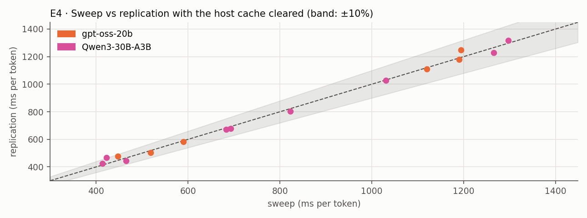

*Figure: all 15 configurations reproduce within 10%: host cache pressure was not the cause*

**What it means.** All 15 configurations reproduce within 10%, and 12 of 15 within 4%. Host page-cache pressure did not distort the sweep; the E1 paging numbers stand. The cause of the earlier, better gpt-oss figure had to be elsewhere (E5).

## E5. Why gpt-oss paging looked like 1.87× before: the degenerate prompt

**Why.** The first gpt-oss paging runs used the original repetitive prompt (`prompt.txt`, 373 tokens tiled to 512). On that prompt gpt-oss generates the token "…" sixteen times in a row. A repeated token routes to the same experts at every step, so a cache of hot experts would hit almost every time.

**How.** Same deployment type, page cache cleared, the old repetitive prompt: 16 GiB limit with 32 and 64 generated tokens, 26 GiB, and the baseline (12 runs). Compared with the same limits on the real prose prompt from the sweep.

| configuration | prompt | per token | vs baseline |
|---|---|---|---|
| baseline | repetitive | 154 ms | 1.00× |
| paging 26 GiB | repetitive | 207 ms | 1.34× |
| paging 16 GiB | repetitive | 284 ms | 1.85× |
| paging 16 GiB, 64 tokens | repetitive | 207 ms | 1.34× |
| baseline | real prose | 151 ms | 1.00× |
| paging 26 GiB | real prose | 447 ms | 2.96× |
| paging 16 GiB | real prose | 1120 ms | 7.42× |
| first measurement, 16 GiB (1–2 Oct) | repetitive | 314 ms | 1.87× |

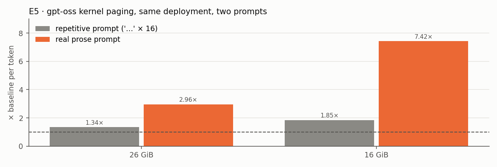

*Figure: the repetitive prompt reproduces the old 1.87× (1.85×); real text costs 7.4×*

**What it means.** With the repetitive prompt the 16 GiB limit gives 284 ms (1.85×), reproducing the first measurement's 1.87× almost exactly; with real prose the same deployment gives 1120 ms (7.4×). The earlier figure described a degenerate output, not normal text. The gpt-oss report, the record, the summary, the explainer and the video were corrected. Lesson: check that generated tokens are not degenerate before trusting a cache-sensitive result.

# Part F. Correctness of the outputs

## F1. Is every output the same as the baseline?

**Why.** All approaches except speculative decoding compute exactly what the baseline computes, just with weights coming from a different place, so their output must be identical. Speculative decoding keeps only tokens the big model itself chose, so it should be identical too, except where bf16 rounding of a differently shaped computation picks the other side of a near-tie.

**How.** Every run's generated tokens compared one by one with the same round's baseline, computed here from the raw files.

| experiment | runs identical | runs diverging | where they diverge |
|---|---|---|---|
| 3B experiment 1 (cyclic, controls) | 189 | 0 | — |
| 3B experiment 2 (alternatives) | 132 | 30 | token 15 of the 128-token prompt (speculative and batched runs) |
| 3B single-pod streaming | 54 | 0 | — |
| gpt-oss experiment 1 | 162 | 0 | — |
| gpt-oss experiment 2 | 153 | 0 | — |
| optimisation round 1 | 30 | 0 | — |
| optimisation round 2 | 54 | 6 | token 32 of the summary prompt |
| optimisation round 3 | 48 | 12 | token 36 of explain, token 32 of summary |
| optimisation round 4 | 55 | 5 | token 36 of explain, token 32 of summary |
| six models: streaming and paging | 171 | 0 | — |
| six models: tree speculation | 34 | 11 | five near-tie tokens (F2) |
| paging replication (E4) | 45 | 0 | — |
| degenerate-prompt recheck (E5) | 9 | 0 | — |

Total: **1136 of 1200 non-baseline runs identical**; the 64 others diverge at one of eight near-tie tokens, never elsewhere.

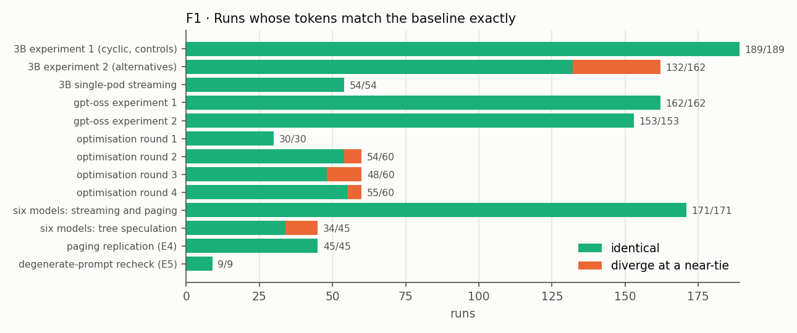

*Figure: every non-speculative run is identical; speculative and batched runs diverge only at near-ties*

**What it means.** Every streaming, partial-residency, kernel-paging and control run reproduces the baseline exactly. All divergences come from runs whose computation has a different shape (speculative verify passes, batched passes) and all sit at a handful of specific tokens. F2 shows those tokens are near-ties.

## F2. The divergences are near-ties, not bugs

**Why.** If a divergence were a bug, the model in full precision would clearly prefer one token. If it is a near-tie, the top two candidates are almost equal and bf16 rounding can tip either way.

**How.** At each divergence position, the full model in fp32 (`tie_check.py`, and `fp32_ref.py` which streams the model layer by layer in fp32 so even the 30B fits in a few GB) gives the top-2 logits and their gap.

| where | token | fp32 first choice | fp32 second | gap (logits) | gap (%) | baseline picked | other run picked | fp32 agrees with |
|---|---|---|---|---|---|---|---|---|
| 3B, 128-token prompt (exp. 2) | 15 | "simplicity" 18.532 | "power" 18.437 | 0.095 | 0.51% | "power" | "simplicity" | speculative / batched |
| 3B, chat explain (rounds 3–4) | 36 | "frequently" 30.392 | "copies" 30.329 | 0.063 | 0.21% | "copies" | "frequently" | speculative |
| 3B, chat summary (rounds 2–4) | 32 | "increased" 25.998 | "made" 25.945 | 0.053 | 0.20% | "increased" | "made" | baseline |
| 1.5B, prose (six models) | 10 | "move" 21.428 | "load" 21.356 | 0.072 | 0.34% | "load" | "move" | speculative |
| 7B, prose (six models) | 23 | "seem" 22.108 | "look" 22.047 | 0.061 | 0.28% | "look" | "seem" | speculative |
| 7B, chat summary (six models) | 4 | "measured" 23.611 | "replaced" 23.337 | 0.274 | 1.16% | "measured" | "replaced" | baseline |
| 14B, prose (six models) | 5 | "solution" 15.603 | "only" 15.549 | 0.054 | 0.35% | "solution" | "only" | baseline |
| 30B-A3B, prose (six models) | 16 | "." 27.819 | "," 27.603 | 0.216 | 0.78% | "." | "," | baseline |

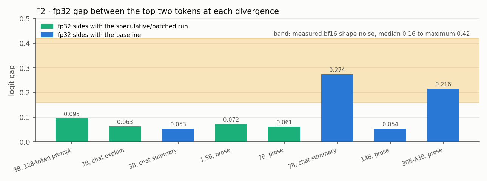

*Figure: every gap is below the largest bf16 shape noise measured; six of eight are below even its median*

**What it means.** At every divergence the top two tokens are within 0.05–0.27 logit points (0.2–1.2%) of each other in fp32. Six of the eight gaps are smaller than even the median bf16 shape noise (0.16, F3), and all eight are smaller than the largest shift measured on each model (0.28 and 0.42). The full-precision model sides with the speculative run four times and with the baseline four times, so neither is "wrong": both are valid bf16 roundings of a tie. The same divergence can even change between repetitions (7B prose: 2 of 3 runs matched).

## F3. How large is bf16 rounding noise?

**Why.** F2's argument needs a number: how much do logits move when the same position is computed in a different shape?

**How.** On two small models (Qwen2.5-0.5B, Qwen3-0.6B), 20 positions each: logits from one full-sequence pass vs. a prefix pass plus a single-token step with the cache, both in bf16.

| model | positions | median max-\|Δ logit\| | largest | top-1 flips |
|---|---|---|---|---|
| Qwen2.5-0.5B | 20 | 0.160 | 0.281 | 1 of 20 |
| Qwen3-0.6B | 20 | 0.234 | 0.422 | 0 of 20 |

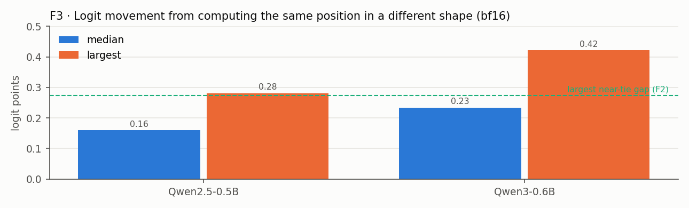

*Figure: shape alone moves logits by up to 0.28–0.42 points, more than any near-tie gap*

**What it means.** Computing the same position in a different shape moves bf16 logits by 0.16–0.23 points at the median and up to 0.42, and flipped the top token once in 40 positions. The largest shifts (0.28 and 0.42) exceed every near-tie gap in F2 (at most 0.274), and the medians exceed six of the eight, so those divergences are expected bf16 behaviour, not bugs. Exact-output claims for speculative decoding in bf16 should therefore always be checked against an fp32 reference.

# Part G. What went wrong during testing, and what was done

| problem | how it was found | what was done | effect on results |
|---|---|---|---|
| Page cache served 'disk' reads (kernel paging, twice) | a 1.5 GiB pod ran at full speed | deploy, then drop the cache, then measure | first two attempts discarded |
| Root-owned weight files blocked the cache drop (gpt-oss) | cgroup peak 0.95 GB at every limit | files made readable, 15 rows rerun | rows discarded and rerun |
| Single-pod deadlock at 2048 tokens | thread dumps | chain consecutive groups in-process | 2 rows discarded |
| Repetitive prompt inflated speculative decoding (3B) | 100% draft acceptance | 750-token non-repeating text | artifact rows excluded (B8) |
| Direct I/O 'faster than the link' (btrfs fallback) | 11 GB/s on a 7.5 GB/s link; 48% of files in cache | end-of-file-safe loader that evicts fallbacks | round-1 direct rows invalid (D1) |
| Degenerate '…' output inflated gpt-oss paging | six-model test disagreed with C7 | replication (E4) and recheck (E5) | gpt-oss paging corrected to 7.4–8.0× |
| Other users' load on halo | baselines up to 40% higher in some rounds | same-round comparisons only | flagged in D4–D5 and E |
| Report errors (units, run counts, cross-references) | independent re-checks of every number | 100+ corrections applied | reports corrected |
| Sweep script copied without its executable bit; a process check matched itself | empty logs | relaunched | none |
| Remote connection to the test machine dropped | ssh timeouts | reconnect; sweeps ran unattended on the machine | none |

# Appendix. Data files

| file | content | runs |
|---|---|---|
| results/qwen2.5-3b/results.jsonl | 3B experiment 1: cyclic streaming | 219 |
| results/qwen2.5-3b/results2.jsonl | 3B experiment 2: alternatives | 195 |
| results/qwen2.5-3b/results3.jsonl | 3B single-pod streaming | 63 |
| results/gpt-oss-20b/results.jsonl | gpt-oss experiment 1 | 192 |
| results/gpt-oss-20b/results2.jsonl | gpt-oss experiment 2 | 183 |
| results/qwen2.5-3b/results4.jsonl | optimisation round 1 | 33 |
| results/qwen2.5-3b/results5.jsonl | optimisation round 2 | 72 |
| results/qwen2.5-3b/results6.jsonl | optimisation round 3 | 72 |
| results/qwen2.5-3b/results7.jsonl | optimisation round 4 | 75 |
| results/six-models/qwen2.5-1.5b.jsonl | six-model test: Qwen2.5-1.5B | 45 |
| results/six-models/qwen2.5-3b.jsonl | six-model test: Qwen2.5-3B | 45 |
| results/six-models/qwen2.5-7b.jsonl | six-model test: Qwen2.5-7B | 45 |
| results/six-models/qwen2.5-14b.jsonl | six-model test: Qwen2.5-14B | 45 |
| results/six-models/gpt-oss-20b.jsonl | six-model test: gpt-oss-20b | 36 |
| results/six-models/qwen3-30b-a3b.jsonl | six-model test: Qwen3-30B-A3B | 54 |
| results/six-models/*_paging2.jsonl | six-model test: kernel-paging replication | 45 |
| results/six-models/gptoss_paging_recheck.jsonl | six-model test: degenerate-prompt recheck | 12 |
| **total** |  | **1,431** |

Charts in this report: `charts/detailed/*.png` (generated by `scripts/make_detailed_report.py` from the data above) and `charts/models.png` (from `scripts/analyze_models.py`). Other documents: `docs/REPORT.md` (decision rules), `docs/FULL_RECORD.md` (lab record), and in `docs/archive/` the earlier reports `FINAL_REPORT.md` (3B), `FINAL_REPORT_GPTOSS.md` and `REPORT_MODELS.md` (six models).
