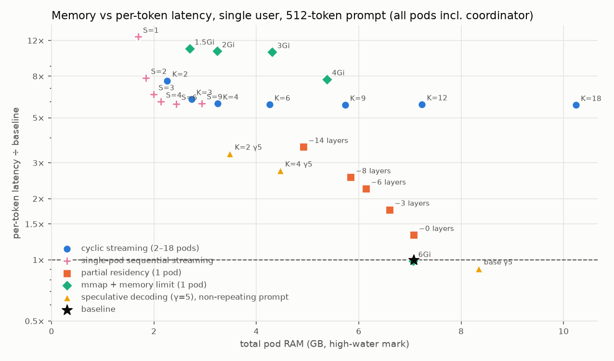
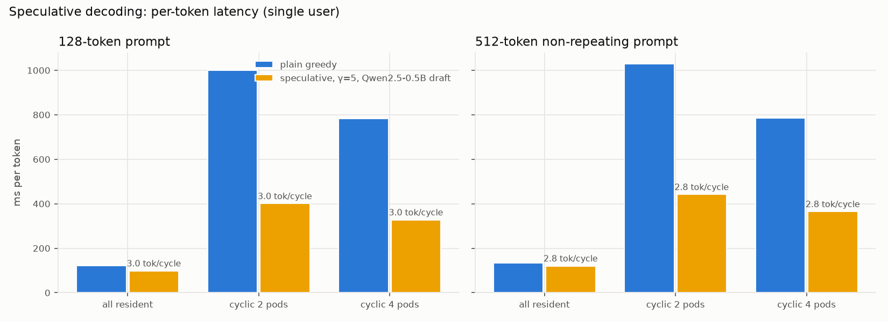
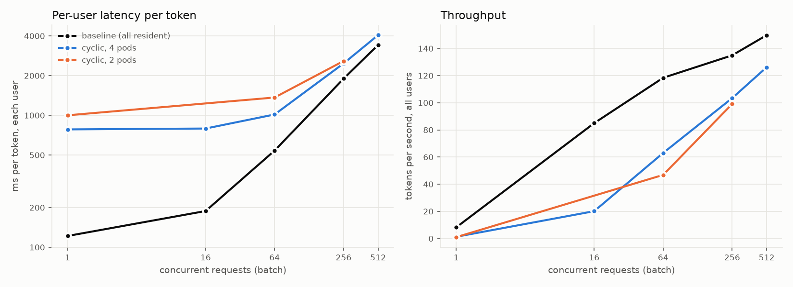

# Serving a 3B model with less memory: cyclic layer streaming and four alternatives

> **Archived report**, superseded by [`../REPORT.md`](../REPORT.md) and kept for the record. Paths refer to the original experiment directory on the test machine (hostname *halo*); see the note at the top of [`../FULL_RECORD.md`](../FULL_RECORD.md) for where code and data are in this repository.

**Machine:** `halo`, AMD Ryzen AI Max+ 395 (16 cores / 32 threads), 125 GB RAM, Micron 4600 NVMe on a PCIe 4.0 ×4 link (7.1 GB/s measured). **Model:** Qwen2.5-3B-Instruct, bf16, 36 layers, 5.55 GB of layer weights + 0.62 GB embedding/output matrix. **Runtime:** PyTorch on CPU, single-node k3d cluster pinned to 16 hardware threads. **Runs:** 24–28 Sep 2026.
Sizes are decimal GB. "Baseline" = the whole model in one pod. "Per token" = time per generated token for one user. All raw data, tables and charts are in `~/cyclic-exp/results/` on halo.

## 1. Question and answer

**Question.** Can we serve the model with much less memory by cycling groups of layers through K pods (each pod computes its group, frees it, and loads its next group from NVMe while the other pods work), and keep the same latency as the whole model in memory?

**Answer.** Memory: yes. Latency: no, not on this machine, and no number of pods fixes it.
- 2 pods with one layer each in memory use **85% less weight memory** (0.93 GB instead of 6.17 GB) and **68% less total RAM** (2.26 GB instead of 7.07 GB, all pods included).
- Prompt processing stays within noise of the baseline for long prompts (2048 tokens, 2 pods), and is 1.2–2.8× slower for short ones.
- **Generating tokens takes 0.77–1.07 s per token with any number of pods (2 to 18): 6–8× slower than the baseline for 128/512-token prompts, 3.6–5× for 2048-token prompts (where the baseline itself slows to 214 ms).** Every generated token needs all 36 layers, so all 5.55 GB are re-read from disk per token. The disk tops out at 7.1 GB/s → 0.78 s per token, against 0.13 s for the baseline. Adding pods only adds concurrent readers on the same disk.

Four alternatives were then measured on the same rig. None reaches baseline latency while saving memory. The table below is the whole story; the rest of the report is the evidence.

## 2. All approaches, one table

Single user, 512-token prompt, 16–32 generated tokens, 3–10 repetitions (the batching rows: 128-token prompt, 2 repetitions, 1 at 512 requests). Memory = high-water mark of all pods including the coordinator. Baseline: 7.07 GB, 133 ms per token, 1.40 s to first token.

| Approach | Config | Total RAM | RAM saved | Per token | vs baseline | First token vs baseline | Output |
|---|---|---|---|---|---|---|---|
| **Baseline** | 36 layers in one pod | 7.07 GB | – | 133 ms | 1.0× | 1.0× | – |
| **Cyclic streaming** | 2 pods, 1 layer each | 2.26 GB | **68%** | 1013 ms | 7.6× | 1.34× | identical |
| | 4 pods | 3.25 GB | 54% | 781 ms | 5.9× | 1.47× | identical |
| | 9 pods | 5.73 GB | 19% | 770 ms | 5.8× | 1.43× | identical |
| | 18 pods | 10.24 GB | −45% (more) | 769 ms | 5.8× | 1.47× | identical |
| **Single-pod sequential streaming** (one pod, all 36 layers streamed in order through S prefetch slots) | 1 slot (no prefetch) | 1.69 GB | 76% | 1664 ms | 12.5× | 2.03× | identical |
| | 2 slots | 1.85 GB | 74% | 1044 ms | 7.85× | 1.35× | identical |
| | 4 slots | 2.14 GB | **70%** | 798 ms | 6.0× | 1.43× | identical |
| | 6 slots | 2.44 GB | 66% | 778 ms | 5.85× | 1.39× | identical |
| **Partial residency** (1 pod) | 30 layers pinned, 6 streamed through 3 slots (−3 layers) | 6.60 GB | 7% | 235 ms | 1.8× | 1.09× | identical |
| | 27 pinned, 9 streamed / 3 slots (−6) | 6.14 GB | 13% | 298 ms | 2.2× | 1.00× | identical |
| | 24 pinned, 12 streamed / 4 slots (−8) | 5.84 GB | 17% | 339 ms | 2.6× | 1.08× | identical |
| | 18 pinned, 18 streamed / 4 slots (−14) | 4.92 GB | 30% | 478 ms | 3.6× | 1.19× | identical |
| **mmap + memory limit** (1 pod, kernel paging) | limit 4 GiB | 5.38 GB | 24% | 1029 ms | 7.7× | 1.60× | identical |
| | limit 2 GiB | 3.23 GB | 54% | 1413 ms | 10.6× | 1.88× | identical |
| | limit 1.5 GiB | 2.70 GB | 62% | 1455 ms | 10.9× | 1.95× | identical |
| **Cyclic + speculative decoding** (0.5B draft model in the coordinator) | 2 pods, γ=5 | 3.48 GB | **51%** | 441 ms | **3.3×** | 1.66׆ | identical |
| | 4 pods, γ=5 | 4.47 GB | 37% | 365 ms | 2.75× | 1.61׆ | identical |
| | 4 pods, γ=8 | 4.53 GB | 36% | 371 ms | 2.8× | 1.55׆ | identical |
| Speculative decoding alone | all 36 layers resident + draft | 8.35 GB | −18% (more) | 120 ms | 0.91× | 1.05׆ | identical |
| **Cyclic + batching** (128-token prompt, per user) | 4 pods, 64 concurrent requests | see §5.4 | | 1015 ms | 1.9× the batched baseline | – | tie* |
| | 4 pods, 256 concurrent | | | 2475 ms | 1.3× | – | tie* |
| | 4 pods, 512 concurrent | | | 4058 ms | 1.19× | – | tie* |

\* identical except one near-tie token that flips under different bf16 rounding; see §7.
† Speculative rows were measured with the non-repeating 750-token text (§5.3); their first-token ratio is against that prompt's own all-resident baseline (1.26 s; same 133 ms per token and 7.07 GB as the header baseline). Against the header's 1.40 s they would be 1.50×, 1.45×, 1.40× and 0.95×.



**What you win each time:**
- Cyclic streaming: the largest memory saving (68–71%), at 6–8× the per-token latency (128/512-token prompts; 3.6–5× at 2048 tokens). Prompt processing of long prompts is unaffected.
- Single-pod sequential streaming: the same cycle inside one pod reaches the same 0.78 s floor (from 4–6 slots) with 0.4–1.8 GB less RAM than the multi-pod version at equal latency (2.44 vs 4.26 GB at 0.78 s): one runtime instead of K, no hops. It dominates the multi-pod cyclic version at every point; the pods were only ever a way to get several concurrent NVMe readers.
- Partial residency: small savings (7–30%) at 1.8–3.6×. Even streaming zero layers costs 1.33× because background disk reads slow the compute (memory-bandwidth contention).
- mmap + memory limit: the same disk floor with worse execution (page faults, single reader): 8–11× at 24–62% saving. Zero engineering, worst result. Also easy to measure wrongly (§5).
- Speculative decoding on top of cyclic: cuts the cyclic penalty by 2.3× (1013 → 441 ms) for 1.2 GB of extra RAM (the draft model): 51% less RAM at 3.3×. Taken further in §6b (single pod, tree speculation, lean drafter): **198–248 ms, 1.7–2.2× at −51 to −54%**, the best single-user trade-off measured.
- Batching: the only way the gap closes. With 256–512 concurrent requests the cyclic pipeline delivers 76–84% of the baseline's throughput while holding 4 of 36 layers in memory.

## 3. What was built

```
 coordinator ──► stage-0 ──► stage-1 ──► … ──► stage-(K-1) ──► stage-0 ──► … ──► coordinator
 (tokenizer,      layer 0     layer 1           layer K-1        layer K            (output layer → next token)
  embeddings,       ↓ free it, load layer K from NVMe while the others compute
  sampling,
  draft model)
```

- Each layer is one 154 MB `safetensors` file. Stage pod *i* owns groups `i, i+K, i+2K, …`; a group is 36/G consecutive layers (one layer in the main configuration). A pod holds one streamed group at a time (or `SLOTS` of them), plus any pinned groups. The loader calls `posix_fadvise(DONTNEED)` around every read so weights never stay in the page cache: every reload is a real NVMe read.
- The coordinator does tokenizer, embeddings, final norm, output layer, greedy sampling, and (when enabled) the draft model for speculative decoding. It is present and identical in every configuration, including the baseline (~1.0 GB RAM, 0.62 GB of it weights).
- Modes: `resident` (everything pinned: baseline and controls), `cyclic` (streamed), `K=1 SLOTS=S` (single-pod sequential streaming, §5.5), `RESIDENT=0-29 SLOTS=3` (partial residency), `LOAD_MODE=mmap` + a k8s memory limit (kernel paging), `DRAFT=…` (speculative), `BATCH=B` (B independent prompts in lockstep).
- Prompts: 128, 512 and 2048 tokens of a technical text; a second, 750-token non-repeating text for the speculative runs (see §5.3 for why). 16 generated tokens per run (32 for speculative). Repetitions: 3 per configuration; 10 for the default-prompt baselines (run as 5 + 5); 3 for the non-repeating-prompt baseline; 2 for batched runs, and a single run at 512 concurrent requests.
- Only the number of pods matters for latency, not the grouping: every 2-pod configuration is ~1.0 s per token whether 2 or 18 layers are in memory (G = 36 … 4). One layer per pod gives the same latency with the least memory, so all results below use it.

## 4. Cyclic streaming (the original idea)

Details, all 66 configuration × prompt rows and the per-pod breakdown are in `REPORT.md`. The essentials:


**Memory** (one layer per pod, 128-token prompt, stage pods only): weights `1 − K/36` → 94% saved with 2 pods, 89% with 4, 50% with 18. Each pod adds ~250 MB of runtime plus its share of the 151 MB KV cache, so total RAM breaks even with the baseline at about 14 pods. Long prompts add 0.8–0.9 GB of temporary activations *per pod*, which multiplies with K (18 pods at 2048 tokens peaked at 22.5 GB).

**Prompt processing** (time to first token): 2048-token prompt with 2 pods, 6.66 s vs 6.67 s baseline (within the ~10% run-to-run noise); every other configuration 5–15% slower. 512 tokens: 1.2–1.5×. 128 tokens: 2–2.8×. With a long prompt each layer computes for 166 ms while a load takes 41 ms, so loads finish in the background (0–22 ms of waiting per prefill); short prompts don't give the loads enough cover.

**Token generation:** 1013 ms per token with 2 pods, 822 with 3, then flat at 770–790 ms from 4 to 18 pods. Where the time goes (512-token prompt, 4 pods): 464 ms waiting for weights, 269 ms compute, 35 ms pod-to-pod hops, ~15 ms coordinator.

**Why more pods don't help.** The hiding condition is *load time ≤ compute time of the other K−1 pods*. Alone, a layer loads in 41 ms and computes in 3.5 ms, so ~13 pods should do. Three things break it:
1. Pods share one disk. With K pods, ~K reads are in flight, and each load slows down: 49 ms with 2 pods, 78 with 4, 231 with 12, 318 with 18. More pods add head start and load time in equal measure.
2. The disk saturates: 4.1 GB/s with one reader, 6.1 with two, 7.0 with four, 7.1 from eight on. Each token re-reads 5.55 GB → 0.78 s minimum from 4 pods on. This is the flat line.
3. Loading slows computing: compute per layer rises from ~4 ms (pods, nothing loading) to 5–9 ms while other pods load (shared memory bandwidth and/or CPU time in the loader; not separated).

Reaching baseline latency this way would need ~43 GB/s of weight bandwidth (5.55 GB in 130 ms), 6× this NVMe.

## 5. Alternatives

### 5.1 Partial residency: keep most layers, stream the last few (one pod)

No pipeline, no hops. The last *m* layers are streamed through *s* slots; the loads for the next token run while the pinned layers compute.

| Pinned / streamed / slots | Layers saved | Total RAM | Per token (512) | vs baseline |
|---|---|---|---|---|
| 33 / 3 / 3 | 0 | 7.08 GB (0%) | 176 ms | 1.33× |
| 30 / 6 / 3 | 3 | 6.60 GB (−7%) | 235 ms | 1.76× |
| 27 / 9 / 3 | 6 | 6.14 GB (−13%) | 298 ms | 2.24× |
| 24 / 12 / 4 | 8 | 5.84 GB (−17%) | 339 ms | 2.55× |
| 18 / 18 / 4 | 14 | 4.92 GB (−30%) | 478 ms | 3.59× |

- The first row saves nothing and still costs 1.33×: the background reads (3 layers per token, ~0.46 GB) slow the compute of the pinned layers. Hidden loads are not free on this chip.
- Every layer saved beyond the slot count costs one extra load per token: ~20–30 ms each after overlap (35–40 ms raw at a single reader's 4.1 GB/s).
- First-token latency is unaffected for the 512- and 2048-token prompts (0.95–1.19×, within noise) but 1.17–1.47× at 128 tokens, where the short prefill does not cover the streamed-layer loads.

### 5.2 mmap + memory limit: let the kernel do it (one pod)

Weights memory-mapped from the files, no explicit loading, pod memory capped with a Kubernetes limit (cgroup). The kernel evicts pages under pressure and faults them back in on access.

| Limit | Pod RAM at peak | Total RAM | Per token (512) | vs baseline | First token (512) |
|---|---|---|---|---|---|
| 6 GiB (everything fits) | 6.0 GB | 7.07 GB (0%) | 131 ms | 0.99× | 0.91× |
| 4 GiB | 4.3 GB | 5.38 GB (−24%) | 1029 ms | 7.7× | 1.60× |
| 3 GiB | 3.2 GB | 4.31 GB (−39%) | 1399 ms | 10.5× | 1.90× |
| 2 GiB | 2.15 GB | 3.23 GB (−54%) | 1413 ms | 10.6× | 1.88× |
| 1.5 GiB | 1.6 GB | 2.70 GB (−62%) | 1455 ms | 10.9× | 1.95× |

- Same disk floor as cyclic streaming, worse execution: the pod is a single reader. If all 5.55 GB are re-faulted per token, the 1.5–3 GiB rows correspond to 5.55 GB / 1.40–1.46 s ≈ 3.8–4.0 GB/s (≈ 4.2–4.4 GB/s after subtracting the 0.13 s of compute), i.e. the 4.1 GB/s of one reader in the disk test, against 7.1 GB/s for the 4-pod pipeline. At equal memory (3.2 GB) the explicit 4-pod pipeline is 1.8× faster (781 vs 1413 ms).
- **Measurement trap.** The first two attempts showed 133 ms per token at a 1.5 GiB limit, identical to no limit. The weights were being served from the host page cache, put there by an earlier pod; a cgroup only charges pages the pod itself faults in. The pod "used" 1.6 GB while the node still held all 5.55 GB of its weights. The numbers above are from a third run where the page cache was dropped after the old pod was gone and before the new one touched the files. Memory limits on memory-mapped models do not reduce host memory unless nothing else has the file cached.

### 5.3 Cyclic streaming + speculative decoding

A Qwen2.5-0.5B draft model (0.99 GB, kept in the coordinator) proposes γ tokens; the streamed 3B model checks all of them in one pass through the pipeline (a γ+1-token mini-prompt) and keeps the prefix it agrees with, plus one token of its own. One cycle of disk reads therefore yields several tokens. The output is the 3B model's own greedy output.

Measured with the non-repeating 750-token text, 512-token prompt, 32 generated tokens:

| Config | Accepted drafts per cycle | Tokens per cycle | Draft time | Verify time | Cycle | Per token | vs baseline | Total RAM |
|---|---|---|---|---|---|---|---|---|
| all resident + draft, γ=5 | 1.82 / 5 | 2.8 | 167 ms | 137 ms | 309 ms | 120 ms | 0.91× | 8.35 GB (+18%) |
| cyclic 2 pods + draft, γ=5 | 1.82 / 5 | 2.8 | 194 ms | 1008 ms | 1209 ms | 441 ms | 3.3× | 3.48 GB (−51%) |
| cyclic 4 pods + draft, γ=5 | 1.82 / 5 | 2.8 | 212 ms | 778 ms | 994 ms | 365 ms | 2.75× | 4.47 GB (−37%) |
| cyclic 4 pods + draft, γ=8 | 2.10 / 8 | 3.1 | 321 ms | 786 ms | 1114 ms | 371 ms | 2.8× | 4.53 GB (−36%) |

Tokens per cycle = accepted drafts + 1. Draft, verify and cycle are medians; per token = total decode time ÷ (tokens − 1).



- The verify pass costs the same as a plain token (it is disk-bound), but produces 2.8 tokens: the cyclic penalty drops from 7.6× to 3.3× (2 pods) and from 5.9× to 2.75× (4 pods).
- The draft model is slow on CPU: ~35–40 ms per drafted token, 170–320 ms per cycle. That is why speculative decoding alone barely helps the all-resident model here (0.91×). A GPU-resident draft model would change this.
- More drafts (γ=8) don't help: acceptance falls (2.1 of 8) and drafting costs more.
- **Prompt caveat.** With the original test text, whose paragraphs repeat, the 512- and 2048-token prompts made the model continue the repetition and the draft was right 100% of the time (6.0 tokens per cycle, 0.47× on the baseline). Those numbers are in `results/summary2_tables.md` but are an artifact of the prompt and are not used here.

### 5.4 Cyclic streaming + batching

B independent prompts (128 tokens each) generated in lockstep. Per-user latency is the time per step; throughput is B tokens per step.

| Concurrent requests | Baseline per user | Cyclic 4 pods per user | Cyclic ÷ baseline | Baseline tok/s | Cyclic 4 pods tok/s | Cyclic 2 pods per user / tok/s |
|---|---|---|---|---|---|---|
| 1 | 122 ms | 783 ms | 6.4× | 8 | 1.3 | 1001 ms / 1 |
| 16 | 188 ms | 795 ms | 4.2× | 85 | 20 | – |
| 64 | 541 ms | 1015 ms | 1.9× | 118 | 63 | 1366 ms / 47 |
| 256 | 1897 ms | 2475 ms | 1.3× | 135 | 103 | 2582 ms / 99 |
| 512 | 3418 ms | 4058 ms | 1.19× | 150 | 126 | – |



- The disk cost per step is fixed (~0.78 s) while compute grows with the batch, so the gap closes: at 512 concurrent requests the cyclic pipeline is 19% slower per user and delivers 84% of the baseline's throughput, with 4 layers instead of 36 in memory.
- Per-user latency never drops below the ~0.78 s floor; batching helps throughput, not the single user.
- Memory in this table is not comparable to the single-user rows: the high-water marks (18.7 GB baseline, 36 GB for 4 cyclic pods at B=512) are dominated by the prefill of 512×128 tokens at once, which each pod performs in turn. Steady-state memory for batched serving was not measured; the KV cache alone is 37 KB per token per request (36,864 bytes; 3.6 GB at 512 requests × 192 positions), identical for both sides.
- The batched attention in this implementation is not optimized (the baseline's per-user latency grows to 3.4 s at B=512); ratios are meaningful, absolute batched numbers are not.
- Batched configurations were run twice at 16/64/256 requests and once at 512, so the 1.19× and 84% figures rest on one run per side.

### 5.5 Single-pod sequential streaming: the same cycle without pods

One pod computes the 36 layers in order. After finishing layer *i* it frees it and starts loading layer *i+S*, so up to S layers are in memory and up to min(S, 4) reads are in flight. With S=1 there is no prefetch at all (load, compute, load, compute). 512-token prompt; memory includes the coordinator:

| Slots (layers in memory) | Total RAM | RAM saved | Per token | vs baseline | First token vs baseline | Reads in flight |
|---|---|---|---|---|---|---|
| 1 | 1.69 GB | 76% | 1664 ms | 12.5× | 2.03× | 1, no overlap |
| 2 | 1.85 GB | 74% | 1044 ms | 7.85× | 1.35× | 2 |
| 3 | 1.99 GB | 72% | 868 ms | 6.5× | 1.36× | 3 |
| 4 | 2.14 GB | 70% | 798 ms | 6.0× | 1.43× | 4 |
| 6 | 2.44 GB | 66% | 778 ms | 5.85× | 1.39× | 4 |
| 9 | 2.93 GB | 59% | 784 ms | 5.9× | 1.44× | 4 |

- S=1 is the arithmetic of no overlap: 36 × (41 ms load + ~4 ms compute) ≈ 1.65 s.
- Each extra slot adds one concurrent reader until the NVMe saturates: 2 readers ≈ 6.1 GB/s → ~1.0 s, 4 readers ≈ 7.0 GB/s → 0.80 s, then flat at 0.78 s. Exactly the curve of the multi-pod version against K (§4), which shows that the pod count never mattered by itself; the number of concurrent reads did.
- At equal latency the single pod uses less RAM than K pods: 2.14 GB vs 3.25 GB at ~0.79 s (4 slots vs 4 pods), 2.44 GB vs 4.26 GB at 0.78 s (6 slots vs 6 pods). One Python/PyTorch runtime instead of K, and no activations travelling between pods.
- With a 2048-token prompt, first-token time is 1.03–1.19× the baseline: the loads are hidden behind the long prefill as before. Output identical in every run.
- Not measured: single-pod streaming combined with speculative decoding (expected ≈ 3.0 GB at ~440 ms, i.e. the §5.3 result minus one pod's runtime).

Run with `python3 deploy.py 36 1 cyclic SLOTS=4`; raw data in `results/results3.jsonl`.

## 6. Recommendation

- **Single user, must keep latency:** keep the model in memory. Nothing that streams weights from this NVMe gets closer than 1.3× at the 512-token prompt (1.13× at 2048 tokens, where the longer per-token compute hides more of the loads), and that configuration (33 layers pinned, 3 streamed) saves no memory. The needed weight bandwidth is ~43 GB/s; a second NVMe or a PCIe 5.0 link gives ~2×, not 6×.
- **Single user, plain streaming:** do it in one pod with 4–6 prefetch slots (§5.5), not across pods: 66–70% less RAM at 6× per-token latency; the multi-pod cycle costs 0.4–1.8 GB more for the same speed.
- **Single user, best latency at half the memory (after the optimisation work, §6b):** single-pod streaming with 4 slots + tree speculation (65 nodes) with the lean drafter: 198–248 ms per token (1.7–2.2× baseline) at 3.2–3.4 GB; output identical to the baseline in 22 of 24 runs (one near-tie token otherwise).
- **Single user, memory matters more than latency (before §6b):** cyclic streaming with 2 pods plus speculative decoding — 51% less total RAM (weights in RAM 1.92 GB instead of 6.17 GB, −69%, of which 0.99 GB is the draft model; the 3B model's own layer weights are cut 94%, to 0.31 GB), 3.3× per-token latency, identical output. Without the draft model: 68% less RAM at 7.6×.
- **Many concurrent users:** cyclic streaming with 4 pods and batches of 256+: 76–84% of the baseline's throughput with 4 of 36 layers in memory. Batch size is bounded by KV-cache memory, not by weights.
- **Do not** use a memory limit on a memory-mapped model as a memory-saving technique: it is the slowest option and, unless the page cache is cold, it does not reduce host memory at all.
- Excluded on request: quantized storage (int8/int4 on disk), which would cut the bytes per cycle 2–4×.

## 6b. Making it faster at the same memory (latency optimisation, 2 Oct 2026)

Goal: keep the ~3.5 GB of the best speculative point and reduce per-token latency, exact output as far as bf16 allows (no quantization). Four prompts: the 512-token non-repeating prose text and three chat-style instructions (explain, summary, short code) in the model's chat template; 48 generated tokens, 3 repetitions (round 1 and the round-4 plain-streaming / partial-residency runs: 32 and 16 tokens); per-token = total decode time ÷ tokens. Baselines per token: 126–129 ms prose in rounds 1–2 (173 ms in round 3, whose prose baseline ran while other users loaded the machine; its chat baselines were normal), 110–123 ms on the chat prompts.

| Step | Configuration | Prose | Chat: explain | Chat: summary | Chat: code | RAM |
|---|---|---|---|---|---|---|
| start | chain γ=5, 2 pods (§5.3) | 428–441 ms (3.3×) | – | – | – | 3.49 GB |
| 1 | chain γ=5, **single pod, 4 slots** | 350 ms (2.7×; 32 tokens — 440 ms, 3.5×, over 48 tokens in round 2) | 315 ms (2.9×) | 301 ms (2.4×) | 260 ms (2.3×) | 3.1–3.4 GB |
| 2 | **tree speculation**, 23–65 nodes, HF drafter | 324 ms (2.6×) | 237 ms (2.15×) | 245 ms (2.0×) | 217 ms (1.95×) | 3.2–3.5 GB |
| 3 | tree 65 nodes, **lean drafter** (our layer code), 4 slots | **242 ms** (1.4× vs the same-round 173 ms baseline; 1.9× vs 126–129 ms) | 248 ms (2.2×) | **200 ms (1.7×)** | **198 ms (1.7×)** | 3.2–3.4 GB |

With 5 slots the 65-node tree gives 238 / 197 / 194 ms on the chat prompts at 3.4 GB, but 268 ms on prose at 3.6 GB.

- **Step 1** removes the pods: four reads in flight in one process saturate the drive (verify pass 1004 → 776 ms), no hops, one runtime. Over 48 tokens the chain is no faster than the 2-pod start on prose (440 ms), because acceptance drops later in the text (1.43 vs 1.82 drafts per cycle over the first 32 tokens).
- **Step 2** replaces the 5-token chain by a tree of candidates verified in one pass (SpecExec/Sequoia idea). The pass is disk-bound, so checking 23–65 candidates costs about the same as checking 5, and a wrong guess at position 2 no longer discards positions 3–5: tokens per disk read rise from 2.4–3.8 to 3.9–5.4. Trees of 129–201 nodes lost with this drafter: drafting took 0.4–1.5 s per cycle and the verify pass rose to 1.0–1.3 s.
- **Step 3** drafts with the 0.5B model run through our own layer code, with tree attention and the same KV compaction as the big model: one forward per tree level, no cache copies. Drafting a 65-node tree drops from 290–620 ms to 210–240 ms per cycle, which makes the 65-node tree the best or tied shape on every prompt (on explain, the 20-node deep tree is 239 vs 248 ms at 4 slots). The cycle is now ~80% verify pass (~860 ms = the streaming floor of ~0.8 s plus 50–90 ms of compute); drafting is 20–30% of it.
- **Output**: identical to the baseline in 48 of 60 round-3 runs. The 12 others (all nine summary-prompt runs of the 20/23/29-node trees, and one of three explain-prompt repetitions of the 65-node tree at 4 and at 5 slots and of the 29-node tree) diverge at one token per prompt where fp32 shows a near-tie (margins 0.05–0.06 logits, 0.2%), i.e. bf16 rounding of a differently shaped verify pass, as in §7. For the 65-node tree this means 22 of 24 runs identical per round (22 of 24 again in round 4); the divergence is not reproducible across repetitions of the same configuration.
- **Direct I/O**: a first set of results (483–505 ms for plain streaming) was an artifact: on halo's btrfs root filesystem O_DIRECT reads partly fall back to buffered I/O, and 48% of the weight files were found resident in the page cache right after those runs (`fincore.py`). With an EOF-safe loader the page cache no longer grows and the aggregate bandwidth is unchanged (6.8 vs 7.1 GB/s, link-bound); the cache-free microbench shows less compute slowdown during loads for single-token work (1.18× vs 1.44×) but not for prompt-sized work (1.65× vs 1.72×). **Round 4, end to end** (same configurations with and without direct I/O, back to back): no gain for streaming — 65-node tree 279 → 288 ms (prose), 284 → 288, 209 → 214, 200 → 205 ms (chat prompts); plain single-pod streaming 808 → 834 ms (16 tokens); only partial residency improves (209 → 195 ms, one reader plus heavy pinned compute) and first-token time for plain streaming (1.83 → 1.56 s). Not worth its complexity on this machine.
- **Round 4, tree size with the lean drafter**: a 129-node tree is slower than the 65-node tree on every prompt (331 vs 279, 315 vs 284, 261 vs 209, 238 vs 200 ms): the verify pass rises to 1.0–1.1 s and drafting to 270–410 ms while acceptance barely moves (4.2–5.9 vs 4.4–5.5 tokens per read). A deep, narrow 20-node tree (3,4,4,3,2,2,1) matches or beats the 65-node tree on the explain and code prompts (239 vs 284 and 197 vs 200 ms) at lower drafting cost, but is 10–16% slower on the summary prompt (242 vs 209 ms; 221 vs 200 in round 3, where its summary output also differs from the baseline) and worse on prose (335 ms). Round 4 ran while other users loaded the machine (baselines 143–172 ms instead of 110–129 in round 2 and in round-3 chat), so its tree numbers are 1–15% above round 3 and its chat baselines 24–41% above; only its within-round comparisons are used here.

Net: **from 441 to 198–248 ms per token (1.7–2.2× the normal baselines) at 3.2–3.4 GB (−51 to −54%)**; output identical to the baseline in 22 of 24 runs per round for the chosen configuration, the exceptions being one repetition on the explain prompt at a near-tie token. Best general configuration: `deploy.py 36 1 cyclic SLOTS=4 DRAFT_LAYERS=/exp/weights_05b TREE=8,16,16,12,8,4`; for the explain and code prompts `TREE=3,4,4,3,2,2,1` is as good and cheaper to draft, not for summary or prose. Remaining levers, in the order the data suggests: a tree shape chosen per prompt from the draft's confidence (Sequoia's optimizer), drafting asynchronously during the verify pass, and pinning the layers that fit in the leftover budget to cut bytes per read.

## 6c. Does the rule hold on other models? (4–5 Oct 2026)

Yes. The same protocol (baseline, single-pod streaming, streaming + 64-node tree speculation, kernel paging; prose + 2 chat prompts, 32 tokens, 3 repetitions) on Qwen2.5-1.5B / 3B / 7B / 14B and on two mixtures of experts (gpt-oss-20b, Qwen3-30B-A3B), reported in `REPORT_MODELS.md`:

| model | best approach | RAM saved | per token vs baseline |
|---|---|---|---|
| Qwen2.5-1.5B | streaming + tree speculation | 24–28% | 1.7–2.1× |
| Qwen2.5-3B (this report's model, re-run) | streaming + tree speculation | 51–54% | 1.5–1.9× |
| Qwen2.5-7B | streaming + tree speculation | 61–62% | 1.7–2.9× |
| Qwen2.5-14B | streaming + tree speculation | 74% | 2.1–2.7× |
| gpt-oss-20b (MoE) | kernel paging, 26 GiB | 29–30% | 3.0–4.0× |
| Qwen3-30B-A3B (MoE) | kernel paging, 38 GiB | 38–39% | 1.7× |

Dense: every weight is touched every token, so the only lever is tokens per read, and kernel paging is the worst option (9–15×) on all four. Mixture of experts: a token touches 6–12% of the experts, kernel paging keeps the hot ones, and layer streaming is 32–37×. The drafter must be small next to the target (at 1.5B it costs most of the saving). Outputs: streaming and paging reproduce the baseline in 171 of 171 runs; tree speculation in 34 of 45, the rest at bf16 near-ties (§7).

## 7. Correctness

- Layer implementation vs Hugging Face `transformers` in fp32: maximum logit difference 0.0 over a 128-token prompt (`results/fp32_check.txt`).
- Every cyclic, partial and mmap run produced exactly the same tokens as the baseline for the same prompt (219 runs in the first sweep, all 3 repetitions of each configuration in the second).
- Speculative decoding with the non-repeating prompt: identical to the baseline in all runs. With the 128-token original prompt it differs at token 15, as do all batched runs. fp32 shows a near-tie there: " simplicity" 18.532 vs " power" 18.437 (0.5% margin). The baseline's single-token bf16 pass picks " power", a multi-token bf16 pass picks " simplicity" (the fp32 choice). Both are legitimate bf16 roundings of a tie; not a bug of the pipeline (`results/spec_tie_check.txt`).
- Eviction is real: pods report at most `SLOTS` streamed groups resident and their load counters equal tokens × owned groups; a cold reload takes 41 ms vs 19 ms from the page cache.

## 8. Caveats and things that went wrong

- halo is shared with other containers; only CPUs 16–31 were used. The baseline drifted during the first sweep: +4/+15/+9% on first-token time and +2/+6/+5% per token (128/512/2048) between its start and end runs. Ratios below ~1.1× are within noise. The 6–8× (3.6–5× at 2048 tokens) and 3.3× results are far outside it.
- CPU only. A GPU makes compute faster and therefore makes hiding disk loads harder, not easier; it would however fix the slow draft model.
- 16–32 generated tokens per run; 3 repetitions (10 for the default-prompt baselines, 2 for batched runs, 1 at 512 requests). Medians are reported; per-token values for speculative runs are total decode time ÷ (tokens − 1), the first token being counted in the first-token time, as for plain runs.
- Bug found and fixed during the alternatives sweep: with one pod, the pipeline sent each group's output to itself over TCP; at 2048-token prompts the 8 MB hidden state exceeded the socket buffer and the pod deadlocked with itself. Single-pod configurations were rerun after the fix, without the loopback hops.
- Two invalid mmap runs were discarded (§5.2): the first (`sweep2b.sh`) never dropped the page cache; the second (`sweep2c.sh`) dropped it before `deploy.py`, while the previous pod still had the files mapped, so nothing was evicted. The retained rows come from `sweep2d.sh` (deploy, then drop, then measure).
- Repetitive test text inflated speculative acceptance to 100%; those runs are excluded from conclusions (§5.3).

## 9. Reproduce

```bash
ssh halo && cd ~/cyclic-exp && . env.sh
docker build -t cyclic:v1 . && k3d image import cyclic:v1 -c cyclic          # image (torch 2.8 CPU, transformers)
python3 deploy.py 36 2 cyclic                                                # cyclic, 2 pods
python3 deploy.py 36 1 cyclic SLOTS=4                                        # single-pod sequential streaming, 4 prefetch slots
python3 deploy.py 36 1 cyclic RESIDENT=0-29 SLOTS=3                          # partial residency
python3 deploy.py 1 1 resident LOAD_MODE=mmap MEM_LIMIT=2Gi && python3 dropcache.py   # kernel paging (drop cache AFTER deploy)
python3 deploy.py 36 2 cyclic DRAFT=/exp/draft GAMMA=5 PROMPT_FILE=prompt_long.txt    # + speculative decoding
python3 deploy.py 36 4 cyclic BATCH=64 MAXLEN=192                            # + batching
kubectl exec coordinator -- python /exp/smoke.py 512 16                     # quick check: tokens, timings, memory
./sweep.sh; ./sweep2b.sh; ./sweep2c.sh                                      # the sweeps (results/*.jsonl); their mmap rows are the invalid page-cache runs of §5.2:
python3 -c "import json;L=[l for l in open('results/results2.jsonl') if json.loads(l)['approach']!='mmap'];open('results/results2.jsonl','w').writelines(L)"
./sweep2d.sh                                                                 # valid mmap rows: deploy, then dropcache, then measure
./sweep3.sh                                                                  # single-pod sequential streaming → results/results3.jsonl
docker run --rm -v $PWD:/exp -w /exp cyclic:v1 sh -c "pip install -q matplotlib; python analyze.py > results/summary_table.md; python analyze2.py > results/summary2_tables.md"
k3d cluster delete cyclic                                                    # cleanup
```

Files: `common.py` (loaders, Qwen2 layer, framing), `stage_server.py`, `coordinator.py`, `deploy.py`, `bench.py`, `smoke.py`, `sweep*.sh`, `analyze.py`, `analyze2.py`, `dropcache.py`, `microbench.py`, `diskbw.py`, `fp32_check.py`, `ref_check.py`. Results: `results/results.jsonl` (first sweep, 219 runs), `results/results2.jsonl` (alternatives, 195 runs), `results/summary*.md|csv|json`, charts `results/*.png`. The detailed report of the first sweep is `REPORT.md`.
