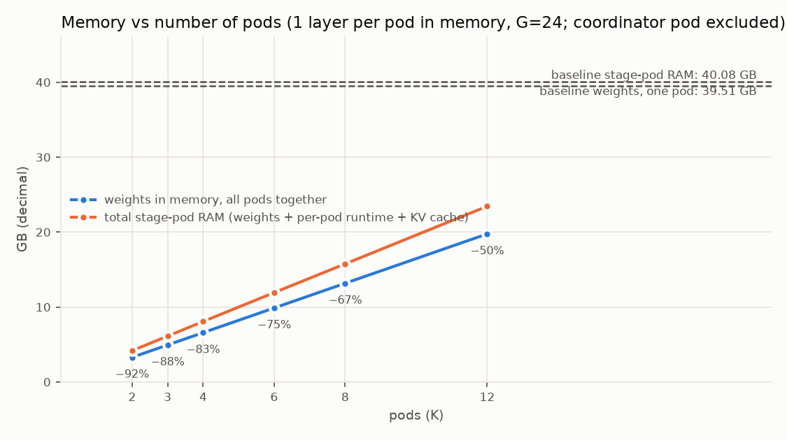
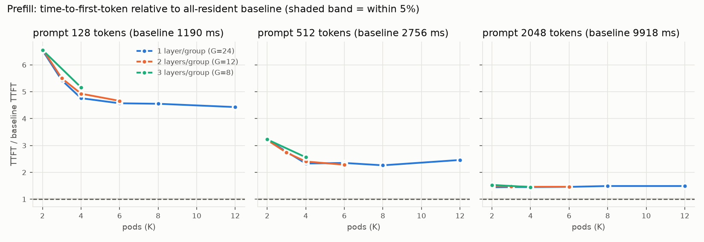
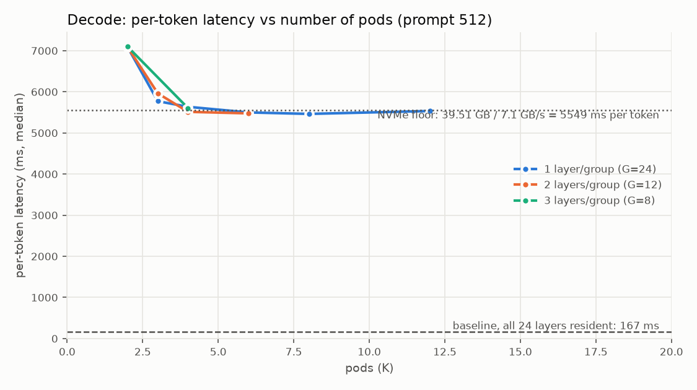
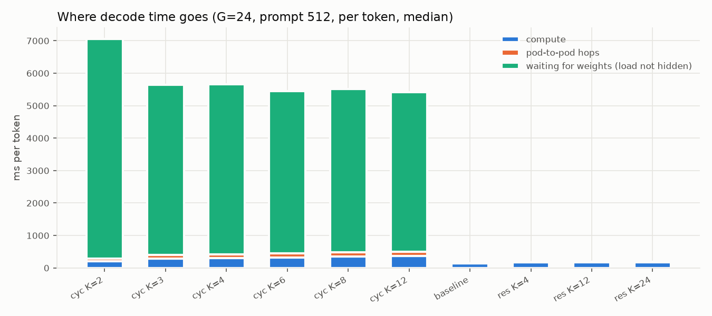
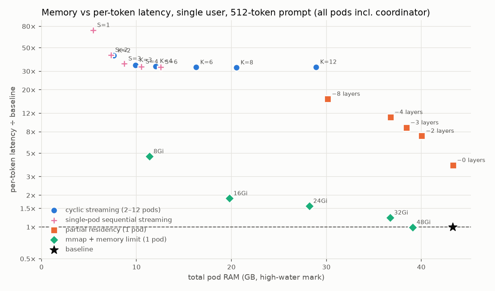
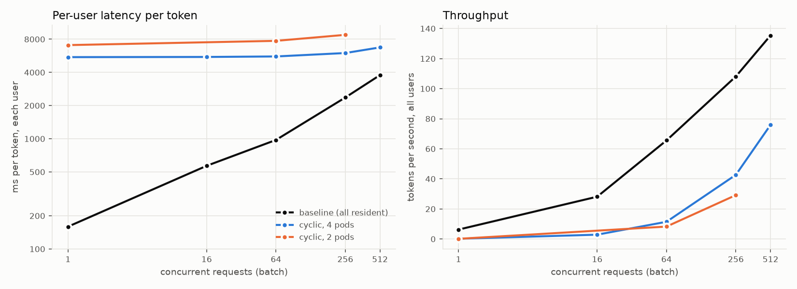

# gpt-oss-20b on halo: cyclic layer streaming and the alternatives, and how a big model differs from the 3B

> **Archived report**, superseded by [`../REPORT.md`](../REPORT.md) and kept for the record. Paths refer to the original experiment directory on the test machine (hostname *halo*); see the note at the top of [`../FULL_RECORD.md`](../FULL_RECORD.md) for where code and data are in this repository. The kernel-paging rows of §6.3 were corrected on 5 October 2026 (the correction is in the text); the frontier chart still shows the uncorrected points.

**Machine:** `halo`, AMD Ryzen AI Max+ 395 (16 cores / 32 threads), 125 GB RAM, Micron 4600 NVMe on a PCIe 4.0 ×4 link (7.1 GB/s measured). **Model:** OpenAI gpt-oss-20b, 21B parameters in a mixture of experts (32 experts per layer, 4 used per token, 3.6B active parameters), 24 layers, dequantized from its native 4-bit format to bf16 as agreed (no quantization anywhere): 24 × 1.65 GB = 39.5 GB of layer weights + 2.3 GB embedding/output matrices. **Runtime:** PyTorch on CPU, the same single-node k3d cluster and code as the 3B experiments, pinned to 16 hardware threads. **Runs:** 28 Sep 2026. Sizes are decimal GB; "baseline" = all 24 layers in one pod.

The 3B report (`FINAL_REPORT.md`) explains the approaches; this report gives the gpt-oss numbers and, in §7, the side-by-side comparison with the 3B.

## 1. In short

- **Memory works the same way.** 2 pods hold 2 of 24 layers: 3.29 GB of layer weights instead of 39.5 GB (−92%), 4.2 GB of stage-pod RAM instead of 40.1 GB (−90%).
- **Generating tokens is 33–44× slower** with any number of pods (2 to 12): 5.4–7.1 s per token against 0.167 s for the baseline. The 3B was 6–8× slower. The reason is the mixture of experts: each token computes with 4 of the 32 experts in a layer, but the cyclic scheme must load all 32 (1.65 GB) to have them ready, so it reads 8× more bytes than it uses. NVMe floor: 39.5 GB ÷ 7.1 GB/s = **5.55 s per token**.
- **Long prompts no longer hide the loads.** With the 3B a 2048-token prompt reached the first token at baseline speed; with gpt-oss it takes 1.44–1.53× (14.3–15.2 s vs 9.9 s). The loads are hidden (waiting is only 0–0.2 s of the 14 s), but streaming 1.65 GB layers at 7 GB/s throughout the prefill slows every layer's compute by 40–55% (387 ms → 509–607 ms per layer); with the 3B this slowdown was 8%.
- **Output identical** to the baseline in every configuration, and the baseline reproduces Hugging Face's own generation token for token.
- **Layer-level alternatives don't rescue it, kernel paging does** (§6). Streaming inside one pod reaches the same 5.5 s floor with a little less RAM (10.5 GB with 4 slots, −76%). Pinning most layers and streaming a few costs 3.9× before saving anything and 16× for a 30% saving. Batching closes the gap only slowly: 1.78× per user and 56% of the baseline's throughput at 512 concurrent requests (3B: 1.19×, 84%). But memory-mapping the weights under a memory limit, which loads only the experts a token touches, is the one approach that stays within an order of magnitude: with real prompts **−30% RAM at 3.0–4.0× per token** (26 GiB limit) and **−54% at 7.4–8.0×** (16 GiB), at the cost of a 4–11× slower first prompt pass. *(Corrected 5 Oct 2026: the figure first reported here, 1.87× at −54%, was measured on a degenerate output, the token "…" repeated 16 times, which routes to the same experts every step; see §6.3.)* Speculative decoding was not run: gpt-oss has no small draft model in its family.

## 2. What was built (differences from the 3B setup)

Same pods, same protocol, same measurement code. New for gpt-oss:
- A gpt-oss decoder layer in `common.py`: attention with learned sinks, sliding-window attention (128 tokens) on even layers and full attention on odd layers, YaRN rotary embeddings, a top-4-of-32 expert router with softmax over the chosen experts, SwiGLU experts with the ±7 clamp. Checked layer by layer against transformers' `GptOssDecoderLayer` in fp32: maximum difference 1.5e-5 on outputs of scale ~100 (layers 0–1) and ~1e-7 relative on the last layers (outputs of scale 10⁵); our decode path (KV cache + sliding window) agrees with our prefill path to the same precision (`results_gptoss/gptoss_check.txt`).
- `split_gptoss.py`: transformers dequantizes the MXFP4 expert weights to bf16 on CPU; one `safetensors` file per layer (1,646,375,608 bytes each), plus `embed_head.safetensors` (embeddings, final norm, untied `lm_head`, 2.3 GB).
- Layer groups: G ∈ {24, 12, 8, 6, 4} groups (1, 2, 3, 4, 6 layers per group), K pods from 2 to 12. Resident controls with 4, 12 and 24 pods. Prompts of 128, 512, 2048 tokens (same text as the 3B runs), 16 generated tokens, 3 repetitions (baseline 5 + 5, start and end). Experiment 1: 20 configurations × 3 prompts = 60 rows, 190 runs.

Microbench (single process, nothing else running): cold load of one layer 598 ms (2.75 GB/s with one reader; 4+ readers reach 7.1 GB/s), warm (page cache) 245 ms; compute per layer 6.4 ms for one token, 47 ms for 128 tokens, 103 ms for 512, 388 ms for 2048. To hide one load behind other pods' single-token compute you would need 1 + 598/6.4 ≈ **95 pods** (the 3B needed 13); the NVMe saturates long before that.

## 3. Experiment 1 — cyclic streaming

### 3.1 Memory

One layer per pod (G=24), 128-token prompt, stage pods only. Baseline stage pod: 39.51 GB of weights, 40.08 GB of RAM. The coordinator (embeddings + output matrix + runtime) is ~2.9 GB in every configuration including the baseline.

| Pods | Layers in memory at once | Weights | Weight saving | Stage-pod RAM | RAM saving |
|---|---|---|---|---|---|
| 2 | 2 | 3.29 GB | **92%** | 4.18 GB | **90%** |
| 3 | 3 | 4.94 GB | 88% | 6.13 GB | 85% |
| 4 | 4 | 6.59 GB | 83% | 8.07 GB | 80% |
| 6 | 6 | 9.88 GB | 75% | 11.93 GB | 70% |
| 8 | 8 | 13.17 GB | 67% | 15.76 GB | 61% |
| 12 | 12 | 19.76 GB | 50% | 23.45 GB | 41% |

- Weight saving = 1 − K/24. With layers of 1.65 GB the per-pod runtime (~0.3 GB) hardly matters: RAM saving tracks the weight saving, unlike the 3B where 12+ pods used more RAM than the baseline.
- Long prompts add far more temporary memory than with the 3B: at 2048 tokens each pod's peak rises by ~2.6 GB (expert activations for 2048 tokens), so 12 pods peaked at 54 GB of stage-pod RAM, above the 40 GB baseline. At 512 tokens: +0.5 GB per pod.



### 3.2 Prompt processing (time to first token)

Baseline: 1.19 s (128 tokens), 2.76 s (512), 9.92 s (2048).

| Prompt | Best cyclic | Ratio | Pods | Range over all cyclic configs |
|---|---|---|---|---|
| 128 tokens | 5.27 s | 4.4× | 12 | 4.4–6.6× |
| 512 tokens | 6.23 s | 2.3× | 8 | 2.3–3.2× |
| 2048 tokens | 14.3 s | 1.44× | 2 | 1.44–1.53× |

Where the 2048-token prefill time goes (first pass, sums over the 24 layers, from the traces):

| Config | First token | Waiting for weights | Compute | Compute per layer | Hops |
|---|---|---|---|---|---|
| baseline (1 pod, all resident) | 9.3 s | 0 | 9.29 s | 387 ms | 0 |
| resident control, 4 pods | 10.6 s | 0 | 10.51 s | 438 ms | 0.09 s |
| cyclic 2 pods | 14.3 s | 1.89 s | 12.21 s | 509 ms | 0.17 s |
| cyclic 4 pods | 14.4 s | 0.12 s | 14.04 s | 585 ms | 0.18 s |
| cyclic 12 pods | 14.8 s | 0 | 14.57 s | 607 ms | 0.19 s |

The loads are hidden from 3 pods on (waiting ≤ 0.24 s), yet the prefill is 4.5–5 s slower than the baseline because the compute itself slows down while 1.65 GB layers are streaming in: the NVMe transfers, the kernel's page zeroing/copying and the matrix multiplications share the same memory bandwidth on this chip. With the 3B the same effect was 180 → 194 ms per layer (+8%); here 387 → 509–607 ms (+30–55%). Short prompts additionally expose the loads themselves.



### 3.3 Token generation

Per generated token, 512-token prompt, one layer per pod. Baseline: **167 ms** (144 ms of layer compute + ~20 ms for the 201k-word output layer).

| Pods | Per token | vs baseline | Waiting for weights | Compute | Hops | One layer load |
|---|---|---|---|---|---|---|
| 2 | 7087 ms | 42× | 6762 ms | 210 ms | 81 ms | 573 ms |
| 3 | 5772 ms | 35× | 5240 ms | 288 ms | 113 ms | 697 ms |
| 4 | 5636 ms | 34× | 5231 ms | 300 ms | 126 ms | 929 ms |
| 6 | 5499 ms | 33× | 5005 ms | 327 ms | 123 ms | 1356 ms |
| 8 | 5463 ms | 33× | 5034 ms | 357 ms | 131 ms | 1797 ms |
| 12 | 5533 ms | 33× | 4917 ms | 372 ms | 128 ms | 2647 ms |

Same shape as the 3B: a drop from 2 to 3 pods (the NVMe reaches ~7 GB/s with 3 concurrent readers), then flat at the floor 39.5 GB ÷ 7.1 GB/s = 5.55 s. Per-layer load time grows in proportion to the pod count (573 ms → 2647 ms), so extra pods add exactly as much load time as head start. Grouping 2–6 layers per group (G = 12, 8, 6, 4) changes nothing: every 2-pod configuration is 7.05–7.12 s per token, every 3-pod one 5.8–6.0 s, everything from 4 pods on 5.4–5.6 s.




### 3.4 Cost of splitting alone (controls)

K pods, each keeping its own 24/K layers permanently in memory, 512-token prompt: 4 pods 198 ms per token (1.19×), 12 pods 207 ms (1.24×), 24 pods 206 ms (1.23×); first-token times 1.04–1.05×. The pipeline itself costs 20–25% per token here (hops of ~5 ms per layer and slightly slower compute per pod), less than the 30% seen with the 3B because each gpt-oss layer computes for longer relative to a hop.

## 4. Why more pods don't help (gpt-oss version)

Same three reasons as for the 3B, with bigger numbers:
1. K pods → ~K concurrent reads on one NVMe → each 1.65 GB load takes K × 1.65 GB ÷ 7.1 GB/s (573 ms with 2 pods, 2.6 s with 12).
2. The NVMe saturates at 7.1 GB/s; every token re-reads all 24 layers = 39.5 GB → 5.55 s minimum.
3. Loading slows computing: per-layer decode compute rises from 6.4 ms alone to 9–15 ms while other pods load; per-layer prefill compute (2048 tokens) from 387 to 509–607 ms.

The mixture of experts adds a fourth: **the cyclic scheme loads 8× more bytes than the token uses.** A token passes through 4 of 32 experts per layer (≈0.2 GB of expert weights + 0.05 GB of attention), but which 4 is decided by the router only when the token reaches the layer, so a prefetching scheme has to load all 32 (1.65 GB). Baseline latency by this route would need 39.5 GB in 167 ms = **236 GB/s** of weight bandwidth (the 3B needed 43 GB/s).

## 5. Correctness (experiment 1)

- Layer implementation vs transformers `GptOssDecoderLayer`, fp32, 256-token input (longer than the 128-token sliding window), layers 0, 1, 22, 23: max |Δ| 1.5e-5, 1.7e-5, 2.0e-3, 1.7e-2 on output scales 103, 67, 76k, 190k (relative 1e-7 to 3e-8); YaRN inverse frequencies and cos/sin identical (Δ = 0).
- Baseline pod vs Hugging Face `generate` (bf16, eager attention), 128-token prompt, 16 tokens: identical token ids (`results_gptoss/ref_128.json`).
- All 60 configuration × prompt rows produced exactly the same tokens as the baseline (every repetition).
- Baseline drift between the start and end of the 4.3-hour sweep: first-token time +7% (128), +9% (512), +11% (2048); per token 0%, +6%, +5%. Ratios use the pooled median of both runs; ratios below ~1.1× are within noise.
- Note on the text: the test prompt repeats its paragraphs, and gpt-oss (like the 3B) continues the repetition, so the generated tokens are "easy". This does not affect any latency or memory measurement; every token still passes through all layers and all loads.

## 6. Experiment 2 — the alternatives on gpt-oss

Same four alternatives as for the 3B (no speculative decoding: no small draft model in the gpt-oss family). 512-token prompt unless stated; "total RAM" includes the coordinator (2.9 GB). Baseline (pooled start/end runs): 43.3 GB total RAM, 168 ms per token, 2.90 s to first token.

### 6.1 Single-pod sequential streaming (the cycle inside one pod)

One pod, the 24 layers computed in order, layer *i* freed after use and layer *i+S* loaded in the background; up to min(S, 4) reads in flight.

| Slots | Total RAM | RAM saved | Per token | vs baseline | First token vs baseline (512 / 2048) |
|---|---|---|---|---|---|
| 1 (no prefetch) | 5.4 GB | 87% | 12.4 s | 73× | 5.2× / 2.1× |
| 2 | 7.3 GB | 83% | 7.18 s | 43× | 3.1× / 1.45× |
| 3 | 8.7 GB | 80% | 5.95 s | 35× | 2.7× / 1.37× |
| 4 | 10.5 GB | 76% | 5.56 s | 33× | 2.3× / 1.43× |
| 6 | 12.6 GB | 71% | 5.53 s | 33× | 2.4× / 1.40× |

Same conclusion as for the 3B: the pods were only ever a source of concurrent NVMe readers. One pod with 3–4 slots reaches the 5.5 s floor with less RAM than K pods (10.5 GB with 4 slots vs 12.1 GB with 4 pods; 7.3 GB with 2 slots vs 7.6 GB with 2 pods). With 1 slot each layer is loaded and then computed with no overlap: 24 × (~510 ms load + 6 ms compute) = 12.4 s.

### 6.2 Partial residency: pin most layers, stream the last few (one pod)

| Pinned / streamed / slots | Layers saved | Total RAM | RAM saved | Per token | vs baseline | First token vs baseline |
|---|---|---|---|---|---|---|
| 22 / 2 / 2 | 0 | 43.3 GB | 0% | 648 ms | 3.9× | 1.15× |
| 20 / 4 / 2 | 2 | 40.1 GB | 8% | 1229 ms | 7.3× | 1.35× |
| 18 / 6 / 3 | 3 | 38.4 GB | 11% | 1472 ms | 8.8× | 1.40× |
| 16 / 8 / 4 | 4 | 36.8 GB | 15% | 1851 ms | 11.0× | 1.50× |
| 12 / 12 / 4 | 8 | 30.2 GB | 30% | 2755 ms | 16.4× | 1.65× |

With the 3B, streaming 3 layers and saving none cost 1.33×; here streaming 2 layers and saving none costs 3.9×, because the 3.3 GB that must be re-read per token (2 layers) takes ~0.47 s at 7 GB/s while the 22 pinned layers compute for only 0.14 s: there is nothing to hide the loads behind. Every further layer streamed beyond the slot count adds ~290 ms per token (1.65 GB ÷ ~5.7 GB/s). Saving 30% of RAM costs 16×.

### 6.3 mmap + memory limit (kernel paging): the one approach that suits a mixture of experts

Weights memory-mapped, no loading code, pod capped with a Kubernetes memory limit; Linux pages in what is touched and evicts the least recently used. Cache dropped after deployment so the pages are really charged to the pod (cgroup peak = the limit in every row below 48 GiB; at 48 GiB everything fits and the pod peaks at 34–40 GB).

**Correction (5 Oct 2026).** The table below was measured with the original repetitive prompt (`prompt.txt`, 373 tokens tiled to 512), on which gpt-oss emits the token "…" sixteen times in a row. A repeated token routes to the same experts at every step, so the pod's page cache hit almost every time and the per-token figures (1.87× at 16 GiB) describe that degenerate case, not normal text. Re-measured in the cross-model test (`REPORT_MODELS.md`, same code, same limits, 512-token prose prompt and two chat prompts, 32 tokens, 3 repetitions, outputs identical to the baseline):

| Limit | Total RAM | RAM saved | Per token (prose / chat summary / chat code) | vs baseline | First token vs baseline |
|---|---|---|---|---|---|
| 26 GiB | 30.3 GB | 30% | 447 / 519 / 590 ms | **3.0–4.0×** | 3.8–8.7× |
| 16 GiB | 19.9 GB | 54% | 1120 / 1190 / 1194 ms | **7.4–8.0×** | 5.1–11.3× |

Per token the cost is roughly the bytes of experts a token touches that are not cached: at 16 GiB the pod holds under half the model and nearly every token re-reads most of its 4.8 GB of experts through page faults, which is slower than the sequential 5.5 s read of everything only by the fraction it skips. The qualitative conclusion stands, with smaller numbers: kernel paging is 4–12× cheaper than any layer-streaming scheme on this model (35–37×), and it remains the worst approach on dense models. The original table is kept for the record:

| Limit | Total RAM (incl. coordinator) | RAM saved | Per token, 512-token prompt | vs baseline | First token (512) | Per token: 128 / 2048-token prompts |
|---|---|---|---|---|---|---|
| 48 GiB (everything fits) | 39.1 GB | 10% | 167 ms | 0.99× | 0.95× | 1.06× / 0.98× |
| 32 GiB | 36.7 GB | 15% | 206 ms | 1.22× | 3.96× (11.5 s) | 1.00× / 1.09× |
| 24 GiB | 28.2 GB | 35% | 266 ms | 1.58× | 5.5× | 3.5× / 1.43× |
| 16 GiB | 19.8 GB | **54%** | 314 ms | **1.87×** | 5.7× | 7.0× / 2.34× |
| 8 GiB | 11.4 GB | 74% | 786 ms | 4.67× | 6.1× | 15.4× / 7.1× |

- A gpt-oss token touches 4 of the 32 experts in each layer, so the kernel only reads what is used and most hot experts stay cached. With half the memory, decode is 1.87× the baseline, against 33× for every explicit layer-streaming scheme on this model. The dense 3B had the opposite result (worst approach, 8–11×): there, every page is touched every token.
- The price is the first prompt pass, which touches almost every expert: 4–6× slower at 512 tokens (11–18 s instead of 2.9 s; 8–12× at 128 tokens, 2–2.6× at 2048). The per-token figures also depend on how well the recent experts fit: with the 128-token prompt and its repetitive continuation, the 16 and 24 GiB limits thrash far more (7× and 3.5×) than with the 512- and 2048-token prompts.
- This is the naive version of what expert-offloading systems do deliberately (expert prediction, explicit LRU caches, contiguous expert layout); it suggests an expert-level streamer for gpt-oss could do better still, with a fast first pass.



### 6.4 Batching (128-token prompt, B prompts in lockstep)

| Concurrent requests | Baseline per user | Cyclic 4 pods per user | Ratio | Baseline tok/s | Cyclic 4 pods tok/s | Cyclic 2 pods per user / tok/s |
|---|---|---|---|---|---|---|
| 1 | 162 ms | 5.50 s | 34× | 6 | 0.2 | 7.08 s / 0.1 |
| 16 | 568 ms | 5.52 s | 9.7× | 28 | 3 | – |
| 64 | 976 ms | 5.58 s | 5.7× | 66 | 11 | 7.73 s / 8 |
| 256 | 2.37 s | 6.00 s | 2.5× | 108 | 43 | 8.77 s / 29 |
| 512 | 3.78 s | 6.74 s | 1.78× | 135 | 76 | – |

The cyclic cost per step stays at the 5.5 s floor while the baseline's step grows with the batch, so the gap closes with more users, as with the 3B, but from a much higher start: at 512 users the pipeline is still 1.78× slower per user and delivers 56% of the baseline's throughput (3B: 1.19×, 84%). Batched configurations ran twice (once at 512), and the high-water marks (44–60 GB for the baseline, 13–56 GB for 4 cyclic pods) are dominated by the prefill of B × 128 tokens through the expert layers, so they say little about steady-state memory.




## 7. Small vs big: Qwen2.5-3B (dense) against gpt-oss-20b (mixture of experts)

| | Qwen2.5-3B-Instruct | gpt-oss-20b |
|---|---|---|
| Parameters, total / used per token | 3.1B / 3.1B (dense) | 21B / 3.6B (4 of 32 experts per layer) |
| Layers × size | 36 × 154 MB = 5.55 GB | 24 × 1.65 GB = 39.5 GB |
| Baseline (all resident): per token · first token at 2048 | 130 ms · 6.7 s | 167 ms · 9.9 s |
| Baseline RAM (stage pod + coordinator) | 7.1 GB | 43 GB |
| One layer: load (alone) / compute (1 token) | 41 ms / 3.5 ms = 12× | 598 ms / 6.4 ms = 94× |
| Bytes loaded per token ÷ bytes used per token | 1 | 8 |
| NVMe floor per token (all layers ÷ 7.1 GB/s) | 0.78 s | 5.55 s |
| Cyclic per token, 4+ pods (× baseline) | 0.77–0.79 s (6×) | 5.4–5.6 s (33×) |
| Cyclic first token, 2048-token prompt, best | 1.00× | 1.44× |
| Compute slowdown while other pods load (2048-token prefill, per layer) | +8% | +30–55% |
| Pods needed to hide one load behind the others' compute (theory) | 13 | 95 |
| Weight saving with 2 pods | 94% (0.31 GB) | 92% (3.29 GB) |
| Stage-pod RAM with 2 pods vs baseline | 0.99 vs 5.96 GB (−83%) | 4.18 vs 40.1 GB (−90%) |
| RAM break-even vs baseline | ~14 pods | not reached at 12 pods (−41%) |
| Single-pod sequential, 4 slots: RAM saved · per token | 70% · 6.0× | 76% · 33× |
| Partial residency, streaming with nothing saved | 1.33× | 3.9× |
| Partial residency, ~30% RAM saved | 3.6× (−14 of 36 layers) | 16.4× (−8 of 24 layers) |
| mmap + memory limit at ~−54% RAM | 10.6× (2 GiB limit) | **7.4–8.0×** (16 GiB limit, real prompts; 3.0–4.0× at −30%; the 1.87× first reported was a degenerate-output artifact, §6.3) |
| Batching, 512 users: per user vs batched baseline · share of its throughput | 1.19× · 84% | 1.78× · 56% |
| Output identical to baseline | yes | yes |

What the size changes:
- **Memory saving is the one thing that scales in favour of the big model**: the fixed per-pod runtime is negligible next to 1.65 GB layers, so a 90% RAM saving holds with 2 pods and 41% still holds with 12.
- **Everything about latency gets worse**, in proportion to bytes per token. A dense big model would be about as bad as its size ratio (7× the bytes → 7× the 3B's penalty); the mixture of experts makes it worse still, because prefetching whole layers loads experts the token never touches.
- **Prompt processing stops hiding the loads.** Compute per layer scales with layer size like the load does, so the load/compute ratio stays ~1:1.5 during a 2048-token prefill (598 vs 388 ms) as it was for the 3B (41 vs 166 ms → 1:4). The margin that hid the loads for the 3B is gone, and the memory-bandwidth contention that costs the 3B 8% costs gpt-oss 30–55%.
- **The alternatives scale the same way.** Partial residency needs the pinned layers' compute to cover the streamed layers' loads; with 6.4 ms of compute against 598 ms of load per layer, one streamed layer already costs more than all 23 others compute. Batching needs hundreds of users just to bring the per-user penalty under 2×.
- **The unit to stream for a mixture of experts is the expert, not the layer.** Kernel paging already does this implicitly and reaches 3.0–4.0× at −30% RAM and 7.4–8.0× at −54% with real prompts (§6.3; Qwen3-30B-A3B, 8 of 128 experts, does better: 1.7× at −38%, 2.6–3.3× at −57%, see `REPORT_MODELS.md`). An explicit expert-level streamer (predict next-layer experts one layer ahead, cache hot experts in the budget, store experts contiguously) is the natural next step and should also fix the slow first pass; not tested here.

## 8. Things that went wrong

- **Memory-limit rows measured the page cache (first attempt).** The bf16 split ran as root inside a container, so the weight files were root-owned and the host-side `dropcache.py` was denied access before every mmap configuration. The weights stayed in the page cache, charged to no pod (the discarded runs reported a cgroup peak of 0.95 GB for every limit below 48 GiB), and all five limits ran at baseline speed. Those 15 limit × prompt rows were discarded; the files were made readable and the five configurations rerun with the cache verifiably dropped (cgroup peaks now equal the limits for 32 GiB and below; at 48 GiB everything fits). A reboot of halo interrupted that rerun after the 48 and 32 GiB rows; the 24, 16 and 8 GiB rows were run again afterwards (`sweep_g2e.sh`). The results in §6.3 are from these reruns.
- **The kernel-paging figures were flattered by a degenerate output (found 5 Oct).** Experiment 2 used the original repetitive prompt, on which gpt-oss generates "…" sixteen times; the same experts are routed every step, so the page cache hit rate was near 100% and the 16 GiB limit looked like 1.87×. With real text it is 7.4–8.0× (§6.3). A re-measurement with the host page cache cleared gave the same numbers as the cross-model sweep, so host cache pressure (the other hypothesis) was not the cause. All layer-streaming rows are unaffected: they read every byte regardless of the output.
- Experiment 2 output check: every single-pod, partial-residency, mmap and batching run produced the same tokens as the baseline for the same prompt.
- The remote connection to halo dropped for stretches of the runs; the sweeps ran unattended (`nohup`) and were not affected.

## 9. Reproduce

```bash
ssh halo && cd ~/cyclic-exp && . env.sh
./dl_gptoss.sh                                                         # openai/gpt-oss-20b top-level files → gptoss/ (13.8 GB)
docker run --rm -v $PWD:/exp -w /exp cyclic:v1 python split_gptoss.py /exp/gptoss /exp/weights_gptoss   # bf16, one file per layer
docker run --rm -v $PWD:/exp -w /exp cyclic:v1 python gptoss_check.py /exp/weights_gptoss               # fp32 check vs transformers
docker run --rm -e WEIGHTS=/exp/weights_gptoss -v $PWD:/exp -w /exp cyclic:v1 python microbench.py results_gptoss/microbench.json
python3 deploy.py 24 2 cyclic WEIGHTS=/exp/weights_gptoss            # any configuration, as for the 3B, plus WEIGHTS=
kubectl exec coordinator -- python /exp/smoke.py 128 16
./sweep_g1.sh; ./sweep_g2.sh                                          # experiments 1 and 2 → results_gptoss/ (their mmap rows are invalid, see §8)
python3 -c "import json;L=[l for l in open('results_gptoss/results2.jsonl') if json.loads(l).get('LOAD_MODE')!='mmap'];open('results_gptoss/results2.jsonl','w').writelines(L)"
./sweep_g2d.sh; ./sweep_g2e.sh                                        # valid mmap rows (48/32 GiB, then 24/16/8 GiB)
docker run --rm -e R=/exp/results_gptoss -e L=24 -e MODEL_GB=39.51 -v $PWD:/exp -w /exp cyclic:v1 sh -c "pip install -q matplotlib; python analyze.py > results_gptoss/summary_table.md; python analyze2.py > results_gptoss/summary2_tables.md"
python3 traces.py results_gptoss/results.jsonl 24 1646375608          # per-layer time breakdown
```

Files: as for the 3B (`FINAL_REPORT.md` §9) plus `split_gptoss.py`, `gptoss_check.py`, `dl_gptoss.sh`, `sweep_g1.sh`, `sweep_g2.sh`, `traces.py`; data in `results_gptoss/` (`results.jsonl`, `results2.jsonl`, `summary_table.md`, `summary2_tables.md`, `microbench.json`, `gptoss_check.txt`, `ref_128.json`, `*.png`).
