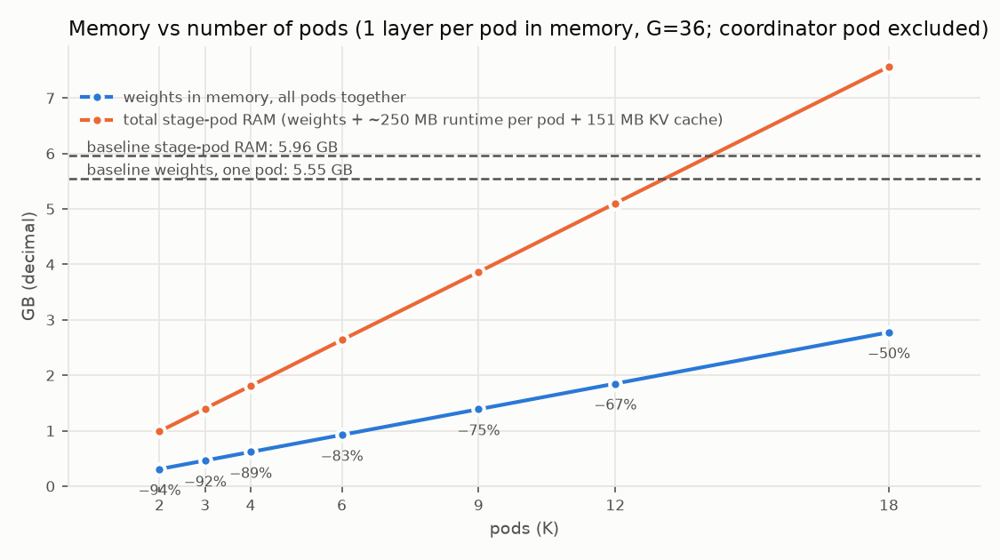
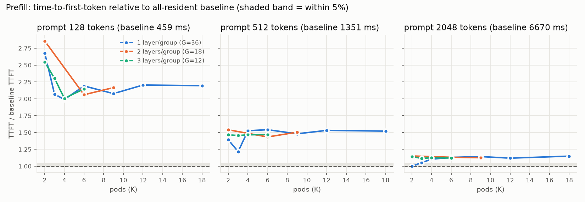
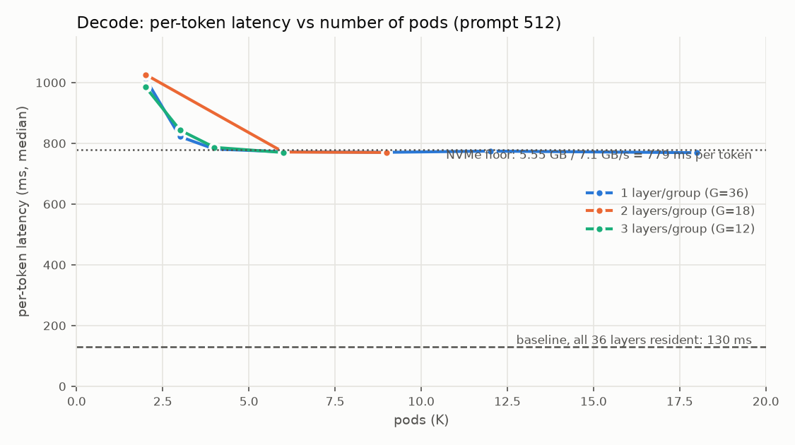
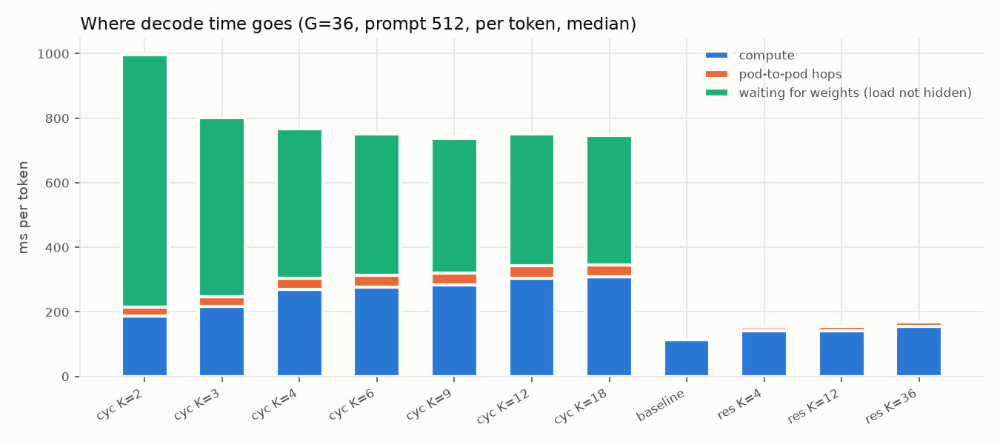

# Cyclic layer streaming: experiment report

> **Archived report**, superseded by [`../REPORT.md`](../REPORT.md) and kept for the record. Paths refer to the original experiment directory on the test machine (hostname *halo*); see the note at the top of [`../FULL_RECORD.md`](../FULL_RECORD.md) for where code and data are in this repository. This is the first report (experiment 1 only).

**Machine:** `halo` (AMD Ryzen AI Max+ 395, 16 cores / 32 threads, 125 GB RAM, Micron 4600 NVMe) · **Model:** Qwen2.5-3B-Instruct, bf16 (16-bit numbers), 36 layers, 5.55 GB of layer weights · **Cluster:** single-node k3d (k3s in Docker), node container pinned to logical CPUs 16–31 · **Run:** 24–25 Sep 2026 (UTC)

All sizes in this report are decimal (1 GB = 10⁹ bytes). Full data: `results/summary_table.md` (all 66 rows), `results/summary.csv`, raw `results/results.jsonl`.

## In short

We split the model's 36 layers across K pods. Each pod keeps **one layer group in memory** (a single layer in the main configuration), computes it, frees it, and loads its next group from disk while the other pods work. Compared with the whole model in one pod:

- **Memory works as intended.** With 2 pods only 2 of the 36 layers are in memory at any moment: **94% less layer-weight memory** (0.31 GB instead of 5.55 GB) and 83% less stage-pod RAM. Counting the coordinator pod too (embeddings + output layer, ~1 GB, identical in every setup), the saving is 85% of weights and 71% of total RAM.
- **Long prompts: about the same speed.** For a 2048-token prompt with 2 pods and one layer per pod (the main configuration), the first token came after 6.66 s vs 6.67 s for the baseline. Both vary by ~10% from run to run, so read this as "within noise". Every other configuration (more pods, or several layers per pod) was 5–15% slower.
- **Generating tokens: 0.77–1.07 s per token whatever the number of pods (2 to 18).** That is 6–8× slower than the baseline for 128/512-token prompts and 4–5.5× for 2048-token prompts (where the baseline itself slows to 0.19 s). Every generated token needs all 36 layers again, so the full 5.55 GB is re-read from disk for each token. The disk delivers at most 7.1 GB/s → at least 0.78 s per token, against 0.13 s for the baseline.
- **Output is identical** to the baseline in all 219 runs (same tokens; the model always picks its single highest-scoring next token, "greedy decoding", so output is deterministic).

## What was built

```
 coordinator pod ──► stage-0 ──► stage-1 ──► … ──► stage-(K-1) ──► stage-0 ──► … ──► coordinator
 (tokenizer,          layer 0     layer 1            layer K-1        layer K            (output layer → next token)
  embeddings,           ↓ free it, load layer K from NVMe while the others compute
  sampling)                                                       (diagram shows the 1-layer-per-group case)
```

- Each of the 36 layers is one 154 MB `safetensors` file on NVMe. The layers are cut into **G groups** of 36/G consecutive layers (G=36 → 1 layer per group; G=18 → 2; G=12 → 3; …).
- **Stage pod** (`stage_server.py`): pod *i* owns groups `i, i+K, i+2K, …` and holds **one group at a time**. After computing a group it frees the buffer and a background thread loads the next one. The loader calls `posix_fadvise(DONTNEED)` on each file right before and after reading it, so weights never stay in the Linux page cache and every reload is a real NVMe read. The KV cache (the attention state of the prompt, kept so it is not recomputed for each new token) of every owned layer stays in memory: 151 MB in total, pre-allocated for 4096 positions, split across the pods.
- **Coordinator pod** (`coordinator.py`): tokenizer, embeddings, final norm and output layer (`lm_head`, 0.62 GB of weights), greedy sampling, HTTP API. Present and identical in every configuration, including the baseline.
- **Baseline:** one stage pod with all 36 layers in memory. **Control ("resident"):** K pods, each keeping its own 36/K layers permanently in memory, no reloading. This isolates the cost of splitting from the cost of reloading.
- **Configurations:** G ∈ {36, 18, 12, 9, 6, 4} × K from 2 to 18 (18 cyclic configurations; 22 with the 3 resident controls and the baseline). Prompts of 128, 512 and 2048 tokens, 16 generated tokens, 3 repetitions each (baseline: 5 at the start and 5 at the end of the sweep). The plan called for 64 tokens and ≥10 repetitions; this was cut to keep the sweep near one hour.

## Results

### 1. Memory

One layer per group (G=36), measured at the 128-token prompt (closest to steady state). Baseline stage pod: 5.55 GB of weights, 5.96 GB of RAM. Figures are summed over the **stage pods only**; the coordinator (~1.0 GB RAM, 0.62 GB of it weights) is constant and excluded.

| Pods | Layers in memory | Weights | Weight saving | Stage-pod RAM | RAM saving |
|---|---|---|---|---|---|
| 2 | 2 | 0.31 GB | **94%** | 0.99 GB | **83%** |
| 3 | 3 | 0.46 GB | 92% | 1.40 GB | 76% |
| 4 | 4 | 0.62 GB | 89% | 1.81 GB | 70% |
| 6 | 6 | 0.92 GB | 83% | 2.64 GB | 56% |
| 9 | 9 | 1.39 GB | 75% | 3.86 GB | 35% |
| 12 | 12 | 1.85 GB | 67% | 5.10 GB | 14% |
| 18 | 18 | 2.77 GB | 50% | 7.57 GB | −27% (more than baseline) |



- Weight saving is exactly `1 − K/36`.
- Each pod carries a fixed ~250 MB of runtime (Python + PyTorch) plus its share of the 151 MB KV cache. Total RAM therefore grows ~0.4 GB per pod: at 12 pods it is still 14% below the baseline, break-even is at about 14 pods, and 18 pods use 27% more than the baseline.
- Including the coordinator in both sides: 2 pods use 0.93 GB of weights instead of 6.17 GB (−85%) and 2.0 GB of total RAM instead of 7.0 GB (−71%).
- Long prompts add temporary memory per pod (0.8–0.9 GB per pod at 2048 tokens, for attention and MLP activations). With many pods this multiplies: 18 pods at 2048 tokens peaked at 22.5 GB in total, and the RAM break-even moves down to ~12 pods at 512 tokens and ~5 pods at 2048.
- Grouping several layers per pod (G < 36) holds more layers in memory for the same K and, as section 3 shows, buys no latency. At K=2, G=36 holds 2 layers (0.31 GB) and G=4 holds 18 (2.77 GB) with the same ~1.0 s per token.

### 2. Prompt processing (time to first token, TTFT)



| Prompt | Baseline (median; run-to-run range) | Best cyclic | Ratio | Pods |
|---|---|---|---|---|
| 128 tokens | 0.46 s (0.42–0.58) | 0.91 s | 1.99× | 4 |
| 512 tokens | 1.35 s (1.17–1.57) | 1.64 s | 1.22× | 3 |
| 2048 tokens | 6.67 s (6.37–7.10) | 6.66 s (6.42–7.12) | **1.00×** | 2 |

With a long prompt each layer has a lot of work (166 ms of compute for 2048 tokens vs 41 ms to load a layer), so the loads finish in the background: the traces show 0–22 ms of waiting for weights in the whole 2048-token prefill at every K with one layer per group (G=36), and at most 94 ms (G=6, K=2; about 1% of the prefill) in any configuration. The remaining 5–15% in the other configurations comes from slower compute in the working pod while the other pods load (section 4, item 3) and ~0.1 s of pod-to-pod hops. Short prompts don't give enough compute time per layer to hide the loads.

The baseline itself drifted during the sweep (see Correctness checks): against the start-only baseline the 2048-token ratio is 1.03×, against the end-only baseline 0.95×. Ratios below ~1.1× should be read as "within noise".

### 3. Generating tokens (decode)



Per generated token, 512-token prompt. Baseline: **130 ms**.

| Pods | Per token | vs baseline | Waiting for weights | Compute | Pod-to-pod hops |
|---|---|---|---|---|---|
| 2 | 1013 ms | 7.8× | 782 ms | 188 ms | 26 ms |
| 3 | 822 ms | 6.3× | 555 ms | 216 ms | 30 ms |
| 4 | 781 ms | 6.0× | 464 ms | 269 ms | 35 ms |
| 6 | 772 ms | 5.9× | 437 ms | 276 ms | 38 ms |
| 9 | 770 ms | 5.9× | 416 ms | 283 ms | 38 ms |
| 12 | 774 ms | 6.0× | 409 ms | 304 ms | 39 ms |
| 18 | 769 ms | 5.9× | 400 ms | 308 ms | 38 ms |

The three breakdown columns come from the stage-pod traces of the first repetition and are each an independent median, so they add up to 13–34 ms less than "Per token". Of this, 13–19 ms is the coordinator's share of every token (hop to stage-0 and back, final norm, output layer over the 152k-word vocabulary; ~10 ms in the baseline). The rest comes from combining independent medians and from using the first repetition only.



Latency drops from 2 to 4 pods, then stays flat at ~770 ms. **What sets it is the number of pods, not how many layers are in memory:** every 2-pod configuration is ~1.0 s per token whether 2 or 18 layers are resident (G=36 … G=4), every 3-pod configuration 0.82–0.86 s, and every configuration with 4 or more pods 0.77–0.79 s. At 12 resident layers, latency spans 771 ms (K=6) to 1013 ms (K=2). So for a given K, one layer per pod (G=36) gives the same latency with the least memory.

### 4. Why more pods don't help

The idea needs: *time to load a group ≤ time the other K−1 pods spend computing*. Alone, that looks easy: loading one layer takes 41 ms and computing one takes 3.5 ms, so ~13 pods should be enough (1 + 41/3.5). Three things break it:

1. **All pods share one disk.** Each pod starts loading its next layer as soon as it finishes computing, so with K pods about K reads are in flight at once and each load gets slower: 49 ms with 2 pods, 62 with 3, 78 with 4, 119 with 6, 179 with 9, 231 with 12, 318 with 18. Adding pods adds head start and adds load time in equal measure.
2. **The disk's total speed saturates.** Measured aggregate read speed: 4.1 GB/s with one reader, 6.1 GB/s with two, 7.0 GB/s with four, 7.1 GB/s from eight on (`results/diskbw.json`). Every token re-reads all 36 layers = 5.55 GB. With 2 pods the disk gives ~6.1 GB/s → ≥0.91 s per token (measured 1.01 s); from 4 pods on it is saturated → **0.78 s per token minimum**, the flat line in the chart. That ramp is why latency falls from 2 to 4 pods and not after. (The drive is a PCIe 5.0 model but runs on a PCIe 4.0 ×4 link, whose limit is ~7.5 GB/s.)
3. **Loading slows the computing.** Compute per layer is 3.5 ms alone and ~4 ms in the resident controls (K pods, nothing loading), but 5–9 ms while the other pods are loading. We did not isolate the cause. Candidates: the NVMe transfers and the kernel's copy into the pod's buffer compete with the decode matrix multiplications for memory bandwidth, and the loader's CPU work runs on the same 16 pinned hardware threads as the compute threads.

So the question "how many pods until the next layer is always ready" has no answer on this machine. The cycle could only keep up if the disk delivered ~43 GB/s (5.55 GB within the baseline's 130 ms per token), about 6× what this NVMe provides.

### 5. Cost of splitting alone (controls)

K pods, each keeping its own 36/K layers permanently in memory (the full model resident once, spread across the pods), 512-token prompt:

| Pods | First token | Per token |
|---|---|---|
| 1 (baseline) | 1.35 s | 130 ms |
| 4 | 1.36 s | 167 ms (1.28×) |
| 12 | 1.55 s | 171 ms (1.31×) |
| 36 | 1.46 s | 172 ms (1.32×) |

First-token times are within the run-to-run spread (~±15% with 3 repetitions), so no trend with K can be read from them. Per token, passing activations between pods costs ~13 ms, and each pod computes a bit slower than one warm process (141–156 ms vs 114 ms of compute per token). This ~30% is the price of the pipeline itself, before any reloading.

## What could make decode work (estimates, not measured)

The 0.78 s is `bytes read per token ÷ disk speed`. Only three levers exist: **read fewer bytes per cycle**, **get more tokens out of each cycle**, or **read faster**.

| Lever | Estimated effect on 0.78 s per token | Memory | Output | Assumptions |
|---|---|---|---|---|
| *More tokens per cycle:* **speculative decoding**. A small Qwen2.5-0.5B (~1 GB, kept in memory) guesses ~5 tokens; the big model checks them all in one cycle and keeps those it agrees with. | ≈ 0.2–0.3 s per token → gap shrinks from 6× to ~1.7–2× | Weight saving drops from 94% to ~70–75% (small model resident) | Identical to the big model alone | 3–4 accepted tokens per cycle (typical published value, not measured here); ~0.1 s of drafting per cycle only partly hidden |
| *More tokens per cycle:* **batching**. Many users share each cycle. | Per-user latency stays ≥ 0.78 s. The gap closes only because a batched baseline also slows: ~2.2–2.5× at 100 concurrent requests, ~1.2× at 300, ~1× at ~400 | KV cache ~36 KB per token per request, same on both sides: 6–10 GB for 300–500 requests with ~500-token contexts, more than the weights saved, so the relative saving falls to ~35–45% | Identical | Compute per layer taken from single-sequence prefill of 128/512 tokens (10 / 27 ms); batched attention not measured, so these are lower bounds |
| *Fewer bytes:* **keep most layers in memory, stream the rest**. | Within a 130 ms token the disk can deliver ~6 layers (~17% weight saving) at 7.1 GB/s, ~3–4 layers (~10%) with a single reader. Latency would not stay at baseline: the pipeline alone costs 1.3× (section 5) and compute slows while loads run (section 4) → roughly 1.4–2× | ~10–17% weight saving at best | Identical | — |
| *Fewer bytes:* quantized storage (int8/int4 on disk). **Excluded for this project.** | 0.39 s / 0.2 s | — | Small loss | — |
| *Read faster:* PCIe 5.0 link or a second NVMe in RAID-0. | ≈ 0.4 s | — | Identical | Roughly doubles read speed |

Speculative decoding is the only lever that keeps most of the memory saving, keeps the output identical, and helps a single user. Combined with batching, it is the path to baseline latency.

## Correctness checks

- **Maths identical to Hugging Face.** Our layer implementation vs `transformers` (Qwen2ForCausalLM), both in fp32 (32-bit), logits (the model's per-token scores) over a 128-token prompt: maximum difference **0.0** on a logit scale of 27.7; top choice identical at every position. Output saved in `results/fp32_check.txt`.
- **Identical output in every configuration.** All 219 generation runs (21 configurations — 18 cyclic, 3 resident controls — × 3 prompt lengths × 3 repetitions = 189, plus 30 baseline runs: 5 repetitions × 3 prompt lengths at the start and again at the end of the sweep) produced exactly the same 16 tokens as the baseline for the same prompt (checked over every repetition against `results.jsonl`).
- **Eviction is real.** In every cyclic run the pods report at most one layer group resident, and each pod's load counter equals generated tokens × groups it owns (±1 for a load in flight), i.e. every layer is re-read on every token: 432 loads (66.6 GB) per pod over the three 16-token runs at K=4. Cold reload takes 41 ms vs 19 ms from the page cache, so `fadvise` is doing its job.
- **Baseline drift.** The baseline was run at the start and at the end of the sweep (5 repetitions each). The end run was slower: first token +4% (128 tokens), +15% (512), +9% (2048); per token +2%, +6%, +5%. All ratios in this report use the pooled median of both runs. Treat first-token ratios as uncertain by ~±2% (128), ±7% (512), ±5% (2048), per-token ratios by ~±3%. The 6–8× decode result is unaffected.
- In bf16 our greedy output diverges from HF's own bf16 `generate` at the 6th generated token (128-token prompt, `results/ref_128.json`); this is bf16 rounding order, and the fp32 check above shows the maths are the same. All comparisons in this report use our implementation for both the baseline and the cyclic runs.

## Caveats

- halo is shared with ~10 other containers. The cluster was pinned to logical CPUs 16–31 (16 of the chip's 32 hardware threads; the mapping to physical cores was not recorded), but memory bandwidth and the disk are shared. This is the likely cause of the baseline drift above.
- CPU only (PyTorch bf16). On a GPU the compute would be faster, which makes hiding the loads *harder*, not easier.
- 16 generated tokens per run; "per token" is the median over the 15 tokens after the first, pooled over repetitions (the first token is counted in TTFT). With 3 repetitions, first-token medians carry the ~±15% spread noted above.
- Pod RAM is the process high-water mark (`VmHWM`), so it includes transient activations; the 128-token rows are the closest to steady state.

## Reproduce

```bash
ssh halo
cd ~/cyclic-exp && . env.sh                          # PATH (k3d, kubectl) + KUBECONFIG
# one-time setup
docker build -t cyclic:v1 .                          # torch 2.8 CPU, transformers, safetensors
docker run --rm -v $PWD:/exp -w /exp -e HF_HOME=/exp/hf cyclic:v1 python split_weights.py /exp/weights   # 36 layer files + embed_head
k3d cluster create cyclic --servers 1 --agents 0 --no-lb -v $HOME/cyclic-exp:/exp@server:0
docker update --cpuset-cpus 16-31 k3d-cyclic-server-0          # pin the node to logical CPUs 16-31
k3d image import cyclic:v1 -c cyclic
# experiments
python3 deploy.py 36 3 cyclic                        # G=36 groups, K=3 pods, cyclic mode (or: 1 1 resident)
kubectl exec coordinator -- python /exp/smoke.py 128 12       # 128-token prompt, 12 tokens: timings + memory
./sweep.sh                                           # full sweep → results/results.jsonl (~1 h)
docker run --rm -v $PWD:/exp -w /exp cyclic:v1 sh -c "pip install -q matplotlib; python analyze.py > results/summary_table.md"  # charts + tables
# cleanup
k3d cluster delete cyclic                            # weights stay in ~/cyclic-exp/weights
```

## Files (`~/cyclic-exp` on halo)

| File | Purpose |
|---|---|
| `common.py` | Cold safetensors loader (`fadvise`), Qwen2 layer forward, framed TCP messages |
| `stage_server.py` | Stage pod: cyclic load / compute / free loop |
| `coordinator.py` | Tokenizer, embeddings, output layer, token loop, HTTP API |
| `deploy.py` | Generates and applies the k8s manifests for one (G, K, mode) |
| `bench.py`, `sweep.sh` | Benchmark one config / run the whole sweep |
| `analyze.py` | `results.jsonl` → `summary.csv`, `summary_table.md`, charts |
| `microbench.py`, `diskbw.py` | Per-layer load vs compute time; NVMe bandwidth vs parallel readers |
| `fp32_check.py`, `ref_check.py` | Equivalence checks against Hugging Face transformers |
| `results/` | `results.jsonl` (raw), `summary.csv`, `summary_table.md`, `microbench.json`, `diskbw.json`, `fp32_check.txt`, `ref_128.json`, `*.png` |
