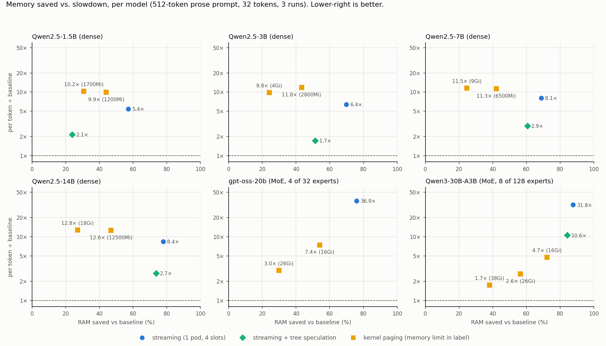

# Which approach is best? The same test on six models

> **Archived report**, superseded by [`../REPORT.md`](../REPORT.md) and kept for the record. Paths refer to the original experiment directory on the test machine (hostname *halo*); see the note at the top of [`../FULL_RECORD.md`](../FULL_RECORD.md) for where code and data are in this repository.

4–5 October 2026. Status: complete. 270 sweep runs (54 baseline, 216 other), 45 replication runs of the mixture-of-experts kernel-paging rows and 12 diagnostic runs (§4.2), fp32 checks of every divergence (§5).

## 1. Question and answer

The 3B and gpt-oss-20b studies pointed to two different winners: streaming + tree speculation for the dense 3B, kernel paging for the mixture-of-experts gpt-oss. This test runs the same configurations on six models to see whether that is a rule.

It is. On every dense model (Qwen2.5 1.5B, 3B, 7B, 14B) **streaming + tree speculation** is the best trade and kernel paging is the worst. On both mixture-of-experts models (gpt-oss-20b, Qwen3-30B-A3B) **kernel paging** is the only approach that saves memory at a moderate cost and layer streaming is 30–37× slower. The reason is structural: a dense token touches every weight, an expert-routed token touches a fraction of them.

| model | weights (bf16) | best approach | RAM saved | per token vs baseline | first token vs baseline |
|---|---|---|---|---|---|
| Qwen2.5-1.5B | 3.1 GB | streaming + tree speculation | 24–28% | 1.7–2.1× | 1.5–2.1× |
| Qwen2.5-3B | 6.2 GB | streaming + tree speculation | 51–54% | 1.5–1.9× | 1.6–3.1× |
| Qwen2.5-7B | 15.2 GB | streaming + tree speculation | 61–62% | 1.7–2.9× | 1.4–3.2× |
| Qwen2.5-14B | 29.6 GB | streaming + tree speculation | 74% | 2.1–2.7× | 1.3–3.3× |
| gpt-oss-20b (MoE, 4 of 32 experts) | 41.9 GB | kernel paging, 26 GiB limit | 29–30% | 3.0–4.0× | 3.8–8.7× |
| Qwen3-30B-A3B (MoE, 8 of 128 experts) | 61.1 GB | kernel paging, 38 GiB limit | 38–39% | 1.7× | 3.5–6.0× |

Ranges are over the three prompts. "Best" means the lowest per-token cost among configurations that save at least a fifth of the memory; the full trade-off per model is in §3 and in the chart.

## 2. Protocol (identical for every model)

- Hardware and cluster as before: halo, one k3d node pinned to CPUs 16–31, weights on the NVMe (7.1 GB/s), page cache of the weight files dropped after deploying and before measuring every kernel-paging configuration.
- Prompts: 512-token prose, chat summary, chat code (chat template, natural length). 32 generated tokens, 3 repetitions, greedy decoding.
- Configurations, all bf16, no quantization:
  1. **baseline**: all layers resident in one pod.
  2. **streaming (1 pod, 4 slots)**: layers read from NVMe in order for every token, four layer files in flight, nothing else resident.
  3. **streaming + tree speculation**: same, plus a resident drafter run through our own layer code (Qwen2.5-0.5B, 1.0 GB, for the Qwen2.5 models; Qwen3-0.6B, 1.5 GB, for Qwen3-30B-A3B) that proposes a 64-node tree per read of the big model (widths 8,16,16,12,8,4). gpt-oss has no drafter in its family, so this row is absent.
  4. **kernel paging**: weights memory-mapped under a pod memory limit; the kernel decides what stays. Two limits per model at about 0.65× and 0.45× of the weights; three for Qwen3-30B-A3B.
- Per token = median per-token decode time, or total decode time ÷ tokens for speculative runs (the honest number when one read of the weights produces several tokens). RAM = peak resident memory of all pods together (decimal GB). "Same output" = how many of the 3 repetitions reproduced the baseline's 32 tokens exactly.
- Scripts: `sweep_models.sh` / `sweep_models2.sh` (per model), `analyze_models.py` (tables and chart), `fp32_ref.py` (correctness, §5). Raw data: `results_models/<model>.jsonl`.

## 3. Results per model

### Qwen2.5-1.5B — 28 layers, 3.1 GB, tied embeddings

| prompt | approach | RAM | saved | per token | vs baseline | tokens per read | same output |
|---|---|---|---|---|---|---|---|
| prose 512 | baseline | 3.9 GB | 0% | 69 ms | 1.0× |  | — |
| prose 512 | streaming (1 pod, 4 slots) | 1.7 GB | 57% | 378 ms | 5.5× |  | 3/3 |
| prose 512 | streaming + tree speculation | 3.0 GB | 24% | 149 ms | 2.1× | 4.5 | 0/3 |
| prose 512 | kernel paging, limit 1200Mi | 2.2 GB | 44% | 687 ms | 9.9× |  | 3/3 |
| prose 512 | kernel paging, limit 1700Mi | 2.7 GB | 31% | 712 ms | 10.2× |  | 3/3 |
| chat: summary | baseline | 3.9 GB | 0% | 64 ms | 1.0× |  | — |
| chat: summary | streaming (1 pod, 4 slots) | 1.6 GB | 58% | 376 ms | 5.9× |  | 3/3 |
| chat: summary | streaming + tree speculation | 2.8 GB | 28% | 108 ms | 1.7× | 6.4 | 3/3 |
| chat: summary | kernel paging, limit 1200Mi | 2.2 GB | 43% | 694 ms | 10.8× |  | 3/3 |
| chat: summary | kernel paging, limit 1700Mi | 2.7 GB | 30% | 716 ms | 11.2× |  | 3/3 |
| chat: code | baseline | 3.8 GB | 0% | 64 ms | 1.0× |  | — |
| chat: code | streaming (1 pod, 4 slots) | 1.6 GB | 59% | 370 ms | 5.8× |  | 3/3 |
| chat: code | streaming + tree speculation | 2.8 GB | 28% | 121 ms | 1.9× | 5.4 | 3/3 |
| chat: code | kernel paging, limit 1200Mi | 2.2 GB | 43% | 702 ms | 10.9× |  | 3/3 |
| chat: code | kernel paging, limit 1700Mi | 2.7 GB | 29% | 695 ms | 10.8× |  | 3/3 |

The model is so small that the 1 GB drafter eats most of the saving: tree speculation keeps only 24–28% of the memory gain. Plain streaming saves 57–59% at 5.5–5.9×. Kernel paging: 10–11× for 29–44% saved.

### Qwen2.5-3B — 36 layers, 6.2 GB, tied embeddings (re-run under this protocol)

| prompt | approach | RAM | saved | per token | vs baseline | tokens per read | same output |
|---|---|---|---|---|---|---|---|
| prose 512 | baseline | 7.1 GB | 0% | 124 ms | 1.0× |  | — |
| prose 512 | streaming (1 pod, 4 slots) | 2.1 GB | 70% | 790 ms | 6.4× |  | 3/3 |
| prose 512 | streaming + tree speculation | 3.4 GB | 51% | 213 ms | 1.7× | 5.2 | 3/3 |
| prose 512 | kernel paging, limit 2800Mi | 4.0 GB | 43% | 1459 ms | 11.8× |  | 3/3 |
| prose 512 | kernel paging, limit 4Gi | 5.4 GB | 24% | 1209 ms | 9.8× |  | 3/3 |
| chat: summary | baseline | 7.0 GB | 0% | 120 ms | 1.0× |  | — |
| chat: summary | streaming (1 pod, 4 slots) | 2.0 GB | 71% | 792 ms | 6.6× |  | 3/3 |
| chat: summary | streaming + tree speculation | 3.2 GB | 54% | 228 ms | 1.9× | 4.7 | 3/3 |
| chat: summary | kernel paging, limit 2800Mi | 4.0 GB | 43% | 1423 ms | 11.9× |  | 3/3 |
| chat: summary | kernel paging, limit 4Gi | 5.4 GB | 23% | 1024 ms | 8.5× |  | 3/3 |
| chat: code | baseline | 7.0 GB | 0% | 113 ms | 1.0× |  | — |
| chat: code | streaming (1 pod, 4 slots) | 2.0 GB | 71% | 790 ms | 7.0× |  | 3/3 |
| chat: code | streaming + tree speculation | 3.2 GB | 54% | 168 ms | 1.5× | 6.2 | 3/3 |
| chat: code | kernel paging, limit 2800Mi | 4.0 GB | 42% | 1428 ms | 12.6× |  | 3/3 |
| chat: code | kernel paging, limit 4Gi | 5.4 GB | 23% | 1394 ms | 12.3× |  | 3/3 |

Consistent with the 3B optimisation rounds (FINAL_REPORT §6b, 1.7× with a 128-node tree): 1.5–1.9× at 3.2–3.4 GB with the 64-node tree used here.

### Qwen2.5-7B — 28 layers, 15.2 GB

| prompt | approach | RAM | saved | per token | vs baseline | tokens per read | same output |
|---|---|---|---|---|---|---|---|
| prose 512 | baseline | 16.3 GB | 0% | 232 ms | 1.0× |  | — |
| prose 512 | streaming (1 pod, 4 slots) | 5.1 GB | 69% | 1867 ms | 8.1× |  | 3/3 |
| prose 512 | streaming + tree speculation | 6.4 GB | 61% | 683 ms | 3.0× | 3.3 | 2/3 |
| prose 512 | kernel paging, limit 6500Mi | 9.4 GB | 42% | 2608 ms | 11.3× |  | 3/3 |
| prose 512 | kernel paging, limit 9Gi | 12.3 GB | 25% | 2659 ms | 11.5× |  | 3/3 |
| chat: summary | baseline | 16.1 GB | 0% | 229 ms | 1.0× |  | — |
| chat: summary | streaming (1 pod, 4 slots) | 4.9 GB | 69% | 1866 ms | 8.1× |  | 3/3 |
| chat: summary | streaming + tree speculation | 6.1 GB | 62% | 446 ms | 1.9× | 5.1 | 0/3 |
| chat: summary | kernel paging, limit 6500Mi | 9.4 GB | 42% | 2580 ms | 11.2× |  | 3/3 |
| chat: summary | kernel paging, limit 9Gi | 12.3 GB | 24% | 2164 ms | 9.4× |  | 3/3 |
| chat: code | baseline | 16.1 GB | 0% | 218 ms | 1.0× |  | — |
| chat: code | streaming (1 pod, 4 slots) | 4.9 GB | 69% | 1882 ms | 8.6× |  | 3/3 |
| chat: code | streaming + tree speculation | 6.1 GB | 62% | 379 ms | 1.7× | 5.9 | 3/3 |
| chat: code | kernel paging, limit 6500Mi | 9.4 GB | 42% | 2585 ms | 11.8× |  | 3/3 |
| chat: code | kernel paging, limit 9Gi | 12.3 GB | 24% | 2594 ms | 11.9× |  | 3/3 |

The drafter is 7% of the model and tree speculation is clearly the best trade: 61–62% saved at 1.7–2.9×. One read of the 13 GB of layer weights takes 1.9 s, and the tree turns it into 3.3–5.9 tokens.

### Qwen2.5-14B — 48 layers, 29.6 GB

| prompt | approach | RAM | saved | per token | vs baseline | tokens per read | same output |
|---|---|---|---|---|---|---|---|
| prose 512 | baseline | 31.2 GB | 0% | 454 ms | 1.0× |  | — |
| prose 512 | streaming (1 pod, 4 slots) | 6.9 GB | 78% | 3815 ms | 8.4× |  | 3/3 |
| prose 512 | streaming + tree speculation | 8.3 GB | 74% | 1207 ms | 2.7× | 3.6 | 0/3 |
| prose 512 | kernel paging, limit 12500Mi | 16.6 GB | 47% | 5707 ms | 12.6× |  | 3/3 |
| prose 512 | kernel paging, limit 18Gi | 22.8 GB | 27% | 5789 ms | 12.8× |  | 3/3 |
| chat: summary | baseline | 31.0 GB | 0% | 408 ms | 1.0× |  | — |
| chat: summary | streaming (1 pod, 4 slots) | 6.8 GB | 78% | 3907 ms | 9.6× |  | 3/3 |
| chat: summary | streaming + tree speculation | 7.9 GB | 74% | 890 ms | 2.2× | 5.0 | 3/3 |
| chat: summary | kernel paging, limit 12500Mi | 16.6 GB | 47% | 5632 ms | 13.8× |  | 3/3 |
| chat: summary | kernel paging, limit 18Gi | 22.8 GB | 26% | 6055 ms | 14.8× |  | 3/3 |
| chat: code | baseline | 31.0 GB | 0% | 403 ms | 1.0× |  | — |
| chat: code | streaming (1 pod, 4 slots) | 6.8 GB | 78% | 3868 ms | 9.6× |  | 3/3 |
| chat: code | streaming + tree speculation | 8.0 GB | 74% | 827 ms | 2.0× | 5.3 | 3/3 |
| chat: code | kernel paging, limit 12500Mi | 16.6 GB | 46% | 5668 ms | 14.1× |  | 3/3 |
| chat: code | kernel paging, limit 18Gi | 22.8 GB | 26% | 4912 ms | 12.2× |  | 3/3 |

Same picture, larger: 74% saved at 2.1–2.7×. Kernel paging reaches 12–15×.

### gpt-oss-20b — 24 layers, 41.9 GB, mixture of experts (4 of 32 experts per token), re-run under this protocol

| prompt | approach | RAM | saved | per token | vs baseline | tokens per read | same output |
|---|---|---|---|---|---|---|---|
| prose 512 | baseline | 43.2 GB | 0% | 151 ms | 1.0× |  | — |
| prose 512 | streaming (1 pod, 4 slots) | 10.4 GB | 76% | 5568 ms | 36.9× |  | 3/3 |
| prose 512 | kernel paging, limit 16Gi | 19.9 GB | 54% | 1120 ms | 7.4× |  | 3/3 |
| prose 512 | kernel paging, limit 26Gi | 30.3 GB | 30% | 447 ms | 3.0× |  | 3/3 |
| chat: summary | baseline | 43.1 GB | 0% | 157 ms | 1.0× |  | — |
| chat: summary | streaming (1 pod, 4 slots) | 10.1 GB | 77% | 5571 ms | 35.4× |  | 3/3 |
| chat: summary | kernel paging, limit 16Gi | 19.8 GB | 54% | 1190 ms | 7.6× |  | 3/3 |
| chat: summary | kernel paging, limit 26Gi | 30.4 GB | 29% | 519 ms | 3.3× |  | 3/3 |
| chat: code | baseline | 43.0 GB | 0% | 149 ms | 1.0× |  | — |
| chat: code | streaming (1 pod, 4 slots) | 10.0 GB | 77% | 5550 ms | 37.2× |  | 3/3 |
| chat: code | kernel paging, limit 16Gi | 19.8 GB | 54% | 1194 ms | 8.0× |  | 3/3 |
| chat: code | kernel paging, limit 26Gi | 30.4 GB | 29% | 590 ms | 4.0× |  | 3/3 |

Layer streaming is 35–37× slower: every token reads all 32 experts of every layer although it uses 4. Kernel paging only reads the experts a token touches, and here costs 3.0–4.0× at the 26 GiB limit and 7.4–8.0× at 16 GiB. **These paging numbers are 3–4× worse than the ones reported on 1–2 October (1.6× at 24 GiB, 1.87× at 16 GiB)**; §4.2 explains why the earlier figures were wrong. A replication with the host page cache cleared gave the same numbers as this sweep (16 GiB prose: 1110 vs 1120 ms).

### Qwen3-30B-A3B — 48 layers, 61.1 GB, mixture of experts (8 of 128 experts per token)

| prompt | approach | RAM | saved | per token | vs baseline | tokens per read | same output |
|---|---|---|---|---|---|---|---|
| prose 512 | baseline | 62.6 GB | 0% | 267 ms | 1.0× |  | — |
| prose 512 | streaming (1 pod, 4 slots) | 7.7 GB | 88% | 8480 ms | 31.8× |  | 3/3 |
| prose 512 | streaming + tree speculation | 9.8 GB | 84% | 2820 ms | 10.6× | 3.2 | 2/3 |
| prose 512 | kernel paging, limit 16Gi | 17.4 GB | 72% | 1266 ms | 4.8× |  | 3/3 |
| prose 512 | kernel paging, limit 26Gi | 27.2 GB | 57% | 692 ms | 2.6× |  | 3/3 |
| prose 512 | kernel paging, limit 38Gi | 38.7 GB | 38% | 465 ms | 1.7× |  | 3/3 |
| chat: summary | baseline | 62.3 GB | 0% | 248 ms | 1.0× |  | — |
| chat: summary | streaming (1 pod, 4 slots) | 7.4 GB | 88% | 8368 ms | 33.8× |  | 3/3 |
| chat: summary | streaming + tree speculation | 9.5 GB | 85% | 1654 ms | 6.7× | 5.3 | 3/3 |
| chat: summary | kernel paging, limit 16Gi | 17.1 GB | 72% | 1297 ms | 5.2× |  | 3/3 |
| chat: summary | kernel paging, limit 26Gi | 26.5 GB | 57% | 822 ms | 3.3× |  | 3/3 |
| chat: summary | kernel paging, limit 38Gi | 38.7 GB | 38% | 422 ms | 1.7× |  | 3/3 |
| chat: code | baseline | 62.2 GB | 0% | 240 ms | 1.0× |  | — |
| chat: code | streaming (1 pod, 4 slots) | 7.4 GB | 88% | 8379 ms | 34.9× |  | 3/3 |
| chat: code | streaming + tree speculation | 9.4 GB | 85% | 1737 ms | 7.2× | 5.0 | 3/3 |
| chat: code | kernel paging, limit 16Gi | 17.0 GB | 73% | 1030 ms | 4.3× |  | 3/3 |
| chat: code | kernel paging, limit 26Gi | 26.2 GB | 58% | 683 ms | 2.9× |  | 3/3 |
| chat: code | kernel paging, limit 38Gi | 37.8 GB | 39% | 413 ms | 1.7× |  | 3/3 |

The second mixture of experts behaves like the first: streaming 32–35× (it reads 60 GB per token), tree speculation 6.7–10.6× (each read still costs 8.4 s and yields 3–5 tokens), kernel paging 1.7× at 38 GiB (−38%), 2.6–3.3× at 26 GiB (−57%), 4.3–5.2× at 16 GiB (−72%). The drafter (Qwen3-0.6B, our layer code) was verified against the transformers model before the run: identical fp32 logits, greedy path inside the tree.

## 4. What the numbers say

### 4.1 The rule

- **Dense model → streaming + tree speculation.** Every weight is needed for every token, so the floor is "layer bytes ÷ NVMe bandwidth" per read: measured plain streaming sits on that floor for all six models (1.5B 0.37 s, 3B 0.79 s, 7B 1.87 s, 14B 3.8 s, gpt-oss 5.6 s, Qwen3-MoE 8.4 s, each within 5% of layer bytes ÷ 7.1 GB/s). The only lever is to get several tokens out of each read; the tree gives 3.3–6.4. Kernel paging is the worst choice on dense weights because every page is touched every token, and the kernel re-reads them in small random pieces at a fraction of the sequential bandwidth.
- **Mixture of experts → kernel paging.** A token touches 12% (gpt-oss) or 6% (Qwen3) of the expert weights, and the kernel keeps what was touched recently. Layer streaming reads every expert whether used or not, which is why it is 30× here and 6–9× on dense models.
- **The drafter must be small relative to the target.** At 1.5B it costs most of the saving; at 7B and above it costs 2–7% of the model and is irrelevant.
- **Tree speculation does not rescue streaming on a mixture of experts.** Tokens per read are the same (3–5), but each read is 60 GB.
- **First token.** Streaming costs 1.2–1.4× on the 512-token prompt and 1.4–3.4× on the short chat prompts for the dense models (the prompt pass is one full read of the weights), 2.0–4.5× on the mixtures of experts. Kernel paging is worse: about 2× on the 512-token prompt and 2–6× on chat prompts for dense models, 3.5–11× on the mixtures of experts (11–26 s for Qwen3-30B-A3B), because the first pass touches every expert through page faults.

### 4.2 The gpt-oss kernel-paging discrepancy (resolved: the earlier figure was an artifact)

At the 16 GiB limit, the 1–2 October runs settled at about 200 ms per token after the first few tokens (baseline 160 ms), and even the 8 GiB limit reached 350 ms; today's 16 GiB runs stay at 700–1200 ms for all 32 tokens. Same model files, same limit, same prompt, same code path (`load_mmap` and `stage_server.py` are unchanged since 2 October), outputs identical to the baseline. Two hypotheses were tested with controlled reruns:

1. **Host page-cache pressure** (79 GB of cached downloads and splits on the host today, an almost empty cache after a reboot on 1–2 October). Refuted: evicting all our large files from the page cache (79 → 51 GB cached, 26 → 54 GB free) and re-measuring both mixtures of experts with the real prompts (`rerun_moe_paging.sh`, rows tagged `cache=evicted`) reproduced this sweep in all 15 limit × prompt rows (45 runs), within 10% everywhere and within 4% in 12 of 15: gpt-oss 16 GiB 1110/1177/1248 vs 1120/1190/1194 ms (prose / chat summary / chat code), 26 GiB 478/504/584 vs 447/519/590 ms; Qwen3-30B-A3B 38 GiB 445/467/423 vs 465/422/413 ms, 26 GiB 678/805/672 vs 692/822/683 ms, 16 GiB 1229/1317/1026 vs 1266/1297/1030 ms.
2. **The prompt.** The 1–2 October rows used the original repetitive prompt (`prompt.txt`, 373 tokens tiled to 512), on which gpt-oss emits the token "…" sixteen times in a row. A repeated token routes to the same experts at every step, so the pod's page cache hit almost every time. Confirmed: re-measuring with that prompt today (`recheck_paging.sh`) gives 284 ms at 16 GiB (1.85×, exactly the old figure) and 207 ms at 26 GiB, while the real prompts give 1110 and 478 ms on the same deployment type.

So the earlier 1.87× was a degenerate-output artifact and the gpt-oss report has been corrected (`FINAL_REPORT_GPTOSS.md` §1, §6.3, §7, §8). The 1–2 October layer-streaming rows are unaffected: they read every byte regardless of the output. The rule is unchanged: kernel paging is the best approach on both mixtures of experts and the worst on all four dense models.

## 5. Correctness

Every non-speculative run (streaming, kernel paging) reproduced the baseline's 32 tokens exactly: 171 of 171 runs across six models. The tree-speculation runs reproduced the baseline in 34 of 45 runs; the 11 that diverged all did so at a bf16 near-tie (five distinct positions):

| model | prompt | token | fp32 top-2 and margin | baseline picked | tree picked | fp32 agrees with |
|---|---|---|---|---|---|---|
| 1.5B | prose 512 (3 of 3 runs) | 10 | " move" 21.428 vs " load" 21.356 (0.34%) | " load" | " move" | tree |
| 7B | prose 512 (1 of 3 runs) | 23 | " seem" 22.108 vs " look" 22.047 (0.27%) | " look" | " seem" | tree |
| 7B | chat summary (3 of 3) | 4 | " measured" 23.611 vs " replaced" 23.337 (1.16%) | " measured" | " replaced" | baseline |
| 14B | prose 512 (3 of 3) | 5 | " solution" 15.603 vs " only" 15.549 (0.35%) | " solution" | " only" | baseline |
| 30B-A3B | prose 512 (1 of 3) | 16 | "." 27.819 vs "," 27.603 (0.78%) | "." | "," | baseline |

Why this is rounding, not a bug. bf16 keeps 8 bits of mantissa, so the same position computed in a different shape (one token alone, or as one of 64 tree nodes in a batch) lands on slightly different logits. Measured directly on two small models (Qwen2.5-0.5B, Qwen3-0.6B; 20 positions each; one full-sequence pass vs. prefix + single-token step, both bf16), that shape noise moves logits by 0.16 and 0.23 points at the median and up to 0.28 and 0.42. The largest shifts exceed every gap above (0.05–0.27), and three of the five gaps are below even the median shift. Whenever the top-2 gap is inside that noise, either pick is a valid bf16 result and which one wins can even change between repetitions (7B prose: 2 of 3 runs matched). The fp32 reference (`fp32_ref.py`, streams the model layer by layer in fp32 so a 30B fits in a few GB) sides with the tree twice and with the baseline three times. Streaming and kernel paging compute exactly the baseline's shapes and matched it every time.

## 6. Caveats

- Shared machine: other users' containers ran during the dense blocks (load average 10–12); the mixture-of-experts blocks and the 3B/gpt-oss re-runs ran on a quiet machine (load < 1). Baselines come from the same block, so the ratios hold; absolute numbers are not comparable across blocks.
- 32 generated tokens is short. Speculative acceptance on longer outputs is usually similar but was not measured here; kernel paging improves with warm-up (see the first-token column), so its ratios over long generations would be somewhat better than the 32-token medians.
- The mixture-of-experts kernel-paging rows were measured twice (sweep, then replication with the host page cache cleared); the tables show the sweep, `analyze_models.py` lists the replication under it.
- Two or three kernel-paging limits per model is a coarse sweep. The dense/MoE contrast is a factor 3–10, not a few percent, so the conclusion does not depend on the exact limits.
- The fp32 checks for the 7B ran on CPUs 0–15 while the 14B block ran on 16–31 and briefly shared the NVMe and memory bus (about one minute). The 14B medians are unaffected; its first-token times could be slightly inflated. All other checks ran after the sweeps.
- One sweep launch failed silently (script copied without the executable bit) and two helper scripts were skipped because a process check matched its own command line; both were caught from empty logs and re-launched. No measurement was affected.
